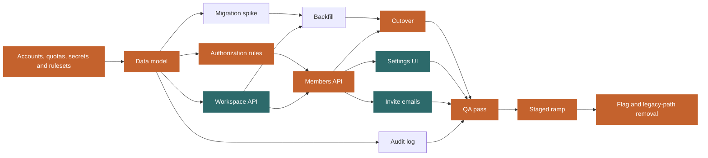

# Plan report: Team workspaces for a single-user product

Recorded 2026-10-07. Durations are working days; a week is 5.

## Checks

- No warnings.

## Units

| Unit | Kind | C | U | Depends on | o / m / p | Expected | Start | Finish | Float | On path | Route |
| --- | --- | --- | --- | --- | --- | --- | --- | --- | --- | --- | --- |
| `preflight` | preflight | 1 | 2 | none | 0.5 / 1 / 2 days | 1.1 | 0.0 | 1.1 | -0.0 | yes | human only |
| `schema` | build | 2 | 2 | preflight | 3 / 4 / 7 days | 4.3 | 1.1 | 5.4 | -0.0 | yes | human-led |
| `authz` | build | 2 | 2 | schema | 3 / 5 / 8 days | 5.2 | 5.4 | 10.6 | -0.0 | yes | human only |
| `api-crud` | build | 2 | 1 | schema | 2 / 3 / 6 rounds, 60 min | 1.7 | 5.4 | 7.1 | 2.8 | no | agent fan-out |
| `api-members` | build | 2 | 1 | authz, api-crud | 3 / 5 / 7 days | 5.0 + 1.0 | 10.6 | 16.6 | -0.0 | yes | human-led |
| `migration-spike` | spike | 1 | 3 | schema | 2 / 3 / 5 days | 3.2 | 5.4 | 8.6 | 1.3 | no | human only |
| `backfill` | build | 3 | 3 | migration-spike, api-crud | 4 / 5 / 10 days | 5.7 + 1.0 | 8.6 | 15.3 | 1.3 | no | human only |
| `cutover` | build | 3 | 2 | backfill, api-members | 3 / 5 / 9 days | 5.3 + 1.0 | 16.6 | 22.9 | -0.0 | yes | human-led |
| `settings-ui` | build | 2 | 1 | api-members | 2 / 4 / 8 rounds, 90 min | 2.2 | 16.6 | 18.8 | 4.2 | no | agent fan-out |
| `invite-emails` | build | 1 | 1 | api-members | 1 / 2 / 4 rounds, 45 min | 1.1 | 16.6 | 17.7 | 5.2 | no | agent fan-out |
| `audit-log` | build | 2 | 2 | schema | 3 / 5 / 8 days | 5.2 | 5.4 | 10.6 | 12.3 | no | human-led |
| `qa-pass` | qa | 2 | 2 | cutover, settings-ui, invite-emails, audit-log | 2 / 3 / 5 days | 3.2 + 1.0 | 22.9 | 27.1 | -0.0 | yes | human-led |
| `ramp` | launch | 2 | 2 | qa-pass | 3 / 5 / 8 days | 5.2 | 27.1 | 32.2 | -0.0 | yes | human-led |
| `tail` | tail | 2 | 1 | ramp | 2 / 3 / 5 days | 3.2 | 32.2 | 35.4 | 0.0 | yes | human-led |

## Critical path

`preflight -> schema -> authz -> api-members -> cutover -> qa-pass -> ramp -> tail`

Expected 35.4 days (7.1 weeks). Range 31.5 to 39.3 days (6.3 to 7.9 weeks) at two standard deviations, which assumes the unit estimates are independent.
Every unit at its optimistic figure: 22.5 days. Every unit at its pessimistic figure: 54.0 days.
A join buffer of 1.0 days is added to each unit with two or more dependencies.

## Off the path

| Unit | Float (days) | Route |
| --- | --- | --- |
| `api-crud` | 2.8 | agent fan-out |
| `migration-spike` | 1.3 | human only |
| `backfill` | 1.3 | human only |
| `settings-ui` | 4.2 | agent fan-out |
| `invite-emails` | 5.2 | agent fan-out |
| `audit-log` | 12.3 | human-led |

## Execution model

| Route | Units | Days |
| --- | --- | --- |
| human only | `preflight`, `authz`, `migration-spike`, `backfill` | 16.1 |
| human-led | `schema`, `api-members`, `cutover`, `audit-log`, `qa-pass`, `ramp`, `tail` | 34.3 |
| agent fan-out | `api-crud`, `settings-ui`, `invite-emails` | 4.9 |

## Staffing

| Staffing | Duration | What binds it |
| --- | --- | --- |
| 1 engineer, no fan-out | 11.1 weeks (55.3 days) | Everything runs serially |
| 1 engineer + agent fan-out | 10.2 weeks (51.0 days) | Engineer capacity: owned units and review of agent work |
| 2 engineers + agent fan-out | 7.1 weeks (35.4 days) | The critical path: this is the floor |
| 3 engineers + agent fan-out | 7.1 weeks (35.4 days) | No further gain: the path is saturated |

Agent-built units estimated in rounds take 0.5 days a round, and an engineer for their owner minutes at the end, at 6 focus hours a day. The no-fan-out row prices them at that agent time, so it understates a team working without agents.

## Owner time

The plan needs 306 hours of a person's time: 303 on units a person owns, at 6 focus hours a day, and 3 on agent-built units.
At 40 hours a week from one lead, that is 7.6 weeks, against a floor of 7.1 weeks.
The lead's hours, not the graph, set the date, unless other people take owned units.
Rounds per unit, owner minutes, owner hours a week and the review fraction are assumptions until the delta log measures them after the third agent-built merge.

## Appetite and first milestone

Appetite: 10 weeks. Floor 7.1 weeks; the lead's own time 7.6 weeks. The plan fits.
A member can be invited to a workspace: 6 units with their prerequisites (`preflight`, `schema`, `authz`, `api-crud`, `api-members`, `invite-emails`). Floor 3.5 weeks; the lead's own time 2.5 weeks at 40 hours a week.

## Cross-check

Serial total: 55.3 days over 14 units, 4.0 days per unit.
- Previous feature epic: 5.3 days per unit predicts 74.7 days. This plan is 0.74 times that.

## The sentence

> Critical path is Accounts, quotas, secrets and rulesets, Data model, Authorization rules, Members API, Cutover, QA pass, Staged ramp and Flag and legacy-path removal: about 7.1 weeks, range 6.3 to 7.9. Workspace API, Migration spike, Backfill, Settings UI, Invite emails and Audit log are off it. One engineer with no fan-out is 11.1 weeks serial. The floor is 7.1 weeks, reached with 2 engineers + agent fan-out; more people add nothing. At 40 hours a week, the lead's own time is 7.6 weeks. The first walkable milestone, A member can be invited to a workspace, has a floor of 3.5 weeks.

## Graph

