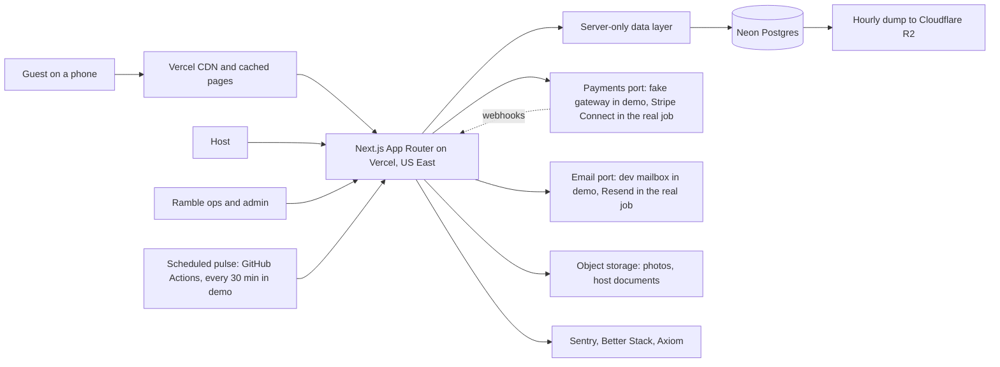

# Ramble design doc

## 1. Context and scope

Ramble is a Brooklyn media business (newsletter, Instagram, city guide) that today links out to hosts. It wants guests to book and pay for local experiences on Ramble itself, launching in New York on mobile web, with bookable experiences live for a sponsor's gift-guide takeover on December 1, 2026 (PRD sections 1 and 2, C-02).

This doc describes how the launch scope in the signed PRD (v1.0, 78 requirements) is built. It is the first of the seven P4 artifacts; the work breakdown, scores, dependency graph, execution model, estimate, and resourcing follow from it.

**In scope:** the guest site (discovery, experience pages, booking, checkout, gifting, post-booking), the host tools, the Ramble ops and admin tools, measurement, the move from the current site, and the operational backbone (jobs, email, monitoring, recovery).

**Out of scope:** everything in PRD section 5, and the items marked Later. The demo build runs with no real money (C-09): a fake payment gateway, an in-app dev mailbox instead of real email, and seeded hosts and experiences (ADR 0003, ADR 0007 decisions D2 and D3, ADR 0008). Where the demo simulates something, the design still describes the real job, so the estimate reflects it (PRD section 11).

**Already decided** (not re-argued here): ten ADRs and their amendments, the P3 design (Figma library, 14 mobile screens, 10 states, 5 desktop templates), and the data-contract depth decision of 2026-10-18 (field level for the money and hold paths, entities and interfaces for the rest).



## 2. Goals and non-goals

### Goals

| Goal | Measure | From |
|---|---|---|
| Guests find, book, and pay for one dated session in a few taps on a phone | Single-page checkout; median booking under 3 minutes from the experience page [proposed, measured in usability testing] | PRD-14, PRD-67, G2 |
| Never sell a space twice, never charge twice | A real-database concurrency test passes on every PR that touches the hold path; zero double charges | PRD-16, PRD-22 |
| The total shown is the total charged | Total charged equals the last total shown, in every test | PRD-19 |
| Gifting works for the December 1 takeover | Gift purchase, scheduled delivery, and redemption live at launch | PRD-33, G5 |
| Fast on phones, including newsletter spikes | Core Web Vitals "good" at p75 on home, browse, experience; checkout completes for 99% under 12,500 visitors in 3 hours | PRD-68, PRD-70 |
| Accessible | WCAG 2.2 AA, automated plus a manual checkout pass | PRD-69 |
| Hosts spend almost no time on admin | A week of sessions published in 5 minutes; no weekly double entry | PRD-41, PRD-42 |
| Money reconciles | Every money movement is a ledger row tied to a provider ID; statements, the finance export, and money held are views over the ledger | PRD-47, PRD-56, PRD-57 |
| Organic traffic survives the move | Every current page with search traffic redirects to its closest new page | PRD-64, G7 |
| Agents can build most of it in parallel | Contracts fixed early (section 4.2), so units depend on stable shapes | BUILD-PLAN purpose 2, ADR 0010 |

### Non-goals

- Everything in PRD section 5: native app, other cities, imported reviews, host self-serve sign-up, wishlists, two-step checkout, a cart or several sessions per checkout, upsells, series and per-group pricing, real money in the demo.
- Gift cards for a money amount (PRD-34): first in the cut order under the working assumption that the sponsor doesn't need them (ADR 0003). If Q-13 says otherwise, they need their own ledger product.
- A separate API (REST or GraphQL), a hosted CMS, a hosted search service, Redis, a map, and live booking-system connectors at launch (ADRs 0001, 0002, 0004, 0005).
- Real email sends, a domain, and per-minute scheduling in the demo (ADR 0007 D2, D3). The 5-minute email promises are designed for the real job and demonstrated in the demo with the manual job trigger.

## 3. System overview

### 3.1 Runtime shape

- **Next.js 16.4.1+, App Router only, React 19.3, Server Components by default,** Cache Components on (`'use cache'`, explicit `cacheLife`, tags) (ADR 0001).
- **Reads:** Server Components call the server-only data layer directly. **Writes:** Server Actions. **Route Handlers** only for webhooks, the scheduled pulse, the event and web-vitals beacons, and file downloads (stack decisions).
- **Data:** Neon Postgres with Drizzle, one store for catalog, holds, orders, money, content, jobs, and events (ADR 0002).
- **Ports with swappable adapters** (ARCH-8): payments (fake, Stripe), email (fake, Resend, Postmark), storage, availability (Ramble's own; OCTO-shaped for later connectors), rate limiter, clock.
- **Background work:** an outbox (`jobs` table written in the same transaction as the change) drained by one secured, idempotent route; a scheduled pulse calls it (every 30 minutes in the demo, every minute in the real job) (ADR 0002, ADR 0007).

### 3.2 Route map [proposed addresses]

Addresses carry a city segment where the page is city-specific, so a second city adds pages without changing any existing address (PRD-63). Experience and guide addresses are city-free and ID-bearing, with a slug-history table that 301s renamed slugs (ADR 0001 amendment). No address shape is taken from prior client work.

| Surface | Address | Rendering | PRD |
|---|---|---|---|
| Home | `/` | Cached, tags | 01, 03, 04 |
| Category page | `/new-york/things-to-do/[category]` | Prerendered, editorial copy | 02, 65 |
| Neighborhood page | `/new-york/neighborhoods/[neighborhood]` | Prerendered, editorial copy | 02, 65 |
| Browse and search | `/new-york/browse?…` | Short-lived cache, filters in the URL, extra combinations noindex | 02, 05, 06, 07 |
| Ramble Picks | `/picks/[slug]` | Prerendered | 03 |
| Gift guide | `/gifts` | Prerendered, sponsor slot | 04 |
| Experience | `/experiences/[slug]-[id]` | Cached shell; dates and spaces left streamed | 09 to 12, 66 |
| Guide-only entry | `/guide/[slug]-[id]` | Cached; links out, `rel=sponsored` on affiliate links | 13, 64 |
| Checkout | `/checkout/[holdId]` | Dynamic, noindex | 14 to 24 |
| Gift checkout | `/gifts/checkout/[experienceId]` | Dynamic, noindex | 33 |
| Confirmation and receipt | `/orders/[reference]` (capability token) | Dynamic, noindex | 25 |
| Manage booking | `/manage/[token]` | Dynamic, noindex, never unfurls | 26, 30 |
| Gift redemption | `/gift/[token]` | Dynamic, noindex | 33 |
| Private group request | `/experiences/[slug]-[id]/private` | Dynamic | 35 |
| Help, legal, accessibility, contact | `/help/…`, `/legal/[doc]`, `/accessibility`, `/contact` | Cached (contact dynamic) | 53, 54, 69 |
| Host tools | `/host/…` | Dynamic, authenticated | 41, 44 to 48 |
| Ops and admin | `/ops/…` | Dynamic, authenticated, passkeys | 39, 40, 50 to 59, 74 |
| Machine endpoints | `/api/webhooks/payments`, `/api/webhooks/email`, `/api/pulse`, `/api/beacon/events`, `/api/beacon/vitals` | Route Handlers, signed or secret, rate limited | 22, 58, 61, 68 |

### 3.3 Surfaces that P3 did not draw

The host and ops tools were kept out of P3 (decision of 2026-10-18) and are built from the library in P5. They are listed here so the work breakdown can size them.

| Host tools (`/host`) | PRD |
|---|---|
| Sign-in link; host owner and (Should) staff access | 37, 48, 74 |
| Week view of sessions; publish a week from templates; change capacity (never below booked); change time (runs cancellation); price changes apply to new bookings only | 41 |
| Allocation view for hosts on an external system (read-only, ops-managed) | 42 |
| Session guest list with party, ages, waiver acceptance, contacts; print and share | 45 |
| Cancel a session (weather or other), with the guest impact shown first | 28 |
| Statements and payouts: owed, released, upcoming, per booking | 47 |

| Ops and admin (`/ops`) | PRD |
|---|---|
| White-glove onboarding: host, agreement acceptance, payout account, experiences, templates or allocation | 39, 42, 52 |
| Spreadsheet import (Should) | 40 |
| Review queue: approve hosts and experiences, photo check, tax treatment | 50, 78 |
| Editorial admin: home modules, Picks, gift guide, guide entries, category and neighborhood copy, help articles, legal documents | 01, 03, 04, 13, 50, 53, 54, 65 |
| Bookings: search, history, cancel, full or partial refund | 51 |
| Private requests queue (Should); support queue | 35, 54 |
| Money: finance export, money held (Should), disputes (Should), investor report, report snapshots | 55 to 57, 59, 60 |
| Settings and ops switches: banner, pause bookings, gifts off, gift validity, hold length | 16, 33, ADR 0002 |
| Trust and safety: host documents, incidents, suspend | ADR 0001 amendment |
| Demo only: dev mailbox, manual job trigger with a date argument | ADR 0007 |

## 4. The four seams

### 4.1 Seam 1: server and client boundary

Server Components are the default. A client component is a justified exception, listed here; anything else that wants `"use client"` needs a line in this table first.

| Client island | Why it must be client-side | Data in, data out |
|---|---|---|
| Booking bar, booking sheet, booking panel | Date, time, and party choices before the hold; shared state between bar and sheet on phones, panel on desktop | In: experience ID, session summaries, price options. Out: `reserveSpaces` |
| Date picker and calendar | React Aria keyboard grid (ADR 0005) | In: available dates. Out: chosen date |
| Filter drawer | Dialog focus management; writes the URL | In: current filters. Out: URL change |
| Checkout payment form | Provider's embedded payment field and wallet buttons (PRD-72) | In: client secret. Out: provider confirmation |
| Hold timer | Counts down from the server's `expiresAt` | In: `expiresAt`. Out: display state only |
| Order status poller | Shows "checking your payment" after a dropped connection (S9) | In: order reference and token. Out: `getOrderStatus` |
| Event and web-vitals beacon | Page views and Core Web Vitals from cached pages | Out: `sendBeacon` to Ramble's endpoints |

Spaces left and upcoming dates on the experience page stream from the server into reserved space, so the cached shell stays fast and nothing shifts (PRD-68).

### 4.2 Seam 2: the data layer and its contracts

**Rules for every data-layer function** (ADR 0002, standards ARCH and SEC):
1. Lives under `src/server/` with `import 'server-only'`.
2. Validates its input with a Zod schema at the boundary and returns typed results, never raw rows from another vendor.
3. Checks the caller's role and ownership against the row it touches (SEC-1, SEC-3), not just the page.
4. Runs multi-row changes in one transaction and writes its outbox jobs, audit rows, and ledger rows in that same transaction.
5. Puts decisions in plain functions in `src/lib/` (ARCH-1) so they unit-test without a database.

Money is always integer minor units (cents) in USD. Times are `timestamptz` in UTC; session times also carry the host's IANA time zone so recurring sessions survive daylight saving.

#### 4.2.1 Entities and interfaces (schemas written in P5)

| Area | Tables | Key relationships and fields that shape the work |
|---|---|---|
| Catalog | `hosts`, `experiences`, `price_options`, `session_templates`, `sessions`, `categories`, `neighborhoods`, `photos`, `slug_history` | An experience belongs to a host and a category and neighborhood. It carries status (draft, in review, live, paused, guide-only), outdoor flag and weather policy (fixed set, PRD-12), age rule (all ages, minimum age, range, 21+; whether children use spaces, PRD-23), accessibility notes, tax treatment (taxable, not taxable, unknown, PRD-78), cancellation tier (PRD-46), waiver requirement and document (PRD-24), and for guide-only entries a link-out URL and optional affiliate URL (PRD-13). `price_options` hold per-person prices by type (adult, child) and whether each uses a space. Sessions are generated from templates or allocations with `source` (ramble, allocation, external) and carry `allocation` and `seats_sold` (section 4.2.2) |
| Policies | `cancellation_tiers`, `legal_documents`, `legal_acceptances`, `settings` | Tiers span "full refund to 24 hours before" through "no refund within 7 days", default 24 hours (PRD-46). Legal documents are versioned; acceptances point at a version (PRD-24, PRD-53). Settings hold ops switches, hold length, payment grace, gift validity and expiry action |
| Editorial | `collections` (Picks, gift guide), `collection_items`, `home_modules`, `pages` (category and neighborhood copy), `help_articles` | Home is ordered configuration rows (PRD-01). Rich text is a constrained structured format, sanitized (SEC-6). Publishing calls `tagsForChange()` and invalidates tags (ADR 0001 amendment) |
| People and access | `guests`, auth tables (Better Auth on Postgres), `role_grants`, `consents` | Guests keyed by email; no account needed (PRD-15). Roles: guest, host owner, host staff (Should), ops, admin (PRD-74). Passkeys for ops and admin. Consent rows record newsletter opt-in time and source (PRD-15, PRD-73) |
| Post-booking | `review_invites`, `reviews`, `private_requests` | Invites go to verified bookers after the session (PRD-29); display at 5 or more (PRD-32, Should). Private requests go to host and ops (PRD-35, Should) |
| Operations | `jobs`, `messages`, `rate_limits`, `audit_log`, `support_requests`, `privacy_requests`, `incidents`, `host_documents`, `synthetic_runs`, `report_snapshots`, `disputes` | Outbox with `SKIP LOCKED`, backoff, dead letters. Message log with delivery status and suppression. Audit log insert-only by role and trigger (PRD-74). Disputes are a Should (PRD-55) |
| Measurement | `events` | One row per page view, experience view, checkout start, booking; session ID, attribution source and issue, consented subscriber ID only; bot, internal, and synthetic traffic flagged (PRD-58, PRD-61). Investor report and funnel are SQL views (PRD-59) |

**Ports** (interfaces; adapters are swappable and tested with the same contract tests):

| Port | Operations | Adapters |
|---|---|---|
| `PaymentsPort` | `createPayment`, `cancelPayment`, `retrieve` (by ID or by Ramble metadata), `refund`, `transfer`, `reverseTransfer`, `verifyWebhook` (returns a normalized `ProviderEvent`). Every object carries Ramble IDs in metadata | `fake` (demo, tests, load tests), `stripe` (real job, Connect separate charges and transfers) |
| `AvailabilityPort` | `check`, `reserve`, `confirm`, `cancel` (shaped like OCTO) | `ramble` only at launch; external systems later (PRD-43) |
| `EmailPort` | `send({ template, to, data, idempotencyKey })` | `fake` with dev mailbox, `resend`, `postmark` (spare); `EMAIL_MODE` sink, allowlist, live |
| `StoragePort` | `put`, `getSignedUrl`, `delete` (public photos, private host documents) | Vercel Blob or S3-compatible |
| `RateLimiter` | `consume(key, limit, window)` | Postgres table |
| `Clock` | `now()` | System; fixed clock in tests; demo job trigger passes a date |

**Server Actions** (input and output named here; the money and hold actions are specified at field level in 4.2.3):

| Action | Caller | Summary |
|---|---|---|
| `reserveSpaces` | Guest | Places a hold (field level below) |
| `releaseHold` | Guest | Ends an `active` hold early; refuses a `paying` one |
| `startPayment` | Guest | Creates or resumes the order and a payment attempt (field level below) |
| `getOrderStatus` | Guest (token) | Pending, confirmed, failed, refunded after lapse |
| `purchaseGift` | Guest | Gift order and attempt (field level below) |
| `redeemGift` | Recipient (token) | Turns a gift and a hold into a booking (field level below) |
| `cancelBooking` | Guest (manage token), ops | Ends a booking and refunds what the tier allows (field level below) |
| `refundBooking` | Ops (step-up) | Partial or goodwill refund; the booking stays confirmed (field level below) |
| `moveBooking` | Guest (manage token) | Should (PRD-30): release old seats, hold new, no money moves if same price |
| `cancelSession` | Host, ops | Cancels a session, fans out refunds and emails (section 5.5) |
| `publishWeek`, `updateSession`, `updateAllocation` | Host, ops | Session management; capacity can't drop below `seats_sold` plus open holds (PRD-41, PRD-42) |
| `requestPrivateSession`, `submitSupportRequest` | Guest | Forms with honeypot, minimum time, rate limit |
| Editorial and ops actions | Ops, admin | Content, approvals, refunds, settings; each writes an audit row; refunds, cancellations, payout and role changes need step-up |

#### 4.2.2 Sessions: the columns the hold path depends on

| Column | Type | Rule |
|---|---|---|
| `id` | uuid | |
| `experience_id` | uuid, FK | |
| `starts_at`, `ends_at` | timestamptz | `ends_at > starts_at` |
| `time_zone` | text | IANA name of the host |
| `allocation` | integer | `>= 0`; spaces Ramble may sell |
| `seats_sold` | integer | `>= 0`; changed only when an order confirms or a confirmed order is cancelled |
| `status` | enum `scheduled`, `cancelled`, `completed` | Only `scheduled` sessions accept holds |
| `source` | enum `ramble`, `allocation`, `external` | |
| `cancel_reason` | enum `host`, `weather`, `ramble`, null | Set with `status = cancelled` |
| `version` | integer | Optimistic check for host edits |

Database constraint: `CHECK (seats_sold <= allocation)`. It is the backstop under the hold logic, and it also stops a host lowering capacity below what is booked (PRD-41).

**Spaces left** for a session at time `t`:

```
spaces_left = allocation
            - seats_sold
            - sum(holds.seats where status = 'active' and expires_at > t)
            - sum(holds.seats where status = 'paying' and paying_until > t)
```

Computed in a plain function from the session row and its open holds. Reads for display go through the runtime cache (5 to 10 seconds, tag per session); `reserveSpaces` always recomputes under the session-row lock.

#### 4.2.3 Field-level contracts: holds, orders, payment in flight, refunds, transfers, the ledger, gifts

Revised the same day after an adversarial review found double-charge and stuck-money paths in the first draft. Each finding and its fix is listed in Appendix B.

##### Rules every money and hold transaction follows

1. **One lock order.** Locks are always taken in this order: the device advisory lock (reserve only), the session row, the hold, the order, the gift. A handler that starts from an order or a provider event reads the IDs without locks first, then locks in this order. Reserve, payment, confirmation, cancellation, refunds, and transfers can't deadlock each other.
2. **Decide at processing time.** Whether a hold still counts is judged when the transaction runs (`now()`), never by a provider's `occurred_at`.
3. **Terminal states never change.** Attempt `succeeded` or `canceled`, order `cancelled` or `refunded_after_lapse`, refund `succeeded`, and transfer `paid` are never overwritten by a later or repeated event.
4. **One live payment per order.** An order has at most one attempt that isn't `succeeded` or `canceled`. Retrying after a decline reuses it. Any success for a payment that isn't the order's live attempt is refunded.
5. **Cash moves at the provider first.** Liability postings are written when a refund, transfer, or payout is requested; the cash posting is written only on the provider's success event for it.
6. **Provider objects carry Ramble's IDs.** Every payment, refund, and transfer sent to the provider carries `order_id` and the Ramble record ID in metadata, so any event can be matched even if Ramble never stored the provider's ID.
7. **Provider idempotency keys expire** (about 24 hours at Stripe). A job retried after that window looks the object up by metadata (`PaymentsPort.retrieve`) before creating anything.
8. **Events for one order are processed one at a time.** The drain takes a transaction-level advisory lock on the order ID before handling any provider event for it.

##### Holds

`holds`

| Column | Type | Rule |
|---|---|---|
| `id` | uuid | Appears in the checkout address |
| `session_id` | uuid, FK sessions | |
| `purpose` | enum `booking`, `gift_redemption` | |
| `gift_id` | uuid, FK gifts, null | Required when `purpose = gift_redemption` |
| `status` | enum `active`, `paying`, `converted`, `released` | Transitions below |
| `seats` | integer | `> 0`; sum of item quantities whose price option uses a space |
| `device_key` | text | Hash of the device cookie (PRD-17) |
| `ip_hash` | text | Secondary limit key |
| `expires_at` | timestamptz | `created_at + settings.hold_minutes` (default 10, PRD-16) |
| `paying_until` | timestamptz, null | Set on `active → paying`: `greatest(expires_at, now()) + settings.payment_grace_minutes` (default 5) [proposed]. Extended once to `now() + grace` on a 3-D Secure challenge |
| `released_reason` | enum `expired`, `guest_left`, `payment_abandoned`, `sold_out_after_lapse`, `session_cancelled`, `superseded`, null | Set with `released` |
| `superseded_by` | uuid, FK holds, null | The same device's newer hold on the same session |
| `created_at`, `updated_at` | timestamptz | |

`hold_items`: `hold_id` and `price_option_id` (primary key), `quantity >= 1`, `unit_price_minor` (snapshot shown on 04 and 05), `uses_space` (snapshot).

**Open hold** (one predicate for spaces left, device limits, and the block): `status = 'active' and expires_at > now()`, or `status = 'paying' and paying_until > now()`.

**Transitions**

| From | To | When | Side effects (same transaction) |
|---|---|---|---|
| (new) | `active` | `reserveSpaces` succeeds | Supersedes this device's open `active` hold on the same session; event `hold_placed` |
| `active` | `paying` | `startPayment` | `paying_until` set |
| `paying` | `paying` | `payment.requires_action` for the order's live attempt | `paying_until` extended once |
| `paying` | `active` | The live attempt reports a failed try and `expires_at > now()` | Guest retries on the same attempt (PRD-20) |
| `active`, `paying` | `converted` | `confirmOrder` (below) | `sessions.seats_sold += seats` |
| `active` | `released` | `releaseHold`, superseded, session cancelled, or the cleanup job after expiry | None on spaces: an expired hold already stopped counting |
| `paying` | `released` | `paying_until` passes, or the session is cancelled | The live attempt is canceled at the provider; a success that still lands is handled by the event table |

`releaseHold` refuses a `paying` hold and returns `payment_in_progress`. Expiry is lazy: the cleanup job tidies rows, never decides correctness.

**Limits (PRD-17)**
- After superseding the same-session hold, the seats in this device's open holds plus the new hold are at most 6.
- Three holds from this device whose deadline (`expires_at`, or `paying_until` for paying holds) passed without conversion in the last 15 minutes block new holds for 15 minutes. Counted from those timestamps, not from the cleanup job. Superseded holds don't count.

**`reserveSpaces` contract**

Input (Zod):

```ts
{
  sessionId: uuid,
  items: Array<{ priceOptionId: uuid, quantity: int (1..6) }>  // 1..4 entries; space-using total 1..6
  purpose: 'booking' | 'gift_redemption',
  giftToken?: string                                           // required for gift_redemption; the party comes from the gift
}
```

Output:

```ts
| { status: 'held', holdId: uuid, expiresAt: ISODateTime, totalMinor: int, lines: Line[] }
| { status: 'sold_out', alternatives: SessionSummary[] }                                    // PRD-21, S5
| { status: 'blocked', reason: 'device_limit' | 'too_many_holds', until?: ISODateTime }      // PRD-17, S4
| { status: 'unavailable', reason: 'session_cancelled' | 'bookings_paused' | 'past' | 'gift_not_valid' }
| { status: 'invalid', fieldErrors: Record<string, string> }
```

Steps: validate; check the ops switch; take the device advisory lock; lock the session row and check it is `scheduled`; supersede the device's open `active` hold on this session; check the limits; compute spaces left; for a gift redemption, lock the gift and check it is `delivered` and before `valid_until`; insert the hold and items; write the event; commit. Price lines come from `src/lib/pricing.ts`.

##### Orders

`orders`

| Column | Type | Rule |
|---|---|---|
| `id` | uuid | |
| `reference` | text, unique | `RMB-` plus 6 Crockford base32 characters |
| `kind` | enum `booking`, `gift_purchase` | A gift redemption is a `booking` with `gift_id` set |
| `status` | enum `pending_payment`, `confirmed`, `payment_failed`, `void`, `cancelled`, `refunded_after_lapse` | Transitions below |
| `idempotency_key` | text, unique | Bookings: `book:{hold_id}`, so two tabs or a refresh reach the same order. Gift purchases: a uuid created once per gift checkout. A reused key with a different payload is rejected |
| `hold_id` | uuid, FK holds, null | Bookings. `UNIQUE (hold_id) WHERE status <> 'void'`: one live order per hold |
| `session_id`, `experience_id`, `host_id` | uuid, FKs | `session_id` null for gift purchases |
| `gift_id` | uuid, FK gifts, null | The gift redeemed (booking) or created (gift purchase) |
| `guest_id` | uuid, FK guests | Found or created by email |
| `contact_email` | citext | Required |
| `contact_phone` | text, null | Optional |
| `lead_guest_name` | text | Required for bookings |
| `age_confirmed` | boolean, null | Required true when the experience has a minimum age or is 21+ (PRD-23) |
| `children_ages` | integer[], null | One age per child, each within range (PRD-23) |
| `guardian_name`, `guardian_contact` | text, null | Required with `children_ages` (PRD-23, PRD-73) |
| `waiver_document_id` | uuid, FK legal_documents, null | Required when the experience requires a waiver (PRD-24) |
| `terms_document_id` | uuid, FK legal_documents | Marketplace terms version accepted (PRD-24) |
| `currency` | char(3) | `USD` |
| `ticket_subtotal_minor` | integer | Sum of order items |
| `tax_treatment` | enum `taxable`, `not_taxable`, `unknown` | Snapshot (PRD-78); `unknown` is charged as not taxable and flagged |
| `tax_rate_ppm` | integer | Snapshot; 0 unless taxable |
| `tax_minor` | integer | `round_half_up(ticket_subtotal_minor * tax_rate_ppm / 1_000_000)` |
| `total_minor` | integer | Always `ticket_subtotal_minor + tax_minor`; no buyer fee (Q-03) |
| `gift_applied_minor` | integer | 0, or the gift value applied on a redemption |
| `amount_due_minor` | integer | `total_minor - gift_applied_minor`, at least 0; what the guest pays (PRD-19) |
| `commission_rate_bps` | integer | Snapshot, 1500 |
| `commission_minor` | integer | `round_half_up(ticket_subtotal_minor * commission_rate_bps / 10_000)`, on the ticket before tax (Q-03) |
| `refunded_ticket_minor`, `refunded_tax_minor`, `commission_returned_minor` | integer | Running totals of requested refunds (math below) |
| `refund_failed` | boolean | A provider refund failed; ops follow up |
| `cancellation_tier_id` | uuid, FK | Snapshot |
| `free_cancel_until` | timestamptz, null | From the tier and `starts_at` (PRD-10) |
| `cancelled_by` | enum `guest`, `host`, `weather`, `ramble`, null | |
| `attribution_source`, `attribution_campaign`, `attribution_issue` | text, null | Last non-direct visit in 30 days (PRD-58) |
| `manage_token_hash` | text, null | Hash of the manage token (PRD-26) |
| `created_at`, `confirmed_at`, `cancelled_at` | timestamptz | |

Row checks: `total_minor = ticket_subtotal_minor + tax_minor`; `amount_due_minor = total_minor - gift_applied_minor >= 0`; `refunded_ticket_minor <= ticket_subtotal_minor`; `refunded_tax_minor <= tax_minor`; `commission_returned_minor <= commission_minor`.

`order_items` mirror `hold_items` (price option, label snapshot, quantity, unit price, uses space, line total). For gift purchases they record the party the gift covers.

**Order transitions**

| From | To | When |
|---|---|---|
| (new) | `pending_payment` | `startPayment`, `purchaseGift`, or a redemption with an amount due |
| (new) | `confirmed` | `redeemGift` with nothing due |
| `pending_payment`, `payment_failed`, `void` | `confirmed` | `confirmOrder` passes |
| `pending_payment`, `payment_failed`, `void` | `refunded_after_lapse` | A payment succeeds but the spaces are gone or the session was cancelled (S10) |
| `pending_payment` | `payment_failed` | A failed try on the live attempt |
| `payment_failed` | `pending_payment` | The guest tries again on the same attempt |
| `pending_payment`, `payment_failed` | `void` | The hold is released with no success; the live attempt is canceled |
| `confirmed` | `cancelled` | `cancelBooking` or a session cancellation (refund rules below) |

`void` is not terminal: a payment that succeeds after the hold was released still lands through `confirmOrder`.

**`startPayment` contract**

Input (Zod):

```ts
{
  holdId: uuid,                         // the order's idempotency key is derived from it
  contact: { email: email, phone?: string },
  leadGuestName: string (1..120),
  attendees: {
    ageConfirmed?: boolean,
    childrenAges?: int[],
    guardian?: { name: string, contact: string }
  },
  waiverDocumentId?: uuid,
  termsDocumentId: uuid,
  newsletterOptIn: boolean,             // unticked by default (PRD-15)
  attribution?: { source?: string, campaign?: string, issue?: string }
}
```

Output:

```ts
| { status: 'requires_payment', orderId: uuid, reference: string,
    payment: { provider: 'fake' | 'stripe', clientSecret: string }, amountDueMinor: int }
| { status: 'already_confirmed', reference: string }                    // a resubmit after S9
| { status: 'hold_expired', canRehold: boolean, spacesLeft: int }       // S6
| { status: 'sold_out', alternatives: SessionSummary[] }                 // S7
| { status: 'too_many_tries' }                                           // 5 failed tries on this hold
| { status: 'invalid', fieldErrors: Record<string, string> }
```

Steps:
1. Validate; check age, waiver, and terms rules with plain functions.
2. Read the hold's session ID; lock the session, the hold, then any order on the hold.
3. If the order is `confirmed`, return `already_confirmed`. If it has a live attempt, return that attempt's client secret (re-fetched with its own key); no new provider payment is created.
4. Otherwise, if the hold isn't open, return `hold_expired` or `sold_out`.
5. Create the order (key `book:{hold_id}`) and attempt 1, or reuse the existing order; move the hold to `paying`; write consent and acceptance rows; commit.
6. Call `PaymentsPort.createPayment` with the attempt's key and metadata; store `provider_payment_id` in a second short transaction before returning the client secret. If that write fails, events still match by metadata.

##### Payment in flight

`payment_attempts`

| Column | Type | Rule |
|---|---|---|
| `id` | uuid | |
| `order_id` | uuid, FK orders | `UNIQUE (order_id) WHERE status NOT IN ('succeeded', 'canceled')`: one live attempt |
| `attempt_no` | integer | Unique with `order_id`; a new attempt only after the previous one is `canceled` |
| `provider` | enum `fake`, `stripe` | |
| `provider_key` | text, unique | `pay:{order_id}:{attempt_no}` (FORM-8) |
| `provider_payment_id` | text, unique, null | Stored before the client secret is returned |
| `amount_minor`, `currency` | integer, char(3) | Equals `orders.amount_due_minor` at creation |
| `failed_tries` | integer | Failed tries reported by the provider; 5 cancels the attempt (ADR 0002 amendment) |
| `method` | enum `card`, `apple_pay`, `google_pay`, null | (PRD-18) |
| `status` | enum `created`, `requires_action`, `processing`, `failed_try`, `succeeded`, `canceled` | `succeeded` and `canceled` are terminal; `failed_try` can still succeed when the guest retries |
| `failure_code` | text, null | Mapped to safe copy by a plain function (S8) |
| `created_at`, `updated_at` | timestamptz | |

`provider_events`

| Column | Type | Rule |
|---|---|---|
| `id` | uuid | |
| `provider` | enum | |
| `provider_event_id` | text | Unique with `provider`; repeats are no-ops |
| `type` | text | Normalized: `payment.succeeded`, `payment.failed`, `payment.requires_action`, `payment.canceled`, `refund.succeeded`, `refund.failed`, `transfer.paid`, `transfer.failed`, `transfer.reversed`, `dispute.opened`, `dispute.won`, `dispute.lost` |
| `object_id` | text | The provider object |
| `ramble_order_id`, `ramble_record_id` | uuid, null | From the object's metadata |
| `amount_minor`, `currency` | integer, char(3), null | From the provider, checked before confirming |
| `occurred_at`, `received_at`, `processed_at` | timestamptz | `processed_at` null until handled |
| `attempts`, `last_error` | integer, text | Retries with backoff; an alert after 5 |
| `payload` | jsonb | The verified body, trimmed |

**Webhook intake:** verify the signature on the raw body; insert into `provider_events` (a duplicate is a no-op); enqueue `process_provider_event`; return 2xx.

**What each event does**

| Event | Matches | Order state | Action |
|---|---|---|---|
| `payment.succeeded` | The order's live attempt | `pending_payment`, `payment_failed`, `void` | `confirmOrder` |
| `payment.succeeded` | An attempt already `succeeded` | Any | No-op (a repeat) |
| `payment.succeeded` | Any other payment for the order | Any | Full refund of that payment (reason `duplicate_payment`), ledger charge and refund rows, alert |
| `payment.failed` | The live attempt | `pending_payment` | Attempt `failed_try`, `failed_tries += 1`; order `payment_failed`; hold back to `active` if `expires_at > now()`; at 5 tries, cancel the attempt and void the order |
| `payment.failed` | Anything else | Any | That attempt's row only |
| `payment.requires_action` | The live attempt | `pending_payment` | Attempt `requires_action`; `paying_until` extended once |
| `payment.canceled` | Any | Any | Attempt `canceled` |
| Payment event matching no attempt | | | Look up by metadata; retry with backoff; alert after 5 tries |
| `refund.succeeded`, `refund.failed` | A refund | | See Refunds |
| `transfer.*` | A transfer | | See Transfers |
| `dispute.*` | A payment | | See the ledger |

**`confirmOrder`: one function for every confirmation.** Called on `payment.succeeded` for a live attempt, by `redeemGift` when nothing is due, and on success of an exchange top-up. Under the locks (session, hold, order, gift):

1. If the order is already `confirmed`, stop.
2. Check that the succeeded amount and currency equal `amount_due_minor` and `currency`; if not, alert and take the refund path.
3. **Bookings:**
   - The session must be `scheduled`; if it was cancelled, take the refund path (reason `session_cancelled`).
   - If the hold is still open, its spaces are already counted: confirm.
   - Otherwise compute `free = allocation - seats_sold - seats of other open holds`; if `free >= hold.seats`, confirm; if not, take the refund path.
   - Confirm: `seats_sold += seats`; hold `converted`; order `confirmed`; ledger rows (a charge, or a gift redemption); schedule the transfer (`release_after` = session end plus 24 hours); jobs for the guest and host emails; event `booking_confirmed`; manage token. If the database CHECK still refuses (SQLSTATE 23514), roll back and take the refund path in a new transaction.
4. **Gift purchases:** order `confirmed`; gift `scheduled` with `valid_until = send_at + settings.gift_validity_months`; ledger `gift_liability_in`; job `deliver_gift` at `send_at`.
5. **Refund path:** order `refunded_after_lapse`; hold `released` (`sold_out_after_lapse` or `session_cancelled`); a full refund (below); the S10 email.

> **Accepted 2026-10-19 (Dave chose option A; proposed in the P4 artifact 4 review): how capability links are made.** As written, the manage token and the gift token are stored only as hashes, so no unit can rebuild a link to send or show one. Booking emails, the ops resend, my bookings, gift delivery, the reinstatement invite, and the end-experience exchange offer all need one. The confirmation route's own token (`/orders/[reference]`) is not defined. Two options:
>
> - **A (accepted): derived tokens.** A token is `capabilityToken(kind, id, version)`: an HMAC-SHA256 of the kind (`manage`, `gift`, or `order`), the row ID, and a version, under `CAPABILITY_TOKEN_SECRET`.
>   - `orders` gains `manage_token_version` (integer, default 1), and `manage_token_hash` becomes unique. `gifts` gains `token_version` (integer, default 1).
>   - Lookup is by `hashToken(token)`, then a constant-time compare against the token recomputed for that row. Bumping a version rewrites the stored hash in the same UPDATE, which voids that row's earlier links. Rotating the secret runs a re-hash of every stored hash, then a resend to upcoming bookings and to delivered, unredeemed gifts.
>   - The `order` token stores no hash; it is checked by recomputing it for the order found by reference. `startPayment` and `purchaseGift` return it (`orderToken?: string`) in `requires_payment` and `already_confirmed`, but only to the device whose cookie hash equals the hold's `device_key`; otherwise `already_confirmed` returns the reference alone. The bump that voids the manage link also voids the confirmation URL.
>   - Any server code can rebuild a link, a resend keeps the earlier link working, and a retried email job sends the same link.
>   - The costs: anyone who has the secret can cancel any booking or redeem any gift until it is rotated, and a rotation means resending every live link. A amends accepted ADR 0002's "random tokens hashed at rest" for capability links; sign-in links stay random and single-use.
> - **B: random tokens, as ADR 0002 says.** A token is minted where it is sent and stored as a hash, either as one live token per row (a resend re-mints it and voids the earlier link) or as one row per link sent in a new table.
>   - A copy of the database alone cannot forge a link, and there is no secret whose leak forges every link.
>   - The costs: a retried email job must not leave the guest a link whose hash a retry overwrote, so the email's idempotency key carries the token's hash. The confirmation page either mints a link on each view or shows none (PRD-26 asks only for the link in the confirmation email). My bookings opens a booking through the signed-in session instead of a token.
>
> Either way, no Ramble table stores the raw token; only the sent email carries it (in the demo, the U-006 dev mailbox, behind the ops role from U-073). The units are written for A: built in U-015 and U-017; used by U-047a, U-047b, U-049, U-050, U-051, U-054, U-055, U-062a, U-062b, U-063, U-064a, U-066b, U-077, U-099 (the rotation runbook), U-107, U-108, and U-113.

##### Refunds

Two actions, so cancelling and refunding never get confused:
- **`cancelBooking`** (guest with the manage token, or ops). Ends the booking: order `cancelled`, `seats_sold -= seats` if the session is still ahead, and a refund of what the cancellation tier allows on what remains. The guest passes `expectedRefundMinor` (the amount screen 07 showed); if the tier now gives less, the action returns `terms_changed` with the new amount and does nothing.
- **`refundBooking`** (ops only, step-up). A partial or goodwill refund; the booking stays `confirmed` and no spaces change (PRD-51).
- A host, weather, or Ramble cancellation refunds everything that remains and returns all remaining commission (Q-06).

**Refund math.** A refund has a ticket part `T` and a tax part `X`.
- Tax follows the ticket: `X = round_half_up(T * tax_minor / ticket_subtotal_minor)`, except that the refund taking the ticket to zero takes the exact tax remainder.
- Commission is recalculated on what the host keeps (ADR 0003): after the refund, `kept = ticket_subtotal_minor - refunded_ticket_minor`, and the commission returned now is `commission_minor - round_half_up(kept * rate) - commission_returned_minor`. A full refund returns exactly the commission charged.
- The host share returned is `T - commission returned now`; the tax returned comes from the host's payable, since the host is the seller (Q-01).
- A per-order test asserts that refunds sum to `refunded_ticket_minor + refunded_tax_minor` and never exceed `total_minor`.

**Where the money goes.** To the payment method that paid (`payment_attempt_id` of the succeeded attempt). For a booking paid by a gift, the gift is reinstated instead of refunding a card the recipient doesn't own [proposed]: the gift returns to `delivered` with the same value, `valid_until` is extended to at least 30 days away, and the recipient is invited to pick another date.

`refunds`

| Column | Type | Rule |
|---|---|---|
| `id` | uuid | |
| `order_id` | uuid, FK | |
| `payment_attempt_id` | uuid, FK, null | The succeeded attempt refunded; null when a gift is reinstated |
| `ticket_minor`, `tax_minor`, `commission_returned_minor` | integer | The split above |
| `amount_minor` | integer | `ticket_minor + tax_minor`, `> 0` |
| `reason` | enum `guest_cancel`, `host_cancel`, `weather`, `ramble_cancel`, `session_cancelled`, `lapse_after_payment`, `duplicate_payment`, `goodwill`, `gift_unredeemed`, `gift_buyer_request`, `gift_exchange_difference`, `ops_adjustment` | |
| `initiated_by` | uuid, null | Staff user; null for system |
| `provider_key` | text, unique | `refund:{refund_id}` |
| `provider_refund_id` | text, unique, null | |
| `status` | enum `pending`, `succeeded`, `failed`, `gift_reinstated` | |
| `created_at`, `succeeded_at` | timestamptz | |

On `refund.succeeded`: status `succeeded` and the cash posting. On `refund.failed`: status `failed`, the pending postings reversed, `orders.refund_failed = true`, and an ops queue item; a gift refund leaves the gift in `refund_pending` for ops.

##### Transfers

`transfers` (one per booking, weekly release, ADR 0003)

| Column | Type | Rule |
|---|---|---|
| `id` | uuid | |
| `order_id` | uuid, FK, unique | |
| `host_id` | uuid, FK | |
| `amount_minor` | integer | Set at release: `(ticket - refunded ticket) - (commission - commission returned) + (tax - refunded tax)` |
| `release_after` | timestamptz | Session end plus 24 hours |
| `provider_key` | text, unique | `transfer:{order_id}` |
| `provider_transfer_id` | text, unique, null | |
| `reversed_minor` | integer | |
| `status` | enum `scheduled`, `releasing`, `paid`, `failed`, `reversed`, `skipped`, `simulated` | `simulated` in the demo |

The weekly job locks each order, skips cancelled orders and zero amounts (`skipped`), sets the amount and `releasing`, commits, then calls the provider. A refund that finds a transfer `releasing` waits (its job retries) until it is `paid` or `failed`; after `paid`, the refund first reverses the host share from the transfer.

##### Ledger

`ledger_entries`, append-only (insert-only role, a trigger blocking updates and deletes, PRD-74). Each row moves an amount from one account to another, so every event balances and every balance is a sum.

| Column | Type | Rule |
|---|---|---|
| `id` | bigint identity | |
| `occurred_at` | timestamptz | When the money moved (provider time where there is one) |
| `entry_type` | enum, below | |
| `debit_account`, `credit_account` | enum, below | Different accounts |
| `amount_minor` | integer | `> 0` |
| `currency` | char(3) | `USD` |
| `order_id`, `gift_id`, `host_id` | uuid, null | At least one set |
| `payment_attempt_id`, `refund_id`, `transfer_id`, `dispute_id` | uuid, null | The record that caused it |
| `provider_object_id` | text, null | Present on every cash posting |
| `simulated` | boolean | Demo payouts and fake-gateway money |
| `created_by` | uuid, null | Staff user, or null for system |
| `memo` | text, null | |

Unique index on `(entry_type, provider_object_id)` where the provider ID is present, so a repeated event can't post cash twice.

**Accounts**

| Account | Meaning |
|---|---|
| `platform_cash` | Money in Ramble's provider balance |
| `host_payable` | Owed to hosts and not yet transferred: ticket less commission, plus tax |
| `ramble_commission` | Commission earned |
| `processing_fees` | Card and dispute fees paid by Ramble (inside the 15%, Q-03) |
| `gift_liability` | Gift money held until redemption, refund, or expiry |
| `refunds_pending` | Refunds requested and not yet confirmed by the provider |
| `dispute_hold` | Money the provider withdrew while a dispute is open |
| `dispute_losses` | Disputes lost and not recoverable from the host |
| `ramble_payouts` | Commission Ramble has paid out to itself (manual, ADR 0003) |

**Postings** (example: two guests at $65, not taxable, card fee $4.07)

| Event | Entry type | Debit | Credit | Example |
|---|---|---|---|---|
| Booking paid | `charge_host_share` | platform_cash | host_payable | 110.50 |
| | `charge_commission` | platform_cash | ramble_commission | 19.50 |
| | `charge_tax` (taxable only) | platform_cash | host_payable | tax |
| Card fee | `processing_fee` | processing_fees | platform_cash | 4.07 |
| Transfer paid | `transfer_to_host` | host_payable | platform_cash | 110.50 |
| Transfer reversed | `transfer_reversal` | platform_cash | host_payable | host share recovered |
| Refund requested | `refund_host_share` | host_payable | refunds_pending | `T - c` |
| | `commission_returned` | ramble_commission | refunds_pending | `c` |
| | `refund_tax` | host_payable | refunds_pending | `X` |
| Refund succeeded | `refund_cash_out` | refunds_pending | platform_cash | `T + X` |
| Refund failed | `refund_reversal` (one per request leg) | refunds_pending | host_payable or ramble_commission | as requested |
| Gift purchased | `gift_liability_in` | platform_cash | gift_liability | value, tax included |
| Gift redeemed | `gift_to_host_share`, `gift_to_commission`, `gift_to_tax` | gift_liability | host_payable, ramble_commission, host_payable | from the gift's snapshot prices |
| Gift refunded or expired | `gift_refund` | gift_liability | refunds_pending | value |
| Gift reinstated after a cancelled redemption | `gift_reinstated` (one per redemption leg) | host_payable or ramble_commission | gift_liability | as redeemed |
| Ramble pays itself | `ramble_payout` | ramble_payouts | platform_cash | |
| Dispute opened | `dispute_withdrawal`, `dispute_fee` | dispute_hold, processing_fees | platform_cash | amount, fee |
| Dispute won | `dispute_reinstated` | platform_cash | dispute_hold | amount |
| Dispute lost | `dispute_to_host` (what the host can cover, Q-18), `dispute_loss` (the rest) | host_payable, dispute_losses | dispute_hold | |

Because a redemption uses the gift's snapshot prices, the gift liability drains to exactly zero. An exchange posts the new order's host share, commission, and tax once, funded first from the gift and then from the top-up charge; unused gift value is refunded to the buyer through `gift_refund`.

**Views over the ledger:** paid to each host (transfers less reversals); host statement (PRD-47); finance export, one row per booking (PRD-56); money held = `host_payable + gift_liability + refunds_pending` (PRD-57); GMV and take rate (PRD-59); and the daily check that the ledger's `platform_cash` equals the provider balance (ADR 0003).

##### Gifts

`gifts`

| Column | Type | Rule |
|---|---|---|
| `id` | uuid | |
| `purchase_order_id` | uuid, FK orders, unique | The `gift_purchase` order |
| `experience_id` | uuid, FK | A specific experience (PRD-33) |
| `value_minor` | integer | Amount paid, tax included; the gift is worth this (PRD-33) |
| `buyer_guest_id` | uuid, FK guests | Refunds before redemption go to the buyer |
| `recipient_name` | text | |
| `recipient_email` | citext | |
| `message` | text, null | Plain text, at most 300 characters, no links (ADR 0002 amendment) |
| `send_at` | timestamptz | At most 365 days ahead |
| `sent_at` | timestamptz, null | Within 5 minutes of `send_at` in the real job |
| `token_hash` | text, unique | Hash of the redemption token |
| `status` | enum `pending_payment`, `scheduled`, `delivered`, `redeemed`, `refund_pending`, `refunded`, `expired_refunded` | Transitions below |
| `valid_until` | timestamptz | `send_at + settings.gift_validity_months` (12; a setting because of counsel, Q-16) |
| `redeemed_order_id` | uuid, FK orders, null | |
| `created_at`, `redeemed_at` | timestamptz | |

`gift_items`: the party the gift covers, with each price option's unit price and tax rate at purchase. Redemption uses these, so later price changes don't touch the gift (PRD-41).

**Gift transitions**

| From | To | When |
|---|---|---|
| `pending_payment` | `scheduled` | The purchase confirms |
| `scheduled` | `delivered` | `deliver_gift` sends the email |
| `delivered` | `redeemed` | The redemption order confirms |
| `redeemed` | `delivered` | The redeemed booking is cancelled; the gift is reinstated |
| `scheduled`, `delivered` | `refund_pending` | The buyer asks for a refund, or the expiry job runs |
| `refund_pending` | `refunded` or `expired_refunded` | `refund.succeeded` |

The gift row is locked by `reserveSpaces` (redemption), `redeemGift`, refunds, and the expiry job, so one token can't be redeemed twice and a gift can't be refunded mid-redemption. The expiry job skips a gift with an open redemption hold and tries again the next day.

> **Accepted 2026-10-19 (Dave; proposed in the P4 artifact 4 fix-check):** the delivery job (`deliver_gift`) also locks the gift row, last in the lock order, and moves only a `scheduled` gift to `delivered`. Without it, a refund and a delivery could both win, and a refunded gift would still be emailed. Built and tested in U-063.

**Exchange** (no dates work, or the experience ends): the recipient picks another experience for the same party at today's price. A lower total refunds the difference to the buyer inside `confirmOrder`; a higher total is paid by the recipient as `amount_due_minor`, and `confirmOrder` runs on that payment's success.

**`purchaseGift` contract**

Input:

```ts
{
  experienceId: uuid,
  items: Array<{ priceOptionId: uuid, quantity: int (1..6) }>,
  recipient: { name: string (1..80), email: email },
  message?: string (0..300, no URLs),
  sendAt: ISODateTime (now .. now + 365 days),
  buyer: { email: email },
  idempotencyKey: uuid,                 // once per gift checkout
  termsDocumentId: uuid,
  newsletterOptIn: boolean
}
```

Output: `requires_payment`, `already_confirmed`, `too_many_tries`, or `invalid`, as for `startPayment`.

**`redeemGift` contract**

Input: `{ giftToken, holdId, contact, leadGuestName, attendees, waiverDocumentId?, termsDocumentId, newsletterOptIn, exchangeExperienceId? }`.
Output: `{ status: 'confirmed', reference }`; `requires_payment` for an exchange top-up; `{ status: 'gift_not_valid', reason: 'expired' | 'redeemed' | 'refund_pending' | 'refunded' }`; or the hold states.

**`cancelBooking` contract**

Input: `{ manageToken: string, expectedRefundMinor: int }` for guests; `{ orderId, reason }` for ops (step-up).
Output: `{ status: 'cancelled', refundMinor, giftReinstated: boolean, refundEta: string }`, `{ status: 'terms_changed', refundMinor }`, `{ status: 'not_refundable', freeCancelUntil }`, or `{ status: 'already_cancelled' }`.

**`refundBooking` contract** (ops, step-up)

Input: `{ orderId, ticketMinor: int, reason: 'goodwill' | 'ops_adjustment' }`. Output: `{ status: 'refund_requested', refundId, amountMinor }` or `{ status: 'exceeds_remaining', remainingMinor }`.

### 4.3 Seam 3: presentation logic

**Rule:** a decision about what to show is a plain function in `src/lib/` with unit tests. A custom hook is only for stateful logic shared by client components. A purely presentational component gets neither (ADR 0005, STATE-12).

| Plain function | Decides | Used by |
|---|---|---|
| `pricing.lines(items, priceOptions, tax)` | Line items, tax line, total | 04, 05, 06, booking panel, order summary |
| `holdTimer.state(now, expiresAt)` | `running`, `warning` (under 2 minutes), `expired` | Hold timer, header |
| `spaces.label(spacesLeft)` | "8 spaces", "2 left", "Sold out" | Session rows, time slots |
| `cancellation.window(tier, startsAt, now)` | Free-until date, refund amount if cancelled now | 03, 04, 05, 06, 07 |
| `ageRule.requirements(experience)` | Which attendee fields and checkboxes checkout shows | 04b, 04c, 05, 08 |
| `filters.parse(searchParams)`, `filters.toQuery()` | URL state for browse (ADR 0004) | 02, filter drawer |
| `zeroResults.suggestions(filters, counts)` | Other nights, nearby neighborhoods, one less filter | S2 (PRD-05) |
| `paymentErrors.message(code)` | Safe, plain decline copy | S8 |
| `refunds.split(order, ticketMinor)` | Ticket, tax, commission, and host parts of a refund (4.2.3 refund math) | `cancelBooking`, `refundBooking`, session cancellation |
| `availability.state(experience, sessions)` | Booking bar default, date chosen, sold out | Booking bar and panel |

| Hook (client, stateful, shared) | Why a hook |
|---|---|
| `useBookingDraft` | Date, time, and party shared by the bar, sheet, and panel until the hold |
| `useHoldCountdown` | A ticking clock over `holdTimer.state` |
| `useOrderStatus` | Polling after a dropped connection (S9) |

### 4.4 Seam 4: design system primitives

- **Tokens:** the Figma variables are the source. An export step turns them into CSS custom properties named by the contract in ADR 0005 (`color/bg/canvas` becomes `--color-bg-canvas`), with Light and Dark under `prefers-color-scheme` and Type sizes switching at `min-width: 768px`.
- **Styling:** CSS Modules beside each component, using only tokens (UI-2).
- **Components:** one React component per Figma component, props named as the Figma properties (`variant`, `size`, `state` where it is a prop): Button, Input, Checkbox, Stepper, Chip, TimeSlot, Badge, Alert, Skeleton, Card, Header, Footer, BookingBar, BookingPanel, HoldTimer, OrderSummary, DatePicker, FilterDrawer, plus Logo, Illustration, and icons from `lucide-react`.
- **Hard widgets:** React Aria Components behind wrappers for the date picker, calendar, and the drawer or dialog (ADR 0005).
- **Storybook** with the accessibility addon, built in CI.
- **Code Connect:** a P4 spike maps one primitive on a throwaway branch to size the work; the full mapping is a P5 unit. The library must be published first (STATUS, blocked on Dave).

## 5. Key flows

### 5.1 Book a session (happy path)

1. Experience page renders from cache; dates and spaces left stream in (03).
2. Guest picks date, time, and party in the sheet or panel (04); `reserveSpaces` returns `held` with `expiresAt`.
3. Checkout (05) shows the hold timer and the total from `pricing.lines`.
4. Guest taps Pay: `startPayment` returns the client secret; the provider's element confirms the payment.
5. The provider's success event arrives; the confirm step runs (4.2.3).
6. The client sees confirmation (06) by redirect or by `getOrderStatus`. Jobs send the guest email with an `.ics` and manage link, and the host email, within 5 minutes (PRD-25, PRD-44).

### 5.2 Failure branches

| State | Trigger | Handling |
|---|---|---|
| S4 hold blocked | Device limits | `reserveSpaces` returns `blocked` with `until` |
| S5 sold out before the hold | Spaces gone at reserve | `sold_out` with alternatives |
| S6 hold expired | Timer ran out before Pay | `startPayment` returns `hold_expired`; "Hold my spaces again" calls `reserveSpaces` |
| S7 sold out mid-checkout | Hold lapsed and spaces sold | `startPayment` returns `sold_out` with other dates |
| S8 card declined | `payment.failed` | A failed try on the live attempt; the hold stays open; the guest retries on the same attempt with another card or a wallet (at most 5 tries) |
| S9 connection lost after Pay | Client lost the response | `startPayment` for the same hold returns the existing order and its live payment, never a new one; the client polls `getOrderStatus` |
| S10 paid after the hold lapsed | Success after the deadline and no spaces | Automatic full refund and email |

### 5.3 Gift

Purchase (05b) → `gift_purchase` order confirms → `deliver_gift` job at `send_at` → recipient opens the gift email → redemption (08): hold, ages, waiver, `redeemGift` → booking confirmed, gift `redeemed`, ledger moves gift liability to host payable and commission.

### 5.4 Guest cancels

Manage link (07) shows the refund the tier allows now. `cancelBooking` checks it against `expectedRefundMinor`, cancels the order, returns the spaces to sale, writes the refund request and its liability postings and an audit row, and enqueues the provider refund and the email. The cash posting is written when the provider confirms the refund. If the transfer already went out, the host share is reversed first. A booking paid by a gift reinstates the gift instead [proposed].

### 5.5 Host or weather cancels a session

`cancelSession` (host or ops) locks the session row and, in one transaction: sets it `cancelled`; releases its `active` and `paying` holds (`session_cancelled`) and cancels their live attempts at the provider; and enqueues one job per confirmed order for a full refund with all commission returned (Q-06) and an email with other dates, within 5 minutes even on the same day (PRD-28). A payment that still succeeds afterward reaches `confirmOrder`, which sees the cancelled session and refunds it. The jobs are idempotent per order, and the mass-cancellation path is part of the load test.

### 5.6 Money out and reconciliation

A weekly job releases each booking whose session ended at least 24 hours earlier: lock the order, skip cancelled orders and zero amounts, mark the transfer `releasing`, then call the provider (key `transfer:{order_id}`); demo transfers are `simulated`. Ramble's own payouts stay manual and are posted as `ramble_payout`. A daily job checks that the ledger's `platform_cash` equals the provider balance and alerts on any difference (PRD-57).

### 5.7 Reminders, reviews, and gift expiry

Jobs: reminder 24 hours before each session (or at booking if later), with the weather-call note for outdoor sessions (PRD-27); review invite after the session for verified bookers (PRD-29); gift delivery at `send_at` and gift expiry at `valid_until` (PRD-33).

## 6. Cross-cutting concerns

| Concern | Design | Source |
|---|---|---|
| Performance and caching | Cached shells and tags; explicit `cacheLife`; no cookies on guest routes; spaces left through the runtime cache; prerendered category, neighborhood, and Picks pages; `next/image` and two local font families; Lighthouse budgets per PR; field vitals from Ramble's own beacon | ADR 0001, ADR 0006, PRD-68 |
| Spikes | Cached pages absorb newsletter traffic; reserve and checkout are the only uncached paths; deploy freeze around sends; k6 load test against a self-hosted build, including hold hoarding, decline storms, and a mass weather cancellation | PRD-70, ADR 0006 |
| Accessibility | WCAG 2.2 AA; contrast checked in both modes (P3); 44 px targets; React Aria for hard widgets; axe per PR and nightly; manual keyboard and screen-reader pass of checkout before launch | PRD-69 |
| Security | Role and ownership checks in the data layer; authorization matrix in CI; rate limits; BotID off checkout; nonce CSP on dynamic routes; passkeys and step-up for staff; hashed capability tokens; signed webhooks; secrets validated at start-up; scanning | ADR 0002, ADR 0007, PRD-74 |
| Payments and PCI | Provider-hosted card field (SAQ A); checkout script inventory test; idempotency keys at every layer | PRD-72, ADR 0003 |
| Privacy | PII inventory across tables and vendors; deletion anonymizes the guest and keeps payment, tax, and dispute records; children's data limited to ages and a guardian contact and never in events; first-party measurement only | PRD-73 |
| Email | `lib/email` with React Email templates (guest confirmation, reminder, cancellation, refund, gift delivery, gift scheduled, host booking and cancellation, sign-in link, S10 notice); `EMAIL_MODE`; message log with suppression; Reply-To a monitored address; help link in every email | PRD-25, 27, 28, 33, 44, 54, 76 |
| Observability | Logger wrapper with request IDs and redaction; Sentry (no browser script on checkout); Better Stack uptime, heartbeats, status page; Axiom logs; timing checks for the 5-minute emails; synthetic booking through the pulse; SLO of 43 minutes a month | PRD-71, ADR 0007 |
| Environments and delivery | Neon branch per preview; staging with the 400-experience fixture; committed migrations, expand then contract; staged production deployment promoted by Dave; rollback runbook | ADR 0007 |
| Recovery | Provider history window plus an hourly dump to R2; monthly restore test; one rehearsal before launch | PRD-75 |
| Seed and demo data | About 60 curated experiences with licensed photos and a manifest; a coverage matrix so every P3 state has data; a generated 400-experience fixture for staging and load tests | ADR 0008 |
| Ops switches | Banner, pause bookings (global or per experience), gifts off; audited; checkout maintenance state | ADR 0002 |

## 7. Alternatives considered

The ADRs hold the full option tables. The design-level choices made here:

| Choice | Picked | Rejected, and why |
|---|---|---|
| Unit of purchase | One session per order, a hold per order | A cart: more state, longer flow, not in launch scope (PRD section 5) |
| Where holds live | Postgres rows under a session-row lock, lazy expiry, CHECK backstop | Redis with expiry (two stores drift), one row per seat (heavier), serializable retries (harder to reason about under spikes) (ADR 0002) |
| Ledger shape | Two-account postings (debit and credit per row) | One signed amount per row: balances still work, but nothing proves each event balances |
| Gift model | Voucher with captured payment; redemption is an ordinary hold and order | Holding seats at purchase (dates unknown); authorization only (expires in about 7 days) (ADR 0002) |
| Late payment success | Confirm if the hold still counts, or if there is room for it at processing time; otherwise refund automatically | Always refund after lapse: loses bookings that could have stood. Trusting the provider's event time: confirms seats someone else now holds (Appendix B, finding 4) |
| Contracts | Server Actions and the data layer, typed with Zod | A separate REST or GraphQL API: a second contract to maintain for one client (stack decisions) |
| Addresses | City segment on city pages; ID-bearing experience slugs | City-free category pages: a second city would have to change them or take worse addresses (PRD-63) |

## 8. Risks and open questions

| Risk or question | Effect on the build | Mitigation or owner |
|---|---|---|
| Neon's HTTP driver under the session-row lock | Reserve path misbehaves under load | Pooled transaction for holds (ADR 0002 amendment); the concurrency test proves it early |
| Cache Components maturity and patch cadence | Advisories force a caching change | Named patch owner; fallback to the classic model (ADR 0001) |
| Gift law (GBL 396-i) may require a longer validity | Gift expiry and where gift money sits | Validity and expiry action are settings (Q-16) |
| Card refunds at 12 months | Unredeemed-gift refund path may fail on old cards | Ask the provider before building that path; fallback refund by another method (ops) |
| Apple Pay in Instagram and mail in-app browsers | Wallet may not show for 70% iPhone traffic | Device check before launch; card always available (PRD-18) |
| Demo pulse every 30 minutes | 5-minute email promises can't be shown live in the demo | Designed for per-minute cron; demo uses the manual trigger |
| Q-14 launch catalog size, Q-11 host tally | Onboarding and seed effort | Working assumptions in the estimate (artifact 6) |
| Q-13 sponsor needs | Gift cards (PRD-34) might become a Must | Ledger accounts leave room for a stored-value product |
| PRD-33 readings: price changes after a gift, and refunds of a gift-paid booking | Who pays if the price changes; whose card gets a refund | Proposed: redemption uses the gift's snapshot prices; cancelling a gift-paid booking reinstates the gift rather than refunding the buyer's card. Confirm with the client |
| Provider idempotency keys expire after about 24 hours | A job retried days later could create a duplicate refund or transfer | Look the object up by Ramble metadata before any retry outside the window (rule 7, 4.2.3) |
| Payment grace period | How long a paying hold blocks spaces | Proposed 5 minutes after expiry; tune in the load test |

## 9. The legacy-retirement tail

The plan ends at the old site switched off, not at launch (planning method).

1. **Before launch:** baseline organic traffic in Search Console on the current site (Tier B); export every page with search visits in the last 12 months; map each to its new address (experience, guide entry, category, neighborhood); guide content moves as guide entries (PRD-13, PRD-64).
2. **At launch:** the redirect map ships as config (bulk redirects if it is large); a CI check proves one hop, 301 or 308, ending in a 200 (ADR 0006).
3. **After launch (60 days):** watch organic visits against the baseline (G7, at most a 10% drop); fix redirect misses from crawl errors; then cancel the site builder and its listings plugin, keep the domain, and archive the old content.
4. **Affiliate links** stay on guide entries until each host goes live on Ramble (Q-15).

## 10. What the work breakdown takes from this doc

Proposed sections for artifact 2, in rough dependency order: platform and walking skeleton; data contracts and the data layer (section 4.2, an early unit at the root of the graph); design system in code; catalog and editorial pages; experience page; booking and holds; checkout and payments; post-booking (confirmation, emails, manage, reminders, cancellations); gifting; host tools; ops and admin; measurement and reporting; migration and SEO; quality, operations, and launch. Spikes before estimating: Code Connect, the concurrency test against Neon, and the provider's refund age limit.

## Appendix A: PRD traceability

| PRD | Where | PRD | Where | PRD | Where |
|---|---|---|---|---|---|
| 01 | 3.2, 4.2.1 editorial | 27 | 5.7 | 53 | 4.2.1 policies |
| 02 | 3.2, 4.3 filters | 28 | 5.5 | 54 | 3.3, 6 email |
| 03 | 4.2.1 collections | 29 | 4.2.1, 5.7 | 55 | 4.2.1 disputes (Should) |
| 04 | 3.2, 4.2.1 collections | 30 | 4.2.1 `moveBooking` (Should) | 56 | 4.2.3 ledger views |
| 05 | 4.3 zero results | 31 | Later | 57 | 4.2.3 ledger views (Should) |
| 06 | 4.2.1 experience fields (Should) | 32 | 4.2.1 (Should) | 58 | 4.2.1 events, orders attribution |
| 07 | Postgres text search (Should) | 33 | 4.2.3 gifts, 5.3 | 59 | 4.2.3 views, events |
| 08 | Later | 34 | Non-goal (cut first) | 60 | Views (Should) |
| 09 | 3.2, 4.2.1 | 35 | 3.3, 4.2.1 (Should) | 61 | 4.2.1 events |
| 10 | 4.2.3 `free_cancel_until`, 4.3 | 36 | Later | 62 | Views (Should) |
| 11 | 4.1 booking bar | 37 | 4.2.1 auth (Should) | 63 | 3.2 addresses |
| 12 | 4.2.1 weather policy | 38 | Later | 64 | 9 |
| 13 | 3.2 guide entries | 39 | 3.3 onboarding | 65 | 3.2, 6 |
| 14 | 4.2.3 orders | 40 | 3.3 import (Should) | 66 | JSON-LD on experience pages (Should) |
| 15 | 4.2.3 `startPayment`, consents | 41 | 3.3, 4.2.2 | 67 | 4.4, 6 |
| 16 | 4.2.3 holds | 42 | 4.2.1 sessions and allocations | 68 | 4.1, 6 |
| 17 | 4.2.3 limits | 43 | `AvailabilityPort` (Should) | 69 | 4.4, 6 |
| 18 | `PaymentsPort` | 44 | 5.1 | 70 | 6 |
| 19 | 4.2.3 orders, 4.3 pricing | 45 | 3.3 | 71 | 6 |
| 20 | 4.2.3 payment in flight, S8 | 46 | 4.2.1 tiers | 72 | 4.1, 6 |
| 21 | 4.2.3, S5, S7, S10 | 47 | 4.2.3 transfers, views | 73 | 6 |
| 22 | 4.2.3 idempotency | 48 | 4.2.1 roles (Should) | 74 | 4.2.1, 6 |
| 23 | 4.2.3 orders, 4.3 | 49 | Later | 75 | 6 |
| 24 | 4.2.3 orders, legal acceptances | 50 | 3.3 | 76 | 6 email |
| 25 | 5.1 | 51 | 3.3, 5.4 | 77 | 4.4 |
| 26 | 4.2.3 `cancelBooking`, 5.4 | 52 | 3.3, photos | 78 | 4.2.3 orders tax snapshot |

## Appendix B: review findings folded in (2026-10-18)

An adversarial review of the first draft's money and hold contracts (section 4.2.3) found 15 problems. All were accepted and fixed in this version.

| # | Finding | Fix in this doc |
|---|---|---|
| 1 | A resubmit with the same key created a second provider payment; a second success was dropped without a refund | One live attempt per order; retries reuse it; any other success is refunded (rules 4, event table) |
| 2 | Two tabs or a refresh made two orders for one hold | Booking key derived from the hold; one live order per hold |
| 3 | A success after the hold was released or the order voided had no path; the provider payment was never canceled | `cancelPayment` and `retrieve` in the port; `void` can still confirm or refund; `releaseHold` refuses paying holds; grace extended once for 3-D Secure |
| 4 | Confirming on the provider's event time could take seats another guest now held; the CHECK error rolled back the refund path | Decide at processing time; explicit room check excluding the hold's own seats; a CHECK violation goes to the refund path |
| 5 | A payment landing after a session was cancelled confirmed a booking nobody refunded | `cancelSession` releases holds and cancels attempts in one transaction; `confirmOrder` refunds when the session is cancelled |
| 6 | Events weren't scoped to the live attempt or ordered; amounts weren't checked | Only the live attempt changes state; terminal states never change; one order processed at a time; amount and currency checked |
| 7 | A paid attempt could become unmatchable if its provider ID wasn't stored | Ramble IDs in provider metadata; ID stored before the client secret is returned; unmatched events retry |
| 8 | Refund cash was posted before the provider acted; `refund.failed` had no handler | `refunds_pending` account; cash posted on success; failures reversed and queued for ops |
| 9 | Cancelling and partial refunds were one action; later refunds ignored earlier ones | `cancelBooking` and `refundBooking` split; all refunds on what remains; `expectedRefundMinor` |
| 10 | Partial refunds split tax 85/15 and rounding drifted by a cent | Ticket and tax parts; commission recalculated on what the host keeps; final refund takes the exact remainder |
| 11 | Gift redemption had no confirm path; order constraints couldn't hold; a redeemed booking couldn't be refunded | One `confirmOrder`; `gift_applied_minor` and `amount_due_minor`; gift reinstated on cancel; gift row locked; `valid_until` from `send_at` |
| 12 | Gift tax stayed in the liability; price changes left residue; exchange refunds came too early | `gift_to_tax`; redemption at snapshot prices; exchange settled inside `confirmOrder` |
| 13 | Hold limits and supersede weren't wired in; a guest could be blocked by their own expired holds | Supersede in `reserveSpaces`; one "open hold" predicate; the block counted from deadlines; device lock before session lock |
| 14 | Transfers had no in-flight state and could race refunds; provider keys expire | `releasing` state; skip cancelled and zero; metadata lookup before late retries |
| 15 | No posting for Ramble's own payouts; disputes posted only on loss and charged to Ramble, against Q-18 | `ramble_payout`; dispute withdrawal, fee, reinstatement; a lost dispute charged to the host first |
