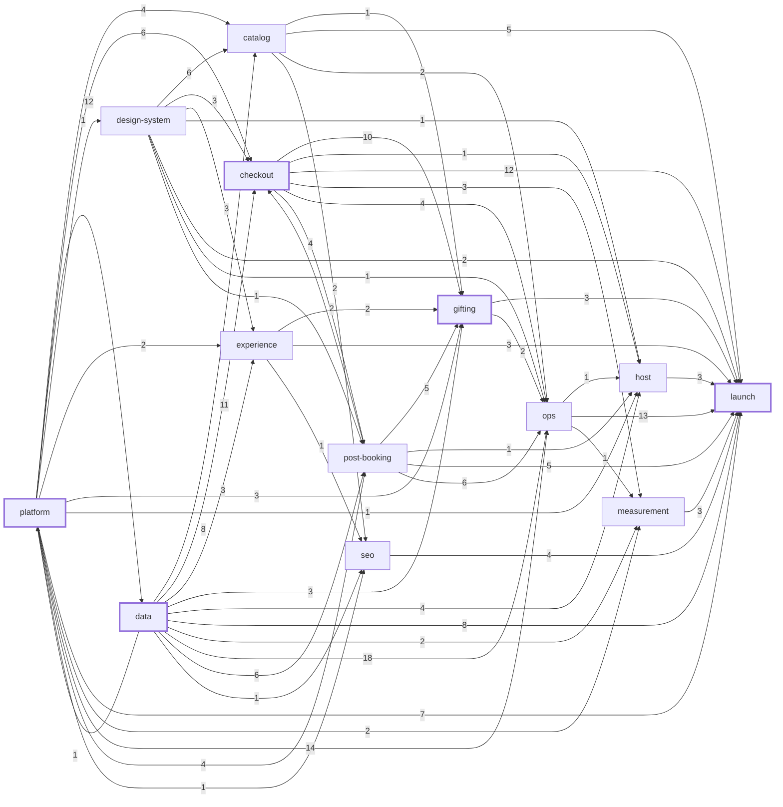
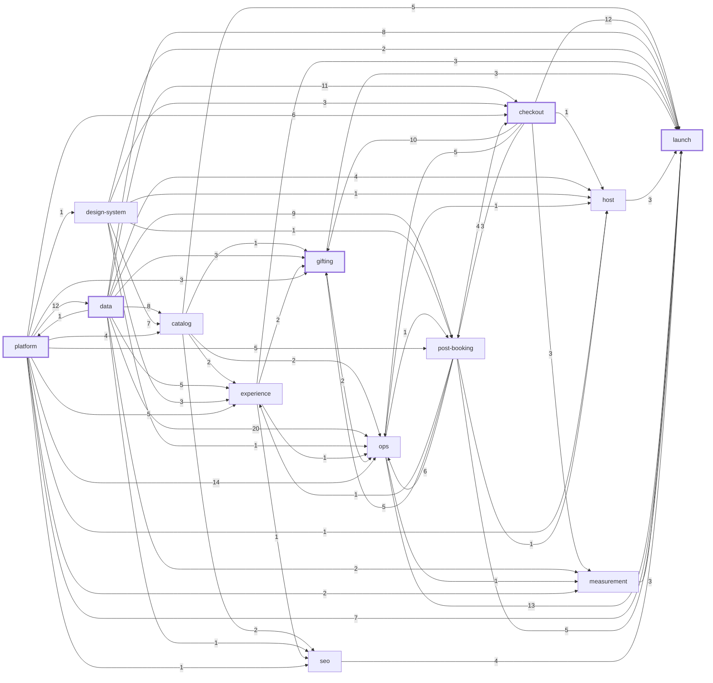

# Ramble: dependency graph and critical path

> **Updated 2026-10-20 (U-118 added, Dave):** the merge desk and agent identity is a new root unit, and U-001 now depends on it, so no fan-out unit merges before the desk exists. The generated blocks below include it: the demo path is 28 points over 13 units (26 over 12 in the prose), and total work 242 points (was 240). After the freeze decisions (levers 2, 3, 4a; DECISIONS 2026-10-20), Dave leads 9 units and his lane is 34 points (28.5 if agents carry half of each). The path in days is in `06-estimate.md`.

## Headline

**The critical path is the money core and its launch checks.** It runs platform, then data, holds, the webhook intake and `confirmOrder`, then out to the launch review by four tied routes:

- the confirmation and failure screens into gift redemption and exchange;
- the redemption and exchange confirm;
- manage booking and the synthetic booking into uptime monitoring;
- the smoke test and staged releases into the runbooks and the cutover rehearsal.

Each is 26 points over 11 or 12 units. Points are complexity scores, a stand-in for size until artifact 6 gives days.

Everything else runs beside it. The graph allows about 9 units in parallel on average and up to 16 at one depth. The design system, catalog, host tools, SEO, and most of ops have 1 to 14 points of slack.

**The graph is not what binds; Dave is.** He leads 16 of the 115 demo units (18 before the 2026-10-19 spikes moved U-008a and U-009 to the agents): the pattern-setters, the uncertainty-3 units, the accessibility walk, and the launch review. One person runs them one at a time. Scheduled that way, the demo finishes at 40 points, or 31.65 if agents carry the last 35% of each unit. So the floor on calendar time is Dave's lane. Artifact 5 adds his review time on the fan-out units, and artifact 7 schedules both.

In the method's words: the critical path is foundation, holds, `confirmOrder`, then gifting, manage booking, and the launch checks, about 26 points. Catalog, design system, host tools, SEO, and most of ops are off it. Dave's own units take 41 points of his time in series, which is longer than the path.

**Two proposed design doc amendments come with this artifact, for Dave to accept** (see below).

## How the path is computed

- **The record.** Each unit's `depends_on` in `units.yaml`. An edge means the unit cannot start until the upstream unit is merged. Nothing computed is stored in the record, because the path moves when estimates land.
- **The script.** `bun scripts/plan/critical-path.ts` checks the graph (no duplicate IDs, missing dependencies, cycles, Must units that need a Should, or units that need something out of scope), then runs a forward and backward pass. A unit's slack is how far it can slip before it joins the path.
- **Weights.** Until artifact 6, each unit weighs its complexity (1 to 3 points), a stand-in for size. Counting units (`--weight count`) also gives a 12-unit path, but it prints a different chain (U-011, U-019, U-015, U-016, U-049); the points path is one of its zero-slack ties, so the money core is critical under either weight. Once every unit carries `estimate_days`, the script switches to three-point means, `(o + 4m + p) / 6`, and adds the path's spread. **Artifact 6 recomputes this path in days.**
- **Scopes.** `demo` (the default) is what the demo builds: P5, Foundation and Must. `--should` adds the Shoulds, and `--scope real-job` adds the Stripe Connect adapter (U-046), which is estimated but not built. The launch review (U-104) waits for every unit in scope, so the script adds an edge to it from any unit that is not already upstream and that nothing else in scope needs (U-046 in the real-job scope, and with `--should` every Should except U-043, which reaches it through U-083b).
- **P4 and the tail.** The P4 spikes (U-013, U-028) finish before the freeze, so edges on them count as met. The post-launch units (U-094a, U-094b) are the legacy-retirement tail, reported after launch.

To rerun and refresh the generated sections below:

```bash
bun scripts/plan/critical-path.ts --write docs/plan/04-dependency-graph.md
```

```bash
bun scripts/plan/critical-path.ts --scope real-job --brief --write docs/plan/04-dependency-graph.md
```

```bash
bun scripts/plan/critical-path.ts --should --brief --write docs/plan/04-dependency-graph.md
```

## What the review changed

Three adversarial rounds ran as workflows, then a short check of what the third round added. Each round had independent finders, and skeptics who tried to refute every finding before it counted. The third round found no edge that shortens the path, so the graph has converged at this level of detail.

**Round 1** (eight finders: path edges, late hubs, missing edges in three section groups, contract-first cuts, routing, and the gate model). It produced 101 findings: 74 confirmed, 17 modified, 9 refuted, 1 unverified. The PM applied 83, using the skeptic's corrected form where a finding was modified. The path went from 35 to 32 points:

- **Gifting came off the path at 32.** Round 2 later shortened the launch chain, so at 26 the redemption and exchange chain is zero-slack again, tied with the others.
  - Ops session management (U-108) only emails offers when an experience ends; it does not call the exchange page or the refund job.
  - Redemption (U-064a) does not need gift delivery built first, because its tests seed a delivered gift.
  - Delivery (U-063) defines the `deliver_gift` job, and the purchase confirm (U-062a) enqueues it.
- **Accessibility runs per screen.** U-100 builds the axe matrix with a route-list check. Every screen unit adds its own rows, so Dave's checkout walk no longer waits for the ops screens.
- **Hidden orderings fixed:**
  - The catalog data layer (U-011) wrote role checks before any caller contract existed. The contract is now its own small unit, U-116, split from U-004a.
  - Orders (U-015) pointed foreign keys at tables built later; the keys now come in later migrations.
  - The webhook event table (U-048) uses hold functions, so it now depends on U-014a.
  - A dispute function sat in the unit after the one that uses it (U-079a to U-079b).
  - `refunds.split` moved to the refund unit (U-056).
  - The cross-table anonymize function moved to U-085, after the tables it touches.
- **About 40 missing edges added**, for rate-limit keys, cache tags, audit rows, the photos table, and seed fixtures.
- **Spurious edges removed:** U-049 on pricing, U-114 on transfers, U-105 on the failure states, U-096 on the race tests. Booking emails (U-054) now come before `confirmOrder`, which enqueues them.

**Round 2, a fix-check** (seven finders: two checking the application, broken orderings, changed scopes, the new path, routing changes, and the gate model). It produced 44 findings: 29 confirmed, 13 modified, 1 refuted, 1 unverified. The PM applied 43, the unverified one included: it gave manage booking (U-055) its axe-row sentence. The path went from 32 to 26 points:

- **Two orderings that round 1 broke were restored.** The booking and gift emails (U-054, U-063) had lost the jobs outbox.
- **Three edges on the old path's run to launch came off.** Their chains now tie with the path at 26:
  - Manage booking (U-055) needs `confirmOrder`, not the confirmation page.
  - Staged releases (U-103) need the smoke test (U-105), not uptime monitoring (U-097).
  - The runbooks (U-099) no longer wait on U-097; its probe-failure runbook moved into U-097.
- **New unit U-117, the rich-text format and renderer.** It came out of the editorial schema, so that keystone keeps its scored size, and guest pages never wait on the ops editor.
- **Smaller fixes:**
  - One owner each for `requireRole`, the form guard, and the `holds.gift_id` key.
  - Tax follows the experience's tax treatment.
  - The synthetic booking stays off the home cards.
  - The gift delivery job locks the gift row, which is a proposed design doc amendment (below).
- **The one-Dave lane**, now computed by the scripts.

**Round 3, a final check** (six finders: round 2's application, the path, changed scopes, the scripts, and the two docs). It produced 51 findings: 32 confirmed, 18 modified, 1 refuted. The PM applied all 50, mostly corrections to these two docs and to scope wording:

- **No path shortening.** The investor report (U-088) stopped waiting on the synthetic booking: `orders.synthetic` now lives in the orders schema (U-015), and U-114 sets it. One unit left zero slack; the path stays at 26.
- **The capability-token gap.** Manage and gift-redemption tokens are stored only as hashes, so no unit could rebuild a link to send or show one. Eight units needed one (U-050, U-054, U-063, U-066b, U-077, U-107, U-108, U-113), and the booking emails come before `confirmOrder`, so "settle it in U-049" came too late. This is now a proposed design doc amendment (below), with the units written to the recommended option.
- **One tax rule for every caller.** `startPayment`, `purchaseGift`, and the exchange reprice all take the rate from `pricing.taxRatePpm`.
- **One owner for each write.**
  - Attribution columns are written by `startPayment` (U-047a); U-087 passes them in and drops to the standard tier.
  - The dev mailbox moves behind the ops role in U-073.
  - The probe-failure rehearsal is a people check on U-097.
- **Script fixes:**
  - The chain report counts every tie and shows each zero-slack unit.
  - The path gate time covers the heaviest tied chain.
  - Synthetic edges into U-104 come only from units nothing else needs.
  - Human-only units hold Dave for their whole length.
  - The tail is weighed on its own.
  - Numbers print cleanly once there are days.
- **Scores.** U-116 and U-117 are added to `03-scores.md` as PM-scored.

**Where the PM applied a finding differently**, with the reason:

- The rich-text renderer went into its own unit, not edges from guest pages to the ops editor.
- The synthetic-event flag kept the finding's original direction (U-114 after U-086). The skeptic's reverse would have hung the measurement section off U-114 and put it on the path.
- U-048 depends on U-014a, rather than splitting the payment-event handling across two units (1 point).
- U-101 keeps U-051, because U-105 no longer brings it.
- U-004a moved to agent fan-out, since U-116 now sets its pattern.
- The capability-token fix is a design choice, so the PM wrote it as a proposal with two options and a recommendation, not as a settled change.

**Last check** (two finders on the token proposal and the rewritten prose). It produced 19 findings: 4 confirmed, 10 modified, 5 refuted. The PM applied the 14:

- **Version bumps now work.** A bump rewrites the stored hash in the same UPDATE. Before this, a bump left the old link working and broke the rebuilt one.
- **The confirmation page's own token is defined**, and bound to the device that placed the hold.
- **Gift-redemption bookings share the booking confirm**, so they also get the manage token and the emails.
- **The token hash gets a unique index.**
- **Option B is described fairly**, including that it is what accepted ADR 0002 already says.
- **One unit list in both docs.**

Refuted findings were not applied: nine in round 1, one in round 2, one in round 3, and five in the last check. The breakdown now has 134 units. `02-work-breakdown.md` is regenerated from `units.yaml` with `bun scripts/plan/breakdown.ts --write`.

## Design doc amendments (accepted 2026-10-19)

Dave accepted both on 2026-10-19: the gift delivery lock (yes) and capability tokens option A (derived). Both are marked "Accepted" in `01-design-doc.md` 4.2.3 and logged in `DECISIONS.md`. The text below is the proposal as put to him.

1. **The gift delivery job locks the gift row.** `deliver_gift` locks the gift row, last in the lock order, and moves only a `scheduled` gift to `delivered`. The design's lock list left the delivery job out, so a refund and a delivery could both win, and a refunded gift would still be emailed. Built and tested in U-063.
2. **How capability links are made.** The manage token and the gift token are stored only as hashes, so no unit can rebuild a link to send or show one, and the confirmation page's own token is not defined. The two options:
   - **A (recommended): derived tokens.** A token is an HMAC of the kind, the row ID, and a version, under one server secret; only its hash is stored.
     - Any server code can rebuild a link, a resend keeps the earlier link working, and a retried email sends the same link.
     - Bumping a row's version rewrites its stored hash and voids that row's earlier links.
     - The confirmation page gets its own derived token, returned only to the device that placed the hold.
     - The costs: anyone who has the secret can cancel any booking or redeem any gift until it is rotated, and a rotation means resending every live link. A amends accepted ADR 0002 ("random tokens hashed at rest") for capability links; sign-in links stay random.
   - **B: random tokens, as ADR 0002 says.** A token is minted where it is sent and stored as a hash.
     - A copy of the database alone cannot forge a link, and there is no secret whose leak forges every link. A leaked link can be voided on its own.
     - The costs: retries need care, so that a retried email never carries a link whose hash was overwritten. Either a resend voids the earlier link, or every send adds a row. The confirmation page either mints a link on each view or shows none, and my bookings opens a booking through the signed-in session.

   The PM recommends A, for links that stay consistent through retries and resends, and accepts the secret as the cost. The units are written for A. Choosing B rewrites U-015, U-017, U-047a, U-047b, U-049, U-050, U-051, U-054, U-055, U-062a, U-062b, U-063, U-064a, U-066b, U-077, U-099, U-107, U-108, and U-113.

## Reading the path

- **The money core and the launch checks are critical, not just the printed chain.**
  - 24 units have zero slack and 30 more are within 2 points.
  - There are 18 tied chains. All run through U-012, U-018, or U-111 into the holds core and the webhook intake (U-014a, U-048). From there they go one of four ways:
    - `confirmOrder`, the confirmation and failure screens, and gift redemption and exchange (U-049, U-050, U-051, U-064b, U-065b);
    - `confirmOrder` and the redemption and exchange confirm (U-064a, U-065a, U-065b);
    - `confirmOrder` or refund processing (U-056) into manage booking, the synthetic booking, and uptime monitoring (U-055, U-114, U-097);
    - the confirmation page into the smoke test and staged releases, then the runbooks or the cutover rehearsal (U-050, U-105, U-103, U-099 or U-115).
  - Treat data, holds, checkout, gifting, manage booking, and the launch checks as one critical block. Three-point estimates in artifact 6 will decide which chain is longest.
- **Half the path is Dave's.**
  - 6 of the 12 units on the printed path are human-led: U-003, U-011, U-014a, U-048, U-049, U-104.
  - So his lane and the graph's path fight over the same weeks.
  - He takes his units in the order the execution model prints: when he is free, the ready unit with the least latest start, then the least slack. That takes the money core early, but not always first. U-024 (slack 4) goes ahead of U-048, and U-047a (slack 2) ahead of U-049, because each is further past its latest start when Dave gets to it.
- **Keystones come first and stay small.**
  - U-001, U-003, U-116, U-011, and U-002 each have 88 to 114 units downstream. A slip in the first week moves everything.
  - U-116 and U-117 exist partly so that small contracts, not whole implementations, sit at the root.
- **Parallel branches.**
  - Off the path: the design system (4 to 14 points of slack), catalog (6 to 13), host tools (3 to 12), SEO (6 to 13), and ops (1 to 12).
  - These are where agent fan-out runs while Dave works the money core.
  - The width table shows 10 to 16 units ready at each middle depth. Agent capacity is not the limit; Dave's review rate is (see `05-execution-model.md`).
- **Other scopes:**
  - The real job adds the Stripe Connect adapter (U-046). The path stays at 26, but Dave's strict lane grows to 45.
  - With the Shoulds, the path also stays at 26, with more ties: the live dashboard (U-090) and the measurement chain under it (U-086, U-087, U-088) go to zero slack, for 28 zero-slack units and 21 tied chains.
- **After launch:** the legacy-retirement tail, U-094a then U-094b. The plan ends when the old site is removed, 60 days or more after launch.
- **Not in these numbers:**
  - Days (artifact 6).
  - The wait between a PR being ready and Dave merging it (artifact 6 adds it to each path unit).
  - Dave's gate time and people checks (artifact 5, then artifact 7).

## Generated: demo build

<!-- critical-path:demo:start -->
#### Scope `demo`, weighted by points

Generated by `bun scripts/plan/critical-path.ts --scope demo --weight points`. Do not edit by hand.

| Measure | Value |
|---|---|
| Units in scope | 116 |
| Dependency edges in scope | 367 |
| Critical path length | 28 points, 13 units |
| Finish with one Dave (his units one at a time) | 34 points; 28.5 if agents carry 50% of each |
| Total work | 242 points |
| Work ÷ path (average parallelism the graph allows) | 8.6 |
| Zero-slack units | 25 |
| Near-critical units (slack ≤ 2) | 30 |

**Checks.** No duplicate IDs, missing dependencies, cycles, Must-on-Should dependencies, or out-of-scope dependencies.
- Dependencies met in P4: U-013, U-028.
- Out of scope, P4 (done before the plan freeze; dependencies on it count as met): U-013, U-028.
- Out of scope, Should (first in the cut order; run with --should): U-033, U-034, U-042, U-043, U-044, U-057, U-061, U-107, U-072, U-110, U-081, U-082, U-083b, U-090.
- Out of scope, estimated, not built in the demo: U-046.
- Out of scope, post-launch (legacy-retirement tail, reported below): U-094a, U-094b.

**Critical path** (platform → data → checkout → gifting → launch):

| # | Unit | Title | Section | C | U | Weight | Ends at |
|---|---|---|---|---|---|---|---|
| 1 | U-118 | Merge desk and agent identity | platform | 2 | 2 | 2 | 2 |
| 2 | U-001 | Repository setup and CI gates | platform | 1 | 1 | 1 | 3 |
| 3 | U-003 | Database wiring and migrations | platform | 2 | 2 | 2 | 5 |
| 4 | U-011 | Catalog schema and read layer | data | 2 | 1 | 2 | 7 |
| 5 | U-012 | Sessions, templates, and allocations | data | 2 | 2 | 2 | 9 |
| 6 | U-014a | Holds core and reserveSpaces | data | 3 | 2 | 3 | 12 |
| 7 | U-048 | Webhook intake and the event table | checkout | 3 | 2 | 3 | 15 |
| 8 | U-049 | confirmOrder for bookings | checkout | 3 | 2 | 3 | 18 |
| 9 | U-050 | Confirmation page and order status | checkout | 2 | 1 | 2 | 20 |
| 10 | U-051 | Checkout failure states | checkout | 2 | 1 | 2 | 22 |
| 11 | U-064b | Gift redemption page | gifting | 2 | 1 | 2 | 24 |
| 12 | U-065b | Gift exchange: page and top-up | gifting | 2 | 2 | 2 | 26 |
| 13 | U-104 | Launch readiness review | launch | 2 | 2 | 2 | 28 |

**Other zero-slack chains** (17 tie with the path; 4 shown, chosen so each zero-slack unit appears on at least one):

- U-118 → U-001 → U-003 → U-011 → U-018 → U-014a → U-048 → U-056 → U-055 → U-114 → U-097 → U-104
- U-118 → U-001 → U-003 → U-011 → U-111 → U-014a → U-048 → U-049 → U-050 → U-105 → U-103 → U-099 → U-104
- U-118 → U-001 → U-003 → U-011 → U-012 → U-014a → U-048 → U-049 → U-064a → U-065a → U-065b → U-104
- U-118 → U-001 → U-003 → U-011 → U-012 → U-014a → U-048 → U-049 → U-050 → U-105 → U-103 → U-115 → U-104

**Near-critical** (slack ≤ 2 points; a slip here joins the path):

| Unit | Title | Section | Slack |
|---|---|---|---|
| U-002 | Walking skeleton | platform | 1 |
| U-009 | Cache conventions and tag map | platform | 1 |
| U-014b | Hold rules and upkeep | data | 1 |
| U-015 | Orders, attempts, events, refunds, transfers schema | data | 1 |
| U-016 | Ledger and its views | data | 1 |
| U-019 | Guests, consents, and privacy | data | 1 |
| U-040 | Upcoming dates and spaces left | experience | 1 |
| U-041 | Booking bar, sheet, and panel | experience | 1 |
| U-052 | Payment race and idempotency tests | checkout | 1 |
| U-066a | Gift expiry and buyer refunds | gifting | 1 |
| U-086 | Events table and beacons | measurement | 1 |
| U-096 | Load test | launch | 1 |
| U-113 | Ops gift support | ops | 1 |
| U-116 | Caller and role contract | platform | 1 |
| U-047a | startPayment action | checkout | 2 |
| U-047b | Checkout page | checkout | 2 |
| U-054 | Booking emails | post-booking | 2 |
| U-059 | Session cancellation fan-out | post-booking | 2 |
| U-062b | Gift checkout and gift-scheduled pages | gifting | 2 |
| U-066b | Gift reinstatement | gifting | 2 |
| U-077 | Bookings, cancellations, and refunds | ops | 2 |
| U-079a | Weekly release and transfer events | ops | 2 |
| U-079b | Reconciliation and close-out | ops | 2 |
| U-087 | Attribution capture | measurement | 2 |
| U-088 | Investor report and funnel | measurement | 2 |
| U-100 | Accessibility pass | launch | 2 |
| U-101 | Device matrix and wallets | launch | 2 |
| U-108 | Ops session management | ops | 2 |
| U-109 | Refund path in confirmOrder | checkout | 2 |
| U-117 | Rich-text format and renderer | platform | 2 |

**Sections** (parallel branches: a section with slack can run beside the path):

| Section | Units | Work | Zero slack | Least slack | Most slack | Earliest start |
|---|---|---|---|---|---|---|
| platform | 15 | 27 | 3 | 0 | 20 | 0 |
| data | 14 | 29 | 5 | 0 | 13 | 5 |
| design-system | 6 | 12 | 0 | 4 | 13 | 3 |
| catalog | 7 | 11 | 0 | 6 | 13 | 9 |
| experience | 3 | 7 | 0 | 1 | 4 | 9 |
| checkout | 12 | 29 | 4 | 0 | 8 | 5 |
| post-booking | 6 | 14 | 2 | 0 | 12 | 11 |
| gifting | 9 | 22 | 4 | 0 | 6 | 13 |
| host | 5 | 8 | 0 | 3 | 12 | 9 |
| ops | 19 | 43 | 0 | 1 | 12 | 11 |
| measurement | 4 | 7 | 0 | 1 | 5 | 18 |
| seo | 3 | 6 | 0 | 6 | 13 | 7 |
| launch | 13 | 27 | 7 | 0 | 22 | 3 |

**Keystones** (most work downstream; a slip here delays the most units):

| Unit | Title | Downstream units | Slack |
|---|---|---|---|
| U-118 | Merge desk and agent identity | 115 | 0 |
| U-001 | Repository setup and CI gates | 114 | 0 |
| U-003 | Database wiring and migrations | 100 | 0 |
| U-116 | Caller and role contract | 93 | 1 |
| U-011 | Catalog schema and read layer | 89 | 0 |
| U-002 | Walking skeleton | 88 | 1 |
| U-009 | Cache conventions and tag map | 76 | 1 |
| U-117 | Rich-text format and renderer | 70 | 2 |
| U-018 | Editorial and policy schema | 69 | 0 |
| U-005 | Jobs outbox, drain route, and the pulse | 63 | 4 |
| U-012 | Sessions, templates, and allocations | 63 | 0 |
| U-023 | Token export and CSS custom properties | 61 | 4 |

**Width by depth** (units whose longest chain of predecessors has this many units; the fan-out ceiling at each depth):

| Depth | Units | Work | Sections |
|---|---|---|---|
| 0 | 1 | 2 | platform |
| 1 | 1 | 1 | platform |
| 2 | 5 | 7 | platform, design-system, launch |
| 3 | 10 | 20 | platform, data, design-system, checkout |
| 4 | 12 | 23 | platform, data, design-system, checkout, seo, launch |
| 5 | 11 | 22 | platform, data, design-system, catalog, experience, host |
| 6 | 16 | 32 | data, design-system, catalog, checkout, post-booking, host, ops, seo, launch |
| 7 | 16 | 34 | experience, checkout, post-booking, gifting, ops, seo |
| 8 | 15 | 36 | experience, checkout, post-booking, gifting, host, ops, measurement |
| 9 | 15 | 35 | checkout, gifting, host, ops, measurement, launch |
| 10 | 10 | 22 | checkout, gifting, ops, measurement, launch |
| 11 | 3 | 6 | gifting, launch |
| 12 | 1 | 2 | launch |

**Section graph** (an arrow means units in the second section need units in the first; the number counts those edges; the critical path's sections are marked):



**Legacy-retirement tail** (after launch; the plan ends at the old site removed): U-094a Post-launch redirect fixes → U-094b Decommission the old site (starts 60 days after launch), 2 points of work.

<details><summary>Every unit in scope: earliest start, slack, downstream units</summary>

| Unit | Title | Section | C | U | Depth | Starts at | Slack | Downstream |
|---|---|---|---|---|---|---|---|---|
| U-118 ★ | Merge desk and agent identity | platform | 2 | 2 | 0 | 0 | 0 | 115 |
| U-001 ★ | Repository setup and CI gates | platform | 1 | 1 | 1 | 2 | 0 | 114 |
| U-002 | Walking skeleton | platform | 1 | 1 | 2 | 3 | 1 | 88 |
| U-003 ★ | Database wiring and migrations | platform | 2 | 2 | 2 | 3 | 0 | 100 |
| U-116 | Caller and role contract | platform | 1 | 1 | 2 | 3 | 1 | 93 |
| U-023 | Token export and CSS custom properties | design-system | 2 | 2 | 2 | 3 | 4 | 61 |
| U-102 | Scanning and secrets | launch | 1 | 1 | 2 | 3 | 22 | 1 |
| U-117 | Rich-text format and renderer | platform | 1 | 1 | 3 | 4 | 2 | 70 |
| U-007 | Logging and error tracking | platform | 2 | 2 | 3 | 4 | 6 | 41 |
| U-008a | CSP and security headers | platform | 2 | 2 | 3 | 4 | 20 | 1 |
| U-009 | Cache conventions and tag map | platform | 2 | 2 | 3 | 4 | 1 | 76 |
| U-005 | Jobs outbox, drain route, and the pulse | platform | 3 | 2 | 3 | 5 | 4 | 63 |
| U-006 | Email port and dev mailbox | platform | 2 | 1 | 3 | 5 | 5 | 59 |
| U-008b | Rate limits and bot checks | platform | 2 | 2 | 3 | 5 | 5 | 57 |
| U-045a | Payments port and fake adapter | checkout | 2 | 2 | 3 | 5 | 5 | 45 |
| U-011 ★ | Catalog schema and read layer | data | 2 | 1 | 3 | 5 | 0 | 89 |
| U-024 | Primitives: controls and feedback | design-system | 2 | 2 | 3 | 5 | 4 | 60 |
| U-020 | Audit log | data | 1 | 1 | 4 | 8 | 7 | 23 |
| U-098 | Backups and restore rehearsal | launch | 2 | 2 | 4 | 8 | 14 | 2 |
| U-004a | Sign-in links, roles, and sessions | platform | 2 | 2 | 4 | 7 | 5 | 26 |
| U-045b | Fake payment UI and event simulator | checkout | 2 | 1 | 4 | 7 | 8 | 17 |
| U-010 | Storage port and photo ingest | platform | 2 | 1 | 4 | 7 | 4 | 23 |
| U-012 ★ | Sessions, templates, and allocations | data | 2 | 2 | 4 | 7 | 0 | 63 |
| U-111 ★ | Pricing and cancellation windows | data | 2 | 1 | 4 | 7 | 0 | 52 |
| U-018 ★ | Editorial and policy schema | data | 2 | 1 | 4 | 7 | 0 | 69 |
| U-019 | Guests, consents, and privacy | data | 2 | 2 | 4 | 7 | 1 | 52 |
| U-091 | Address scheme and slug history | seo | 2 | 2 | 4 | 7 | 13 | 3 |
| U-025 | Primitives: content and navigation | design-system | 2 | 1 | 4 | 7 | 4 | 58 |
| U-026 | React Aria wrappers | design-system | 2 | 2 | 4 | 7 | 6 | 33 |
| U-004b | Passkeys and step-up | platform | 2 | 2 | 5 | 9 | 5 | 20 |
| U-014a ★ | Holds core and reserveSpaces | data | 3 | 2 | 5 | 9 | 0 | 48 |
| U-021a | Seed script and scale fixture | data | 2 | 2 | 5 | 9 | 9 | 12 |
| U-038 | Help center, legal, accessibility, contact | catalog | 2 | 1 | 5 | 9 | 13 | 3 |
| U-015 | Orders, attempts, events, refunds, transfers schema | data | 2 | 1 | 5 | 9 | 1 | 51 |
| U-037 | Guide-only entries | catalog | 1 | 1 | 5 | 9 | 12 | 3 |
| U-039 | Experience page content | experience | 2 | 2 | 5 | 9 | 4 | 17 |
| U-067 | Host shell and access | host | 1 | 1 | 5 | 9 | 12 | 5 |
| U-027 | Order summary, booking bar, booking panel | design-system | 2 | 1 | 5 | 9 | 6 | 25 |
| U-030 | Home page and module renderer | catalog | 2 | 2 | 5 | 9 | 10 | 4 |
| U-031 | Browse with URL filters | catalog | 3 | 2 | 5 | 9 | 6 | 15 |
| U-022 | Authorization matrix test | data | 2 | 1 | 6 | 11 | 11 | 2 |
| U-073 | Ops shell, passkeys, and audit wiring | ops | 2 | 2 | 6 | 11 | 5 | 18 |
| U-014b | Hold rules and upkeep | data | 2 | 2 | 6 | 12 | 1 | 13 |
| U-021b | Curated content and photo pool | data | 2 | 2 | 6 | 11 | 13 | 1 |
| U-016 | Ledger and its views | data | 3 | 1 | 6 | 11 | 1 | 39 |
| U-017 | Gift tables and state machine | data | 2 | 1 | 6 | 11 | 5 | 14 |
| U-047a | startPayment action | checkout | 3 | 2 | 6 | 12 | 2 | 25 |
| U-048 ★ | Webhook intake and the event table | checkout | 3 | 2 | 6 | 12 | 0 | 40 |
| U-054 | Booking emails | post-booking | 2 | 1 | 6 | 11 | 2 | 40 |
| U-093 | Redirect map and guide import | seo | 2 | 3 | 6 | 10 | 12 | 2 |
| U-068 | Publish a week and edit sessions | host | 2 | 2 | 6 | 12 | 10 | 2 |
| U-029 | Code Connect mapping | design-system | 2 | 2 | 6 | 11 | 13 | 1 |
| U-032 | Zero results with ways forward | catalog | 1 | 1 | 6 | 12 | 13 | 1 |
| U-035 | Category and neighborhood pages | catalog | 1 | 2 | 6 | 12 | 6 | 4 |
| U-036 | Ramble Picks and gift guide pages | catalog | 1 | 1 | 6 | 12 | 11 | 2 |
| U-095 | Lighthouse budgets and lab runs | launch | 2 | 2 | 6 | 12 | 12 | 1 |
| U-112 | Ops staff and roles admin | ops | 2 | 2 | 7 | 13 | 11 | 1 |
| U-074a | Host setup | ops | 2 | 1 | 7 | 13 | 5 | 4 |
| U-076a | Editorial editing and publish | ops | 2 | 2 | 7 | 13 | 9 | 3 |
| U-078 | Settings and ops switches | ops | 2 | 2 | 7 | 13 | 11 | 1 |
| U-083a | Support queue | ops | 1 | 1 | 7 | 13 | 12 | 1 |
| U-084 | Trust and safety | ops | 2 | 2 | 7 | 13 | 11 | 1 |
| U-040 | Upcoming dates and spaces left | experience | 2 | 2 | 7 | 14 | 1 | 12 |
| U-063 | Gift delivery | gifting | 2 | 2 | 7 | 13 | 6 | 4 |
| U-047b | Checkout page | checkout | 3 | 2 | 7 | 15 | 2 | 16 |
| U-106 | Paying-hold lapse job | checkout | 2 | 2 | 7 | 15 | 6 | 3 |
| U-056 ★ | Refund processing | post-booking | 3 | 2 | 7 | 15 | 0 | 19 |
| U-079b | Reconciliation and close-out | ops | 3 | 2 | 7 | 15 | 2 | 5 |
| U-049 ★ | confirmOrder for bookings | checkout | 3 | 2 | 7 | 15 | 0 | 33 |
| U-058 | Reminder emails | post-booking | 1 | 1 | 7 | 13 | 12 | 1 |
| U-060 | Review invites, collection, and storage | post-booking | 2 | 1 | 7 | 13 | 9 | 2 |
| U-092 | Sitemaps, robots, and crawler checks | seo | 2 | 1 | 7 | 13 | 6 | 3 |
| U-074b | Experience editor | ops | 3 | 2 | 8 | 15 | 5 | 3 |
| U-076b | Home and collections admin | ops | 2 | 1 | 8 | 15 | 9 | 1 |
| U-076c | Pages and documents admin | ops | 2 | 1 | 8 | 15 | 9 | 1 |
| U-041 | Booking bar, sheet, and panel | experience | 3 | 2 | 8 | 16 | 1 | 11 |
| U-053 | Checkout script inventory and PCI | checkout | 1 | 2 | 8 | 18 | 7 | 1 |
| U-059 | Session cancellation fan-out | post-booking | 3 | 2 | 8 | 18 | 2 | 6 |
| U-109 | Refund path in confirmOrder | checkout | 3 | 2 | 8 | 18 | 2 | 2 |
| U-050 ★ | Confirmation page and order status | checkout | 2 | 1 | 8 | 18 | 0 | 13 |
| U-055 ★ | Manage booking and cancelBooking | post-booking | 3 | 2 | 8 | 18 | 0 | 5 |
| U-062a | purchaseGift and the gift-purchase confirm | gifting | 3 | 2 | 8 | 18 | 3 | 2 |
| U-064a ★ | redeemGift and the redemption confirm | gifting | 3 | 2 | 8 | 18 | 0 | 7 |
| U-069 | Guest lists | host | 1 | 1 | 8 | 18 | 7 | 1 |
| U-079a | Weekly release and transfer events | ops | 3 | 2 | 8 | 18 | 2 | 4 |
| U-086 | Events table and beacons | measurement | 2 | 2 | 8 | 18 | 1 | 6 |
| U-085 | Privacy requests | ops | 2 | 2 | 8 | 15 | 9 | 1 |
| U-074c | Availability setup | ops | 3 | 2 | 9 | 18 | 5 | 1 |
| U-075 | Experience review and approval | ops | 2 | 2 | 9 | 18 | 6 | 1 |
| U-070 | Host cancels or retimes a booked session | host | 2 | 2 | 9 | 21 | 3 | 1 |
| U-108 | Ops session management | ops | 3 | 2 | 9 | 21 | 2 | 1 |
| U-051 ★ | Checkout failure states | checkout | 2 | 1 | 9 | 20 | 0 | 8 |
| U-105 ★ | Booking-path smoke and nightly suite | launch | 2 | 2 | 9 | 20 | 0 | 6 |
| U-065a ★ | Gift exchange: confirm branch | gifting | 3 | 2 | 9 | 21 | 0 | 2 |
| U-066a | Gift expiry and buyer refunds | gifting | 2 | 1 | 9 | 21 | 1 | 2 |
| U-066b | Gift reinstatement | gifting | 3 | 2 | 9 | 21 | 2 | 1 |
| U-071 | Statements and payouts | host | 2 | 2 | 9 | 21 | 3 | 1 |
| U-077 | Bookings, cancellations, and refunds | ops | 3 | 2 | 9 | 21 | 2 | 1 |
| U-080 | Finance export | ops | 2 | 1 | 9 | 21 | 3 | 1 |
| U-087 | Attribution capture | measurement | 2 | 2 | 9 | 20 | 2 | 2 |
| U-089 | Web-vitals field data | measurement | 1 | 1 | 9 | 20 | 5 | 1 |
| U-114 ★ | Synthetic booking isolation | launch | 3 | 2 | 9 | 21 | 0 | 2 |
| U-052 | Payment race and idempotency tests | checkout | 3 | 2 | 10 | 22 | 1 | 1 |
| U-062b | Gift checkout and gift-scheduled pages | gifting | 2 | 2 | 10 | 22 | 2 | 1 |
| U-064b ★ | Gift redemption page | gifting | 2 | 1 | 10 | 22 | 0 | 2 |
| U-096 | Load test | launch | 3 | 3 | 10 | 22 | 1 | 1 |
| U-100 | Accessibility pass | launch | 2 | 2 | 10 | 22 | 2 | 1 |
| U-101 | Device matrix and wallets | launch | 2 | 3 | 10 | 22 | 2 | 1 |
| U-103 ★ | Staged releases and freeze rule | launch | 2 | 2 | 10 | 22 | 0 | 3 |
| U-113 | Ops gift support | ops | 2 | 2 | 10 | 23 | 1 | 1 |
| U-088 | Investor report and funnel | measurement | 2 | 1 | 10 | 22 | 2 | 1 |
| U-097 ★ | Uptime, heartbeats, SLO, synthetic booking | launch | 2 | 2 | 10 | 24 | 0 | 1 |
| U-065b ★ | Gift exchange: page and top-up | gifting | 2 | 2 | 11 | 24 | 0 | 1 |
| U-099 ★ | Runbooks and rehearsal | launch | 2 | 1 | 11 | 24 | 0 | 1 |
| U-115 ★ | Launch cutover runbook and rehearsal | launch | 2 | 2 | 11 | 24 | 0 | 1 |
| U-104 ★ | Launch readiness review | launch | 2 | 2 | 12 | 26 | 0 | 0 |

</details>
<!-- critical-path:demo:end -->

## Generated: real job (adds the Stripe Connect adapter)

<!-- critical-path:real-job:start -->
#### Scope `real-job`, weighted by points

Generated by `bun scripts/plan/critical-path.ts --scope real-job --weight points`. Do not edit by hand.

| Measure | Value |
|---|---|
| Units in scope | 117 |
| Dependency edges in scope | 368 (plus 1 added into U-104) |
| Critical path length | 28 points, 13 units |
| Finish with one Dave (his units one at a time) | 35 points; 28.5 if agents carry 50% of each |
| Total work | 245 points |
| Work ÷ path (average parallelism the graph allows) | 8.8 |
| Zero-slack units | 25 |
| Near-critical units (slack ≤ 2) | 30 |

**Checks.** No duplicate IDs, missing dependencies, cycles, Must-on-Should dependencies, or out-of-scope dependencies.
- Dependencies met in P4: U-013, U-028.
- Added so the launch review waits for everything in scope: U-046 → U-104.
- Out of scope, P4 (done before the plan freeze; dependencies on it count as met): U-013, U-028.
- Out of scope, Should (first in the cut order; run with --should): U-033, U-034, U-042, U-043, U-044, U-057, U-061, U-107, U-072, U-110, U-081, U-082, U-083b, U-090.
- Out of scope, post-launch (legacy-retirement tail, reported below): U-094a, U-094b.

**Critical path** (platform → data → checkout → gifting → launch):

| # | Unit | Title | Section | C | U | Weight | Ends at |
|---|---|---|---|---|---|---|---|
| 1 | U-118 | Merge desk and agent identity | platform | 2 | 2 | 2 | 2 |
| 2 | U-001 | Repository setup and CI gates | platform | 1 | 1 | 1 | 3 |
| 3 | U-003 | Database wiring and migrations | platform | 2 | 2 | 2 | 5 |
| 4 | U-011 | Catalog schema and read layer | data | 2 | 1 | 2 | 7 |
| 5 | U-012 | Sessions, templates, and allocations | data | 2 | 2 | 2 | 9 |
| 6 | U-014a | Holds core and reserveSpaces | data | 3 | 2 | 3 | 12 |
| 7 | U-048 | Webhook intake and the event table | checkout | 3 | 2 | 3 | 15 |
| 8 | U-049 | confirmOrder for bookings | checkout | 3 | 2 | 3 | 18 |
| 9 | U-050 | Confirmation page and order status | checkout | 2 | 1 | 2 | 20 |
| 10 | U-051 | Checkout failure states | checkout | 2 | 1 | 2 | 22 |
| 11 | U-064b | Gift redemption page | gifting | 2 | 1 | 2 | 24 |
| 12 | U-065b | Gift exchange: page and top-up | gifting | 2 | 2 | 2 | 26 |
| 13 | U-104 | Launch readiness review | launch | 2 | 2 | 2 | 28 |

**Other zero-slack chains** (17 tie with the path; 4 shown, chosen so each zero-slack unit appears on at least one):

- U-118 → U-001 → U-003 → U-011 → U-018 → U-014a → U-048 → U-056 → U-055 → U-114 → U-097 → U-104
- U-118 → U-001 → U-003 → U-011 → U-111 → U-014a → U-048 → U-049 → U-050 → U-105 → U-103 → U-099 → U-104
- U-118 → U-001 → U-003 → U-011 → U-012 → U-014a → U-048 → U-049 → U-064a → U-065a → U-065b → U-104
- U-118 → U-001 → U-003 → U-011 → U-012 → U-014a → U-048 → U-049 → U-050 → U-105 → U-103 → U-115 → U-104

**Near-critical** (slack ≤ 2 points; a slip here joins the path):

| Unit | Title | Section | Slack |
|---|---|---|---|
| U-002 | Walking skeleton | platform | 1 |
| U-009 | Cache conventions and tag map | platform | 1 |
| U-014b | Hold rules and upkeep | data | 1 |
| U-015 | Orders, attempts, events, refunds, transfers schema | data | 1 |
| U-016 | Ledger and its views | data | 1 |
| U-019 | Guests, consents, and privacy | data | 1 |
| U-040 | Upcoming dates and spaces left | experience | 1 |
| U-041 | Booking bar, sheet, and panel | experience | 1 |
| U-052 | Payment race and idempotency tests | checkout | 1 |
| U-066a | Gift expiry and buyer refunds | gifting | 1 |
| U-086 | Events table and beacons | measurement | 1 |
| U-096 | Load test | launch | 1 |
| U-113 | Ops gift support | ops | 1 |
| U-116 | Caller and role contract | platform | 1 |
| U-047a | startPayment action | checkout | 2 |
| U-047b | Checkout page | checkout | 2 |
| U-054 | Booking emails | post-booking | 2 |
| U-059 | Session cancellation fan-out | post-booking | 2 |
| U-062b | Gift checkout and gift-scheduled pages | gifting | 2 |
| U-066b | Gift reinstatement | gifting | 2 |
| U-077 | Bookings, cancellations, and refunds | ops | 2 |
| U-079a | Weekly release and transfer events | ops | 2 |
| U-079b | Reconciliation and close-out | ops | 2 |
| U-087 | Attribution capture | measurement | 2 |
| U-088 | Investor report and funnel | measurement | 2 |
| U-100 | Accessibility pass | launch | 2 |
| U-101 | Device matrix and wallets | launch | 2 |
| U-108 | Ops session management | ops | 2 |
| U-109 | Refund path in confirmOrder | checkout | 2 |
| U-117 | Rich-text format and renderer | platform | 2 |

**Sections** (parallel branches: a section with slack can run beside the path):

| Section | Units | Work | Zero slack | Least slack | Most slack | Earliest start |
|---|---|---|---|---|---|---|
| platform | 15 | 27 | 3 | 0 | 20 | 0 |
| data | 14 | 29 | 5 | 0 | 13 | 5 |
| design-system | 6 | 12 | 0 | 4 | 13 | 3 |
| catalog | 7 | 11 | 0 | 6 | 13 | 9 |
| experience | 3 | 7 | 0 | 1 | 4 | 9 |
| checkout | 13 | 32 | 4 | 0 | 16 | 5 |
| post-booking | 6 | 14 | 2 | 0 | 12 | 11 |
| gifting | 9 | 22 | 4 | 0 | 6 | 13 |
| host | 5 | 8 | 0 | 3 | 12 | 9 |
| ops | 19 | 43 | 0 | 1 | 12 | 11 |
| measurement | 4 | 7 | 0 | 1 | 5 | 18 |
| seo | 3 | 6 | 0 | 6 | 13 | 7 |
| launch | 13 | 27 | 7 | 0 | 22 | 3 |

**Keystones** (most work downstream; a slip here delays the most units):

| Unit | Title | Downstream units | Slack |
|---|---|---|---|
| U-118 | Merge desk and agent identity | 116 | 0 |
| U-001 | Repository setup and CI gates | 115 | 0 |
| U-003 | Database wiring and migrations | 101 | 0 |
| U-116 | Caller and role contract | 93 | 1 |
| U-011 | Catalog schema and read layer | 89 | 0 |
| U-002 | Walking skeleton | 88 | 1 |
| U-009 | Cache conventions and tag map | 76 | 1 |
| U-117 | Rich-text format and renderer | 70 | 2 |
| U-018 | Editorial and policy schema | 69 | 0 |
| U-005 | Jobs outbox, drain route, and the pulse | 63 | 4 |
| U-012 | Sessions, templates, and allocations | 63 | 0 |
| U-023 | Token export and CSS custom properties | 61 | 4 |

**Width by depth** (units whose longest chain of predecessors has this many units; the fan-out ceiling at each depth):

| Depth | Units | Work | Sections |
|---|---|---|---|
| 0 | 1 | 2 | platform |
| 1 | 1 | 1 | platform |
| 2 | 5 | 7 | platform, design-system, launch |
| 3 | 10 | 20 | platform, data, design-system, checkout |
| 4 | 13 | 26 | platform, data, design-system, checkout, seo, launch |
| 5 | 11 | 22 | platform, data, design-system, catalog, experience, host |
| 6 | 16 | 32 | data, design-system, catalog, checkout, post-booking, host, ops, seo, launch |
| 7 | 16 | 34 | experience, checkout, post-booking, gifting, ops, seo |
| 8 | 15 | 36 | experience, checkout, post-booking, gifting, host, ops, measurement |
| 9 | 15 | 35 | checkout, gifting, host, ops, measurement, launch |
| 10 | 10 | 22 | checkout, gifting, ops, measurement, launch |
| 11 | 3 | 6 | gifting, launch |
| 12 | 1 | 2 | launch |

**Section graph** (an arrow means units in the second section need units in the first; the number counts those edges; the critical path's sections are marked):


**Legacy-retirement tail** (after launch; the plan ends at the old site removed): U-094a Post-launch redirect fixes → U-094b Decommission the old site (starts 60 days after launch), 2 points of work.

<details><summary>Every unit in scope: earliest start, slack, downstream units</summary>

| Unit | Title | Section | C | U | Depth | Starts at | Slack | Downstream |
|---|---|---|---|---|---|---|---|---|
| U-118 ★ | Merge desk and agent identity | platform | 2 | 2 | 0 | 0 | 0 | 116 |
| U-001 ★ | Repository setup and CI gates | platform | 1 | 1 | 1 | 2 | 0 | 115 |
| U-002 | Walking skeleton | platform | 1 | 1 | 2 | 3 | 1 | 88 |
| U-003 ★ | Database wiring and migrations | platform | 2 | 2 | 2 | 3 | 0 | 101 |
| U-116 | Caller and role contract | platform | 1 | 1 | 2 | 3 | 1 | 93 |
| U-023 | Token export and CSS custom properties | design-system | 2 | 2 | 2 | 3 | 4 | 61 |
| U-102 | Scanning and secrets | launch | 1 | 1 | 2 | 3 | 22 | 1 |
| U-117 | Rich-text format and renderer | platform | 1 | 1 | 3 | 4 | 2 | 70 |
| U-007 | Logging and error tracking | platform | 2 | 2 | 3 | 4 | 6 | 41 |
| U-008a | CSP and security headers | platform | 2 | 2 | 3 | 4 | 20 | 1 |
| U-009 | Cache conventions and tag map | platform | 2 | 2 | 3 | 4 | 1 | 76 |
| U-005 | Jobs outbox, drain route, and the pulse | platform | 3 | 2 | 3 | 5 | 4 | 63 |
| U-006 | Email port and dev mailbox | platform | 2 | 1 | 3 | 5 | 5 | 59 |
| U-008b | Rate limits and bot checks | platform | 2 | 2 | 3 | 5 | 5 | 57 |
| U-045a | Payments port and fake adapter | checkout | 2 | 2 | 3 | 5 | 5 | 46 |
| U-011 ★ | Catalog schema and read layer | data | 2 | 1 | 3 | 5 | 0 | 89 |
| U-024 | Primitives: controls and feedback | design-system | 2 | 2 | 3 | 5 | 4 | 60 |
| U-020 | Audit log | data | 1 | 1 | 4 | 8 | 7 | 23 |
| U-098 | Backups and restore rehearsal | launch | 2 | 2 | 4 | 8 | 14 | 2 |
| U-004a | Sign-in links, roles, and sessions | platform | 2 | 2 | 4 | 7 | 5 | 26 |
| U-045b | Fake payment UI and event simulator | checkout | 2 | 1 | 4 | 7 | 8 | 17 |
| U-046 | Stripe Connect adapter | checkout | 3 | 3 | 4 | 7 | 16 | 1 |
| U-010 | Storage port and photo ingest | platform | 2 | 1 | 4 | 7 | 4 | 23 |
| U-012 ★ | Sessions, templates, and allocations | data | 2 | 2 | 4 | 7 | 0 | 63 |
| U-111 ★ | Pricing and cancellation windows | data | 2 | 1 | 4 | 7 | 0 | 52 |
| U-018 ★ | Editorial and policy schema | data | 2 | 1 | 4 | 7 | 0 | 69 |
| U-019 | Guests, consents, and privacy | data | 2 | 2 | 4 | 7 | 1 | 52 |
| U-091 | Address scheme and slug history | seo | 2 | 2 | 4 | 7 | 13 | 3 |
| U-025 | Primitives: content and navigation | design-system | 2 | 1 | 4 | 7 | 4 | 58 |
| U-026 | React Aria wrappers | design-system | 2 | 2 | 4 | 7 | 6 | 33 |
| U-004b | Passkeys and step-up | platform | 2 | 2 | 5 | 9 | 5 | 20 |
| U-014a ★ | Holds core and reserveSpaces | data | 3 | 2 | 5 | 9 | 0 | 48 |
| U-021a | Seed script and scale fixture | data | 2 | 2 | 5 | 9 | 9 | 12 |
| U-038 | Help center, legal, accessibility, contact | catalog | 2 | 1 | 5 | 9 | 13 | 3 |
| U-015 | Orders, attempts, events, refunds, transfers schema | data | 2 | 1 | 5 | 9 | 1 | 51 |
| U-037 | Guide-only entries | catalog | 1 | 1 | 5 | 9 | 12 | 3 |
| U-039 | Experience page content | experience | 2 | 2 | 5 | 9 | 4 | 17 |
| U-067 | Host shell and access | host | 1 | 1 | 5 | 9 | 12 | 5 |
| U-027 | Order summary, booking bar, booking panel | design-system | 2 | 1 | 5 | 9 | 6 | 25 |
| U-030 | Home page and module renderer | catalog | 2 | 2 | 5 | 9 | 10 | 4 |
| U-031 | Browse with URL filters | catalog | 3 | 2 | 5 | 9 | 6 | 15 |
| U-022 | Authorization matrix test | data | 2 | 1 | 6 | 11 | 11 | 2 |
| U-073 | Ops shell, passkeys, and audit wiring | ops | 2 | 2 | 6 | 11 | 5 | 18 |
| U-014b | Hold rules and upkeep | data | 2 | 2 | 6 | 12 | 1 | 13 |
| U-021b | Curated content and photo pool | data | 2 | 2 | 6 | 11 | 13 | 1 |
| U-016 | Ledger and its views | data | 3 | 1 | 6 | 11 | 1 | 39 |
| U-017 | Gift tables and state machine | data | 2 | 1 | 6 | 11 | 5 | 14 |
| U-047a | startPayment action | checkout | 3 | 2 | 6 | 12 | 2 | 25 |
| U-048 ★ | Webhook intake and the event table | checkout | 3 | 2 | 6 | 12 | 0 | 40 |
| U-054 | Booking emails | post-booking | 2 | 1 | 6 | 11 | 2 | 40 |
| U-093 | Redirect map and guide import | seo | 2 | 3 | 6 | 10 | 12 | 2 |
| U-068 | Publish a week and edit sessions | host | 2 | 2 | 6 | 12 | 10 | 2 |
| U-029 | Code Connect mapping | design-system | 2 | 2 | 6 | 11 | 13 | 1 |
| U-032 | Zero results with ways forward | catalog | 1 | 1 | 6 | 12 | 13 | 1 |
| U-035 | Category and neighborhood pages | catalog | 1 | 2 | 6 | 12 | 6 | 4 |
| U-036 | Ramble Picks and gift guide pages | catalog | 1 | 1 | 6 | 12 | 11 | 2 |
| U-095 | Lighthouse budgets and lab runs | launch | 2 | 2 | 6 | 12 | 12 | 1 |
| U-112 | Ops staff and roles admin | ops | 2 | 2 | 7 | 13 | 11 | 1 |
| U-074a | Host setup | ops | 2 | 1 | 7 | 13 | 5 | 4 |
| U-076a | Editorial editing and publish | ops | 2 | 2 | 7 | 13 | 9 | 3 |
| U-078 | Settings and ops switches | ops | 2 | 2 | 7 | 13 | 11 | 1 |
| U-083a | Support queue | ops | 1 | 1 | 7 | 13 | 12 | 1 |
| U-084 | Trust and safety | ops | 2 | 2 | 7 | 13 | 11 | 1 |
| U-040 | Upcoming dates and spaces left | experience | 2 | 2 | 7 | 14 | 1 | 12 |
| U-063 | Gift delivery | gifting | 2 | 2 | 7 | 13 | 6 | 4 |
| U-047b | Checkout page | checkout | 3 | 2 | 7 | 15 | 2 | 16 |
| U-106 | Paying-hold lapse job | checkout | 2 | 2 | 7 | 15 | 6 | 3 |
| U-056 ★ | Refund processing | post-booking | 3 | 2 | 7 | 15 | 0 | 19 |
| U-079b | Reconciliation and close-out | ops | 3 | 2 | 7 | 15 | 2 | 5 |
| U-049 ★ | confirmOrder for bookings | checkout | 3 | 2 | 7 | 15 | 0 | 33 |
| U-058 | Reminder emails | post-booking | 1 | 1 | 7 | 13 | 12 | 1 |
| U-060 | Review invites, collection, and storage | post-booking | 2 | 1 | 7 | 13 | 9 | 2 |
| U-092 | Sitemaps, robots, and crawler checks | seo | 2 | 1 | 7 | 13 | 6 | 3 |
| U-074b | Experience editor | ops | 3 | 2 | 8 | 15 | 5 | 3 |
| U-076b | Home and collections admin | ops | 2 | 1 | 8 | 15 | 9 | 1 |
| U-076c | Pages and documents admin | ops | 2 | 1 | 8 | 15 | 9 | 1 |
| U-041 | Booking bar, sheet, and panel | experience | 3 | 2 | 8 | 16 | 1 | 11 |
| U-053 | Checkout script inventory and PCI | checkout | 1 | 2 | 8 | 18 | 7 | 1 |
| U-059 | Session cancellation fan-out | post-booking | 3 | 2 | 8 | 18 | 2 | 6 |
| U-109 | Refund path in confirmOrder | checkout | 3 | 2 | 8 | 18 | 2 | 2 |
| U-050 ★ | Confirmation page and order status | checkout | 2 | 1 | 8 | 18 | 0 | 13 |
| U-055 ★ | Manage booking and cancelBooking | post-booking | 3 | 2 | 8 | 18 | 0 | 5 |
| U-062a | purchaseGift and the gift-purchase confirm | gifting | 3 | 2 | 8 | 18 | 3 | 2 |
| U-064a ★ | redeemGift and the redemption confirm | gifting | 3 | 2 | 8 | 18 | 0 | 7 |
| U-069 | Guest lists | host | 1 | 1 | 8 | 18 | 7 | 1 |
| U-079a | Weekly release and transfer events | ops | 3 | 2 | 8 | 18 | 2 | 4 |
| U-086 | Events table and beacons | measurement | 2 | 2 | 8 | 18 | 1 | 6 |
| U-085 | Privacy requests | ops | 2 | 2 | 8 | 15 | 9 | 1 |
| U-074c | Availability setup | ops | 3 | 2 | 9 | 18 | 5 | 1 |
| U-075 | Experience review and approval | ops | 2 | 2 | 9 | 18 | 6 | 1 |
| U-070 | Host cancels or retimes a booked session | host | 2 | 2 | 9 | 21 | 3 | 1 |
| U-108 | Ops session management | ops | 3 | 2 | 9 | 21 | 2 | 1 |
| U-051 ★ | Checkout failure states | checkout | 2 | 1 | 9 | 20 | 0 | 8 |
| U-105 ★ | Booking-path smoke and nightly suite | launch | 2 | 2 | 9 | 20 | 0 | 6 |
| U-065a ★ | Gift exchange: confirm branch | gifting | 3 | 2 | 9 | 21 | 0 | 2 |
| U-066a | Gift expiry and buyer refunds | gifting | 2 | 1 | 9 | 21 | 1 | 2 |
| U-066b | Gift reinstatement | gifting | 3 | 2 | 9 | 21 | 2 | 1 |
| U-071 | Statements and payouts | host | 2 | 2 | 9 | 21 | 3 | 1 |
| U-077 | Bookings, cancellations, and refunds | ops | 3 | 2 | 9 | 21 | 2 | 1 |
| U-080 | Finance export | ops | 2 | 1 | 9 | 21 | 3 | 1 |
| U-087 | Attribution capture | measurement | 2 | 2 | 9 | 20 | 2 | 2 |
| U-089 | Web-vitals field data | measurement | 1 | 1 | 9 | 20 | 5 | 1 |
| U-114 ★ | Synthetic booking isolation | launch | 3 | 2 | 9 | 21 | 0 | 2 |
| U-052 | Payment race and idempotency tests | checkout | 3 | 2 | 10 | 22 | 1 | 1 |
| U-062b | Gift checkout and gift-scheduled pages | gifting | 2 | 2 | 10 | 22 | 2 | 1 |
| U-064b ★ | Gift redemption page | gifting | 2 | 1 | 10 | 22 | 0 | 2 |
| U-096 | Load test | launch | 3 | 3 | 10 | 22 | 1 | 1 |
| U-100 | Accessibility pass | launch | 2 | 2 | 10 | 22 | 2 | 1 |
| U-101 | Device matrix and wallets | launch | 2 | 3 | 10 | 22 | 2 | 1 |
| U-103 ★ | Staged releases and freeze rule | launch | 2 | 2 | 10 | 22 | 0 | 3 |
| U-113 | Ops gift support | ops | 2 | 2 | 10 | 23 | 1 | 1 |
| U-088 | Investor report and funnel | measurement | 2 | 1 | 10 | 22 | 2 | 1 |
| U-097 ★ | Uptime, heartbeats, SLO, synthetic booking | launch | 2 | 2 | 10 | 24 | 0 | 1 |
| U-065b ★ | Gift exchange: page and top-up | gifting | 2 | 2 | 11 | 24 | 0 | 1 |
| U-099 ★ | Runbooks and rehearsal | launch | 2 | 1 | 11 | 24 | 0 | 1 |
| U-115 ★ | Launch cutover runbook and rehearsal | launch | 2 | 2 | 11 | 24 | 0 | 1 |
| U-104 ★ | Launch readiness review | launch | 2 | 2 | 12 | 26 | 0 | 0 |

</details>
<!-- critical-path:real-job:end -->

## Generated: with the Shoulds

<!-- critical-path:demo+should:start -->
#### Scope `demo+should`, weighted by points

Generated by `bun scripts/plan/critical-path.ts --scope demo --should --weight points`. Do not edit by hand.

| Measure | Value |
|---|---|
| Units in scope | 130 |
| Dependency edges in scope | 403 (plus 13 added into U-104) |
| Critical path length | 28 points, 13 units |
| Finish with one Dave (his units one at a time) | 34 points; 28.5 if agents carry 50% of each |
| Total work | 263 points |
| Work ÷ path (average parallelism the graph allows) | 9.4 |
| Zero-slack units | 29 |
| Near-critical units (slack ≤ 2) | 27 |

**Checks.** No duplicate IDs, missing dependencies, cycles, Must-on-Should dependencies, or out-of-scope dependencies.
- Dependencies met in P4: U-013, U-028.
- Added so the launch review waits for everything in scope: U-033 → U-104, U-034 → U-104, U-042 → U-104, U-044 → U-104, U-057 → U-104, U-061 → U-104, U-107 → U-104, U-072 → U-104, U-110 → U-104, U-081 → U-104, U-082 → U-104, U-083b → U-104, U-090 → U-104.
- Out of scope, P4 (done before the plan freeze; dependencies on it count as met): U-013, U-028.
- Out of scope, estimated, not built in the demo: U-046.
- Out of scope, post-launch (legacy-retirement tail, reported below): U-094a, U-094b.

**Critical path** (platform → data → checkout → gifting → launch):

| # | Unit | Title | Section | C | U | Weight | Ends at |
|---|---|---|---|---|---|---|---|
| 1 | U-118 | Merge desk and agent identity | platform | 2 | 2 | 2 | 2 |
| 2 | U-001 | Repository setup and CI gates | platform | 1 | 1 | 1 | 3 |
| 3 | U-003 | Database wiring and migrations | platform | 2 | 2 | 2 | 5 |
| 4 | U-011 | Catalog schema and read layer | data | 2 | 1 | 2 | 7 |
| 5 | U-012 | Sessions, templates, and allocations | data | 2 | 2 | 2 | 9 |
| 6 | U-014a | Holds core and reserveSpaces | data | 3 | 2 | 3 | 12 |
| 7 | U-048 | Webhook intake and the event table | checkout | 3 | 2 | 3 | 15 |
| 8 | U-049 | confirmOrder for bookings | checkout | 3 | 2 | 3 | 18 |
| 9 | U-050 | Confirmation page and order status | checkout | 2 | 1 | 2 | 20 |
| 10 | U-051 | Checkout failure states | checkout | 2 | 1 | 2 | 22 |
| 11 | U-064b | Gift redemption page | gifting | 2 | 1 | 2 | 24 |
| 12 | U-065b | Gift exchange: page and top-up | gifting | 2 | 2 | 2 | 26 |
| 13 | U-104 | Launch readiness review | launch | 2 | 2 | 2 | 28 |

**Other zero-slack chains** (20 tie with the path; 5 shown, chosen so each zero-slack unit appears on at least one):

- U-118 → U-001 → U-003 → U-011 → U-018 → U-014a → U-048 → U-049 → U-086 → U-087 → U-088 → U-090 → U-104
- U-118 → U-001 → U-003 → U-011 → U-111 → U-014a → U-048 → U-056 → U-055 → U-114 → U-097 → U-104
- U-118 → U-001 → U-003 → U-011 → U-012 → U-014a → U-048 → U-049 → U-050 → U-105 → U-103 → U-099 → U-104
- U-118 → U-001 → U-003 → U-011 → U-012 → U-014a → U-048 → U-049 → U-064a → U-065a → U-065b → U-104
- U-118 → U-001 → U-003 → U-011 → U-012 → U-014a → U-048 → U-049 → U-050 → U-105 → U-103 → U-115 → U-104

**Near-critical** (slack ≤ 2 points; a slip here joins the path):

| Unit | Title | Section | Slack |
|---|---|---|---|
| U-002 | Walking skeleton | platform | 1 |
| U-009 | Cache conventions and tag map | platform | 1 |
| U-014b | Hold rules and upkeep | data | 1 |
| U-015 | Orders, attempts, events, refunds, transfers schema | data | 1 |
| U-016 | Ledger and its views | data | 1 |
| U-019 | Guests, consents, and privacy | data | 1 |
| U-040 | Upcoming dates and spaces left | experience | 1 |
| U-041 | Booking bar, sheet, and panel | experience | 1 |
| U-052 | Payment race and idempotency tests | checkout | 1 |
| U-066a | Gift expiry and buyer refunds | gifting | 1 |
| U-096 | Load test | launch | 1 |
| U-113 | Ops gift support | ops | 1 |
| U-116 | Caller and role contract | platform | 1 |
| U-047a | startPayment action | checkout | 2 |
| U-047b | Checkout page | checkout | 2 |
| U-054 | Booking emails | post-booking | 2 |
| U-059 | Session cancellation fan-out | post-booking | 2 |
| U-062b | Gift checkout and gift-scheduled pages | gifting | 2 |
| U-066b | Gift reinstatement | gifting | 2 |
| U-077 | Bookings, cancellations, and refunds | ops | 2 |
| U-079a | Weekly release and transfer events | ops | 2 |
| U-079b | Reconciliation and close-out | ops | 2 |
| U-100 | Accessibility pass | launch | 2 |
| U-101 | Device matrix and wallets | launch | 2 |
| U-108 | Ops session management | ops | 2 |
| U-109 | Refund path in confirmOrder | checkout | 2 |
| U-117 | Rich-text format and renderer | platform | 2 |

**Sections** (parallel branches: a section with slack can run beside the path):

| Section | Units | Work | Zero slack | Least slack | Most slack | Earliest start |
|---|---|---|---|---|---|---|
| platform | 15 | 27 | 3 | 0 | 20 | 0 |
| data | 14 | 29 | 5 | 0 | 13 | 5 |
| design-system | 6 | 12 | 0 | 4 | 13 | 3 |
| catalog | 9 | 14 | 0 | 6 | 13 | 9 |
| experience | 6 | 10 | 0 | 1 | 14 | 9 |
| checkout | 12 | 29 | 4 | 0 | 8 | 5 |
| post-booking | 9 | 19 | 2 | 0 | 12 | 11 |
| gifting | 9 | 22 | 4 | 0 | 6 | 13 |
| host | 6 | 10 | 0 | 3 | 14 | 9 |
| ops | 23 | 49 | 0 | 1 | 12 | 11 |
| measurement | 5 | 9 | 4 | 0 | 5 | 18 |
| seo | 3 | 6 | 0 | 6 | 13 | 7 |
| launch | 13 | 27 | 7 | 0 | 22 | 3 |

**Keystones** (most work downstream; a slip here delays the most units):

| Unit | Title | Downstream units | Slack |
|---|---|---|---|
| U-118 | Merge desk and agent identity | 129 | 0 |
| U-001 | Repository setup and CI gates | 128 | 0 |
| U-003 | Database wiring and migrations | 114 | 0 |
| U-116 | Caller and role contract | 107 | 1 |
| U-011 | Catalog schema and read layer | 103 | 0 |
| U-002 | Walking skeleton | 102 | 1 |
| U-009 | Cache conventions and tag map | 87 | 1 |
| U-117 | Rich-text format and renderer | 77 | 2 |
| U-018 | Editorial and policy schema | 76 | 0 |
| U-023 | Token export and CSS custom properties | 75 | 4 |
| U-024 | Primitives: controls and feedback | 74 | 4 |
| U-005 | Jobs outbox, drain route, and the pulse | 73 | 4 |

**Width by depth** (units whose longest chain of predecessors has this many units; the fan-out ceiling at each depth):

| Depth | Units | Work | Sections |
|---|---|---|---|
| 0 | 1 | 2 | platform |
| 1 | 1 | 1 | platform |
| 2 | 5 | 7 | platform, design-system, launch |
| 3 | 10 | 20 | platform, data, design-system, checkout |
| 4 | 12 | 23 | platform, data, design-system, checkout, seo, launch |
| 5 | 11 | 22 | platform, data, design-system, catalog, experience, host |
| 6 | 21 | 39 | data, design-system, catalog, experience, checkout, post-booking, host, ops, seo, launch |
| 7 | 18 | 36 | experience, checkout, post-booking, gifting, ops, seo |
| 8 | 18 | 40 | experience, checkout, post-booking, gifting, host, ops, measurement |
| 9 | 17 | 39 | checkout, post-booking, gifting, host, ops, measurement, launch |
| 10 | 11 | 24 | checkout, gifting, ops, measurement, launch |
| 11 | 4 | 8 | gifting, measurement, launch |
| 12 | 1 | 2 | launch |

**Section graph** (an arrow means units in the second section need units in the first; the number counts those edges; the critical path's sections are marked):



**Legacy-retirement tail** (after launch; the plan ends at the old site removed): U-094a Post-launch redirect fixes → U-094b Decommission the old site (starts 60 days after launch), 2 points of work.

<details><summary>Every unit in scope: earliest start, slack, downstream units</summary>

| Unit | Title | Section | C | U | Depth | Starts at | Slack | Downstream |
|---|---|---|---|---|---|---|---|---|
| U-118 ★ | Merge desk and agent identity | platform | 2 | 2 | 0 | 0 | 0 | 129 |
| U-001 ★ | Repository setup and CI gates | platform | 1 | 1 | 1 | 2 | 0 | 128 |
| U-002 | Walking skeleton | platform | 1 | 1 | 2 | 3 | 1 | 102 |
| U-003 ★ | Database wiring and migrations | platform | 2 | 2 | 2 | 3 | 0 | 114 |
| U-116 | Caller and role contract | platform | 1 | 1 | 2 | 3 | 1 | 107 |
| U-023 | Token export and CSS custom properties | design-system | 2 | 2 | 2 | 3 | 4 | 75 |
| U-102 | Scanning and secrets | launch | 1 | 1 | 2 | 3 | 22 | 1 |
| U-117 | Rich-text format and renderer | platform | 1 | 1 | 3 | 4 | 2 | 77 |
| U-007 | Logging and error tracking | platform | 2 | 2 | 3 | 4 | 6 | 45 |
| U-008a | CSP and security headers | platform | 2 | 2 | 3 | 4 | 20 | 1 |
| U-009 | Cache conventions and tag map | platform | 2 | 2 | 3 | 4 | 1 | 87 |
| U-005 | Jobs outbox, drain route, and the pulse | platform | 3 | 2 | 3 | 5 | 4 | 73 |
| U-006 | Email port and dev mailbox | platform | 2 | 1 | 3 | 5 | 3 | 70 |
| U-008b | Rate limits and bot checks | platform | 2 | 2 | 3 | 5 | 3 | 67 |
| U-045a | Payments port and fake adapter | checkout | 2 | 2 | 3 | 5 | 5 | 49 |
| U-011 ★ | Catalog schema and read layer | data | 2 | 1 | 3 | 5 | 0 | 103 |
| U-024 | Primitives: controls and feedback | design-system | 2 | 2 | 3 | 5 | 4 | 74 |
| U-020 | Audit log | data | 1 | 1 | 4 | 8 | 5 | 31 |
| U-098 | Backups and restore rehearsal | launch | 2 | 2 | 4 | 8 | 14 | 2 |
| U-004a | Sign-in links, roles, and sessions | platform | 2 | 2 | 4 | 7 | 3 | 34 |
| U-045b | Fake payment UI and event simulator | checkout | 2 | 1 | 4 | 7 | 8 | 18 |
| U-010 | Storage port and photo ingest | platform | 2 | 1 | 4 | 7 | 4 | 28 |
| U-012 ★ | Sessions, templates, and allocations | data | 2 | 2 | 4 | 7 | 0 | 72 |
| U-111 ★ | Pricing and cancellation windows | data | 2 | 1 | 4 | 7 | 0 | 60 |
| U-018 ★ | Editorial and policy schema | data | 2 | 1 | 4 | 7 | 0 | 76 |
| U-019 | Guests, consents, and privacy | data | 2 | 2 | 4 | 7 | 1 | 61 |
| U-091 | Address scheme and slug history | seo | 2 | 2 | 4 | 7 | 13 | 3 |
| U-025 | Primitives: content and navigation | design-system | 2 | 1 | 4 | 7 | 4 | 72 |
| U-026 | React Aria wrappers | design-system | 2 | 2 | 4 | 7 | 6 | 39 |
| U-004b | Passkeys and step-up | platform | 2 | 2 | 5 | 9 | 3 | 27 |
| U-014a ★ | Holds core and reserveSpaces | data | 3 | 2 | 5 | 9 | 0 | 52 |
| U-021a | Seed script and scale fixture | data | 2 | 2 | 5 | 9 | 9 | 12 |
| U-038 | Help center, legal, accessibility, contact | catalog | 2 | 1 | 5 | 9 | 13 | 3 |
| U-015 | Orders, attempts, events, refunds, transfers schema | data | 2 | 1 | 5 | 9 | 1 | 58 |
| U-037 | Guide-only entries | catalog | 1 | 1 | 5 | 9 | 12 | 3 |
| U-039 | Experience page content | experience | 2 | 2 | 5 | 9 | 4 | 21 |
| U-067 | Host shell and access | host | 1 | 1 | 5 | 9 | 12 | 6 |
| U-027 | Order summary, booking bar, booking panel | design-system | 2 | 1 | 5 | 9 | 6 | 28 |
| U-030 | Home page and module renderer | catalog | 2 | 2 | 5 | 9 | 10 | 5 |
| U-031 | Browse with URL filters | catalog | 3 | 2 | 5 | 9 | 6 | 18 |
| U-022 | Authorization matrix test | data | 2 | 1 | 6 | 11 | 11 | 3 |
| U-073 | Ops shell, passkeys, and audit wiring | ops | 2 | 2 | 6 | 11 | 3 | 24 |
| U-014b | Hold rules and upkeep | data | 2 | 2 | 6 | 12 | 1 | 13 |
| U-021b | Curated content and photo pool | data | 2 | 2 | 6 | 11 | 13 | 1 |
| U-016 | Ledger and its views | data | 3 | 1 | 6 | 11 | 1 | 44 |
| U-017 | Gift tables and state machine | data | 2 | 1 | 6 | 11 | 5 | 14 |
| U-047a | startPayment action | checkout | 3 | 2 | 6 | 12 | 2 | 26 |
| U-048 ★ | Webhook intake and the event table | checkout | 3 | 2 | 6 | 12 | 0 | 44 |
| U-054 | Booking emails | post-booking | 2 | 1 | 6 | 11 | 2 | 45 |
| U-093 | Redirect map and guide import | seo | 2 | 3 | 6 | 10 | 12 | 2 |
| U-042 | Structured data and share images | experience | 1 | 2 | 6 | 11 | 14 | 1 |
| U-043 | Private session request | experience | 1 | 1 | 6 | 11 | 13 | 2 |
| U-068 | Publish a week and edit sessions | host | 2 | 2 | 6 | 12 | 10 | 2 |
| U-072 | Host staff access | host | 2 | 2 | 6 | 10 | 14 | 1 |
| U-029 | Code Connect mapping | design-system | 2 | 2 | 6 | 11 | 13 | 1 |
| U-032 | Zero results with ways forward | catalog | 1 | 1 | 6 | 12 | 13 | 1 |
| U-033 | Filter drawer and extra filters | catalog | 2 | 1 | 6 | 12 | 12 | 1 |
| U-034 | Keyword search | catalog | 1 | 2 | 6 | 12 | 13 | 1 |
| U-035 | Category and neighborhood pages | catalog | 1 | 2 | 6 | 12 | 6 | 4 |
| U-036 | Ramble Picks and gift guide pages | catalog | 1 | 1 | 6 | 12 | 11 | 2 |
| U-095 | Lighthouse budgets and lab runs | launch | 2 | 2 | 6 | 12 | 12 | 1 |
| U-112 | Ops staff and roles admin | ops | 2 | 2 | 7 | 13 | 11 | 1 |
| U-074a | Host setup | ops | 2 | 1 | 7 | 13 | 3 | 5 |
| U-076a | Editorial editing and publish | ops | 2 | 2 | 7 | 13 | 9 | 3 |
| U-078 | Settings and ops switches | ops | 2 | 2 | 7 | 13 | 11 | 1 |
| U-083a | Support queue | ops | 1 | 1 | 7 | 13 | 12 | 1 |
| U-084 | Trust and safety | ops | 2 | 2 | 7 | 13 | 11 | 1 |
| U-040 | Upcoming dates and spaces left | experience | 2 | 2 | 7 | 14 | 1 | 12 |
| U-110 | Money-held view | ops | 1 | 1 | 7 | 14 | 11 | 1 |
| U-063 | Gift delivery | gifting | 2 | 2 | 7 | 13 | 6 | 4 |
| U-047b | Checkout page | checkout | 3 | 2 | 7 | 15 | 2 | 17 |
| U-106 | Paying-hold lapse job | checkout | 2 | 2 | 7 | 15 | 6 | 3 |
| U-056 ★ | Refund processing | post-booking | 3 | 2 | 7 | 15 | 0 | 21 |
| U-079b | Reconciliation and close-out | ops | 3 | 2 | 7 | 15 | 2 | 6 |
| U-049 ★ | confirmOrder for bookings | checkout | 3 | 2 | 7 | 15 | 0 | 36 |
| U-058 | Reminder emails | post-booking | 1 | 1 | 7 | 13 | 12 | 1 |
| U-060 | Review invites, collection, and storage | post-booking | 2 | 1 | 7 | 13 | 9 | 4 |
| U-083b | Private requests queue | ops | 1 | 1 | 7 | 13 | 12 | 1 |
| U-092 | Sitemaps, robots, and crawler checks | seo | 2 | 1 | 7 | 13 | 6 | 3 |
| U-074b | Experience editor | ops | 3 | 2 | 8 | 15 | 3 | 4 |
| U-076b | Home and collections admin | ops | 2 | 1 | 8 | 15 | 9 | 1 |
| U-076c | Pages and documents admin | ops | 2 | 1 | 8 | 15 | 9 | 1 |
| U-041 | Booking bar, sheet, and panel | experience | 3 | 2 | 8 | 16 | 1 | 11 |
| U-053 | Checkout script inventory and PCI | checkout | 1 | 2 | 8 | 18 | 7 | 1 |
| U-059 | Session cancellation fan-out | post-booking | 3 | 2 | 8 | 18 | 2 | 6 |
| U-081 | Dispute record | ops | 2 | 1 | 8 | 18 | 6 | 1 |
| U-109 | Refund path in confirmOrder | checkout | 3 | 2 | 8 | 18 | 2 | 2 |
| U-050 ★ | Confirmation page and order status | checkout | 2 | 1 | 8 | 18 | 0 | 14 |
| U-055 ★ | Manage booking and cancelBooking | post-booking | 3 | 2 | 8 | 18 | 0 | 7 |
| U-062a | purchaseGift and the gift-purchase confirm | gifting | 3 | 2 | 8 | 18 | 3 | 2 |
| U-064a ★ | redeemGift and the redemption confirm | gifting | 3 | 2 | 8 | 18 | 0 | 7 |
| U-069 | Guest lists | host | 1 | 1 | 8 | 18 | 7 | 1 |
| U-079a | Weekly release and transfer events | ops | 3 | 2 | 8 | 18 | 2 | 4 |
| U-086 ★ | Events table and beacons | measurement | 2 | 2 | 8 | 18 | 0 | 7 |
| U-044 | Review display | experience | 1 | 1 | 8 | 15 | 10 | 1 |
| U-061 | Review moderation basics | post-booking | 1 | 1 | 8 | 15 | 10 | 1 |
| U-085 | Privacy requests | ops | 2 | 2 | 8 | 15 | 9 | 1 |
| U-074c | Availability setup | ops | 3 | 2 | 9 | 18 | 3 | 2 |
| U-075 | Experience review and approval | ops | 2 | 2 | 9 | 18 | 6 | 1 |
| U-070 | Host cancels or retimes a booked session | host | 2 | 2 | 9 | 21 | 3 | 1 |
| U-108 | Ops session management | ops | 3 | 2 | 9 | 21 | 2 | 1 |
| U-051 ★ | Checkout failure states | checkout | 2 | 1 | 9 | 20 | 0 | 8 |
| U-105 ★ | Booking-path smoke and nightly suite | launch | 2 | 2 | 9 | 20 | 0 | 6 |
| U-057 | Move a booking | post-booking | 2 | 2 | 9 | 21 | 3 | 1 |
| U-107 | Guest account: my bookings | post-booking | 2 | 2 | 9 | 21 | 3 | 1 |
| U-065a ★ | Gift exchange: confirm branch | gifting | 3 | 2 | 9 | 21 | 0 | 2 |
| U-066a | Gift expiry and buyer refunds | gifting | 2 | 1 | 9 | 21 | 1 | 2 |
| U-066b | Gift reinstatement | gifting | 3 | 2 | 9 | 21 | 2 | 1 |
| U-071 | Statements and payouts | host | 2 | 2 | 9 | 21 | 3 | 1 |
| U-077 | Bookings, cancellations, and refunds | ops | 3 | 2 | 9 | 21 | 2 | 1 |
| U-080 | Finance export | ops | 2 | 1 | 9 | 21 | 3 | 1 |
| U-087 ★ | Attribution capture | measurement | 2 | 2 | 9 | 20 | 0 | 3 |
| U-089 | Web-vitals field data | measurement | 1 | 1 | 9 | 20 | 5 | 1 |
| U-114 ★ | Synthetic booking isolation | launch | 3 | 2 | 9 | 21 | 0 | 2 |
| U-082 | Spreadsheet import | ops | 2 | 2 | 10 | 21 | 3 | 1 |
| U-052 | Payment race and idempotency tests | checkout | 3 | 2 | 10 | 22 | 1 | 1 |
| U-062b | Gift checkout and gift-scheduled pages | gifting | 2 | 2 | 10 | 22 | 2 | 1 |
| U-064b ★ | Gift redemption page | gifting | 2 | 1 | 10 | 22 | 0 | 2 |
| U-096 | Load test | launch | 3 | 3 | 10 | 22 | 1 | 1 |
| U-100 | Accessibility pass | launch | 2 | 2 | 10 | 22 | 2 | 1 |
| U-101 | Device matrix and wallets | launch | 2 | 3 | 10 | 22 | 2 | 1 |
| U-103 ★ | Staged releases and freeze rule | launch | 2 | 2 | 10 | 22 | 0 | 3 |
| U-113 | Ops gift support | ops | 2 | 2 | 10 | 23 | 1 | 1 |
| U-088 ★ | Investor report and funnel | measurement | 2 | 1 | 10 | 22 | 0 | 2 |
| U-097 ★ | Uptime, heartbeats, SLO, synthetic booking | launch | 2 | 2 | 10 | 24 | 0 | 1 |
| U-065b ★ | Gift exchange: page and top-up | gifting | 2 | 2 | 11 | 24 | 0 | 1 |
| U-099 ★ | Runbooks and rehearsal | launch | 2 | 1 | 11 | 24 | 0 | 1 |
| U-115 ★ | Launch cutover runbook and rehearsal | launch | 2 | 2 | 11 | 24 | 0 | 1 |
| U-090 ★ | Live dashboard and cohorts | measurement | 2 | 1 | 11 | 24 | 0 | 1 |
| U-104 ★ | Launch readiness review | launch | 2 | 2 | 12 | 26 | 0 | 0 |

</details>
<!-- critical-path:demo+should:end -->
