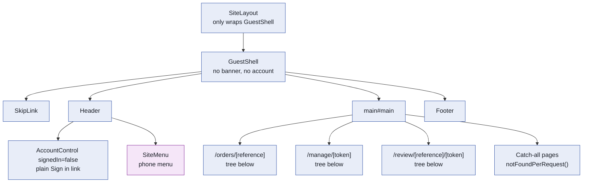
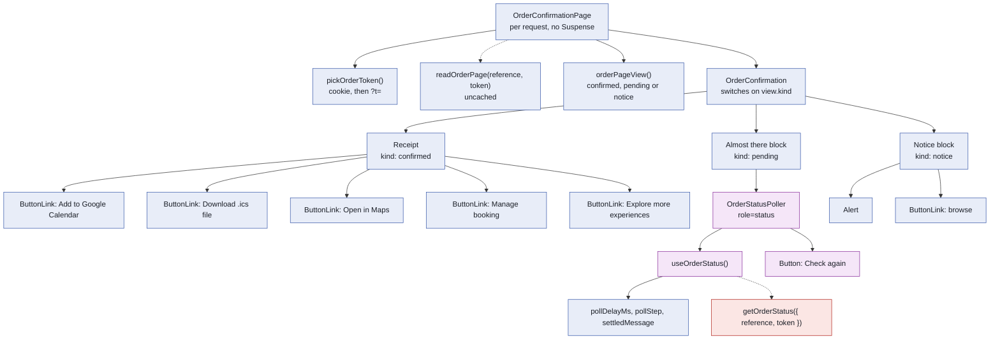
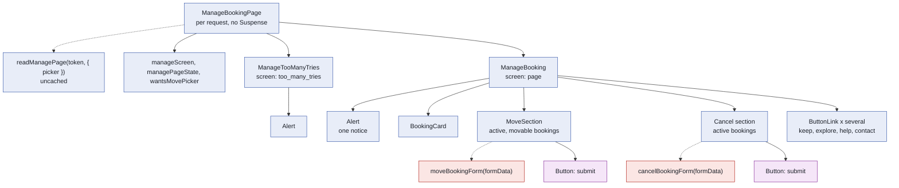
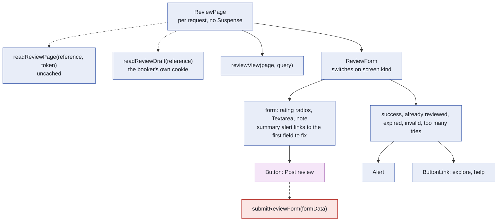

# Order confirmation, manage and review page map

`/orders/[reference]`, `/manage/[token]`, `/review/[reference]/[token]`, and the catch-alls `/orders`, `/manage`, `/review`, `/orders/[...unknown]`, `/manage/[...unknown]`, `/review/[...unknown]`

Read from main at 2db68ea (2026-11-15). A PR that changes this tree (a component, a Suspense or client boundary, a cache tag, an action) updates this file in the same PR.

The gift routes in this folder (`gift/`, `gifts/checkout/`) are parked stubs, mapped in [`../../(guest)/README.md`](<../../(guest)/README.md>). The `(checkout)/layout.tsx` root layout, which draws the document and `RenderPerRequest`, is mapped in [`../checkout/README.md`](../checkout/README.md).

## Legend

server = rendered on the server per request; cached = `'use cache'` read; streamed = inside a Suspense boundary; client = `'use client'` island; action = server action.

Nothing on these pages is a cached read and nothing is streamed. There is no `'use cache'`, `cacheTag`, `cacheLife` or Suspense boundary in any of the three routes. Every page is per request, and every read is behind a secret in the address.

## Render tree

### Shared frame

| Component | Kind | File | Notes |
| --- | --- | --- | --- |
| SiteLayout | server | [layout.tsx](layout.tsx) | Only wraps the page in `GuestShell`. No site notice and no third-party tags (ADR 0007). The checkout page sits outside this layout and draws its own header. |
| GuestShell | server | [GuestShell.tsx](../../../components/GuestShell/GuestShell.tsx) | Passed no `banner` and no `account`, so the header uses the default signed-out control. |
| SkipLink | server | [SkipLink.tsx](../../../components/SkipLink/SkipLink.tsx) | Skip to the main content. |
| Header | server | [Header.tsx](../../../components/Header/Header.tsx) | Logo, main links, gifts and search links. |
| AccountControl signedIn=false | server | [AccountControl.tsx](../../../components/Header/AccountControl.tsx) | A plain "Sign in" link. |
| SiteMenu | client | [SiteMenu.tsx](../../../components/GuestShell/SiteMenu.tsx) | Phone menu, with its own copy of the account control. |
| main#main | server | [GuestShell.tsx](../../../components/GuestShell/GuestShell.tsx) | The route renders inside it. |
| Catch-all pages | server | [orders/page.tsx](orders/page.tsx), [manage/page.tsx](manage/page.tsx), [review/page.tsx](review/page.tsx), [orders/[...unknown]/page.tsx](<orders/[...unknown]/page.tsx>), [manage/[...unknown]/page.tsx](<manage/[...unknown]/page.tsx>), [review/[...unknown]/page.tsx](<review/[...unknown]/page.tsx>) | All six are the same page: `await notFoundPerRequest()`, which awaits `connection()` and then calls `notFound()`. It is read after the request so the not-found page carries the nonce. The status is 200, not 404. |
| Footer | server | [Footer.tsx](../../../components/Footer/Footer.tsx) | Footer links, tagline and copyright. |

Failure frames: [error.tsx](error.tsx) in this folder is a client `ErrorNotice` inside the shell. [`(checkout)/error.tsx`](../error.tsx) is a client `ErrorFrame` around `ErrorNotice`, for errors in the layouts themselves. [`(checkout)/not-found.tsx`](../not-found.tsx) brings its own `GuestShell` with `NotFoundNotice`, because it sits above the `(site)` layout.

### Order confirmation page

| Component | Kind | File | Notes |
| --- | --- | --- | --- |
| OrderConfirmationPage | server | [orders/[reference]/page.tsx](<orders/[reference]/page.tsx>) | Awaits `params`, `searchParams` and `cookies()` together, so the whole page is per request with no Suspense. Generic title, no description, no Open Graph or Twitter card, `referrer: no-referrer`, `nocache`. A missing token, or an order the token does not open, is `notFound()`. |
| pickOrderToken() | server | [orderAccess.ts](../../../lib/orderAccess.ts) | Pure function. The `ramble_order_access` cookie wins and `?t=` is the fallback. Either must have the token shape. |
| readOrderPage(reference, token) | server | [orderConfirmation.ts](../../../server/orderConfirmation.ts) | Uncached. `resolveToken('order', token, reference)` recomputes the HMAC and compares it, then one transaction runs `readBookingEmailOrder`. It returns null for a wrong token, an unknown reference and another order's token alike. |
| orderPageView() | server | [orderReceipt.ts](../../../lib/orderReceipt.ts) | Pure function. Picks `confirmed`, `pending` or `notice` from the order status. For a confirmed order it builds the calendar link, the `.ics` data link, the maps link and the manage link. The manage token comes from `capabilityToken()` in [tokens.ts](../../../server/tokens.ts). |
| OrderConfirmation | server | [OrderConfirmation.tsx](../../../components/OrderConfirmation/OrderConfirmation.tsx) | Switches on `view.kind`. Receives the `getOrderStatus` action as `checkStatus`. |
| Receipt | server | [OrderConfirmation.tsx](../../../components/OrderConfirmation/OrderConfirmation.tsx) | Check badge, heading ("You're booked, Alex"), booking card, receipt lines, seller-of-record line and "what happens next". |
| ButtonLink: Add to Google Calendar | server | [ics.ts](../../../lib/ics.ts) | `googleCalendarUrl()` builds an external calendar.google.com link on the server. |
| ButtonLink: Download .ics file | server | [ics.ts](../../../lib/ics.ts) | `buildIcs()` builds a `data:text/calendar` link with a `download` name, so there is no download route. |
| ButtonLink: Open in Maps | server | [maps.ts](../../../lib/maps.ts) | `mapsHref()` searches the first sentence of the meeting point. It is left out when there is no meeting point or its first sentence is too long to be an address. |
| ButtonLink: Manage booking | server | [routes.ts](../../../lib/routes.ts) | `managePath(manageToken)` goes to `/manage/<token>`. This is the only place the site hands a guest the manage token, besides the email. |
| ButtonLink: Explore more experiences | server | [OrderConfirmation.tsx](../../../components/OrderConfirmation/OrderConfirmation.tsx) | Plain anchor. |
| Almost there block | server | [OrderConfirmation.tsx](../../../components/OrderConfirmation/OrderConfirmation.tsx) | Heading, confirmation reference and experience name. |
| OrderStatusPoller | client | [OrderStatusPoller.tsx](../../../components/OrderStatusPoller/OrderStatusPoller.tsx) | A `role="status"` region. Props are `reference`, the raw order `token`, and the action. Moves focus to the region when "Check again" removes itself. |
| useOrderStatus() | client | [useOrderStatus.ts](../../../components/OrderStatusPoller/useOrderStatus.ts) | A `setTimeout` per attempt. A settled answer sets the message and calls `router.refresh()`, so the server component re-renders with the real state. |
| pollDelayMs, pollStep, settledMessage | server | [orderStatus.ts](../../../lib/orderStatus.ts) | Pure functions. Waits 2, 3, 5, 8, 13, then 20 seconds, at most 12 asks (about three minutes). A pending answer or a dropped request asks again. Anything else is "show". |
| getOrderStatus({ reference, token }) | action | [orders.ts](../../../server/actions/orders.ts) | Zod-checks the input, then `readOrderState` runs `resolveToken` and `readOrderStatus` ([orderStatus.ts](../../../server/db/orderStatus.ts)). Every refusal is `{ state: 'unknown' }`. |
| Button: Check again | client | [Button.tsx](../../../components/Button/Button.tsx) | Appears once the polls give up. Resets the attempt count to 0. |
| Notice block | server | [OrderConfirmation.tsx](../../../components/OrderConfirmation/OrderConfirmation.tsx) | For failed, refunded after lapse, and closed orders. Heading "Booking <reference>". |
| Alert | server | [Alert](../../../components/Alert/) | The notice text. |
| ButtonLink: browse | server | [OrderConfirmation.tsx](../../../components/OrderConfirmation/OrderConfirmation.tsx) | Plain anchor back to browsing. |

### Manage page

| Component | Kind | File | Notes |
| --- | --- | --- | --- |
| ManageBookingPage | server | [manage/[token]/page.tsx](<manage/[token]/page.tsx>) | Awaits `connection()`, then `params` and `searchParams`. Per request, no Suspense. Same private metadata as the order page. Not found is `notFound()`. |
| readManagePage(token, { picker }) | server | [manageBooking.ts](../../../server/manageBooking.ts) | Uncached. `openManageToken` shape-checks the token, spends one try of the `manage` rate limit (`consumeRateLimit`), then `resolveManageToken` finds the order by stored hash. One transaction reads the database clock, `readBookingEmailOrder`, `readCancelFacts` and, with `?move=1`, `readMoveSubject` and `readMoveCandidates`. |
| manageScreen, managePageState, wantsMovePicker | server | [manageBooking.ts](../../../lib/manageBooking.ts) | Pure functions. Reduce the read to `page`, `too_many_tries` or `not_found`, and reduce the query (`confirm`, `move`, `result`, `moved`) to one notice and two step flags. An answer is shown only for a booking it could be about. |
| ManageTooManyTries | server | [ManageBooking.tsx](../../../components/ManageBooking/ManageBooking.tsx) | The same page for every visitor, with no booking on it, and a retry wait. |
| Alert (too many tries) | server | [Alert](../../../components/Alert/) | The rate-limit message. |
| ManageBooking | server | [ManageBooking.tsx](../../../components/ManageBooking/ManageBooking.tsx) | No `'use client'`. Works with scripting off: the steps are links with `?confirm=1` and `?move=1`, and the two forms post to server actions. |
| Alert (one notice) | server | [Alert](../../../components/Alert/) | A cancel or move answer, or the standing "already cancelled" or "can't be cancelled" line. |
| BookingCard | server | [ManageBooking.tsx](../../../components/ManageBooking/ManageBooking.tsx) | Name, date line, reference with host, meeting line, price lines, total, gift and card amounts. |
| MoveSection | server | [ManageBooking.tsx](../../../components/ManageBooking/ManageBooking.tsx) | Active and movable bookings only. A link to `?move=1`. With the picker open, a radio form of other dates of the same experience. |
| moveBookingForm(formData) | action | [orders.ts](../../../server/actions/orders.ts) | Reads `manageToken` and `targetSessionId`, runs `moveBooking` (parse, `openManageToken`, `moveBookingOrder` in [orderMove.ts](../../../server/db/orderMove.ts)), then `redirect`s to `?moved=<code>`. |
| Button: submit (move) | client | [Button.tsx](../../../components/Button/Button.tsx) | Submit button of the move form. |
| Cancel section | server | [ManageBooking.tsx](../../../components/ManageBooking/ManageBooking.tsx) | Active bookings only. Step one shows the refund and a link to `?confirm=1`. Step two is a form that says the refund again. |
| cancelBookingForm(formData) | action | [orders.ts](../../../server/actions/orders.ts) | Reads `manageToken` and the shown `expectedRefundMinor`, runs `cancelBooking` (parse, `openManageToken`, `cancelBookingOrder` in [orderCancel.ts](../../../server/db/orderCancel.ts)), then `redirect`s to `?result=<status>`. |
| Button: submit (cancel) | client | [Button.tsx](../../../components/Button/Button.tsx) | Submit button of the cancel form. |
| ButtonLink x several | server | [ManageBooking.tsx](../../../components/ManageBooking/ManageBooking.tsx) | "Keep my booking", "Explore more" (cancelled only), and the help and contact links. Plain anchors, no script. |

### Review page

| Component | Kind | File | Notes |
| --- | --- | --- | --- |
| ReviewPage | server | [review/[reference]/[token]/page.tsx](<review/[reference]/[token]/page.tsx>) | Awaits `connection()`, then `params` and `searchParams`. Per request, no Suspense. Private metadata like the manage page, except `referrer: origin`: `no-referrer` makes a browser send `Origin: null` on the form post, which a Server Action refuses, so the form would fail with scripting off. Reads the draft cookie beside the page. Every state, an invalid link included, is a 200 page with its own notice; only a form post with no usable link is `notFound()`. |
| readReviewPage(reference, token) | server | [reviewForm.ts](../../../server/reviewForm.ts) | Uncached. `openReviewGate` shape-checks the link, spends one try of the `manage` rate limit (the same count the manage links use, per token), then `resolveToken('review', ...)` finds the order by its reference and compares the HMAC. A link of the wrong shape ends there: it spends no try and reaches no database. Otherwise one transaction reads the order with its review state ([db/reviews.ts](../../../server/db/reviews.ts)) and the database clock, and the page gets both in the `found` read. |
| readReviewDraft(reference) | server | [reviewDraft.ts](../../../server/reviewDraft.ts) | What the booker had typed when a submit did not go through, from their own short-lived cookie (`ramble_review_draft`, http only, scoped to `/review`), for this order only. Never in an address, never stored on the server. |
| reviewView(page, query) | server | [reviews.ts](../../../lib/reviews.ts) | Pure function: `reviewScreen` plus the session summary, which an invalid screen drops. `reviewEligibility` decides: a confirmed booking, not refunded, whose session ended, with no review, inside 90 days, is the `form`; a review that exists is `already_reviewed` (or `success` when the address says `?done=1`); a closed window is `expired`; a cancelled or refunded booking, a gift purchase, a session not over, and a link that opens nothing are all the same `invalid`. |
| ReviewForm | server | [ReviewForm.tsx](../../../components/ReviewForm/ReviewForm.tsx) | No `'use client'`. Works with scripting off: native required radios and a native textarea, posting to the action. The session is named only when the link opened an order. After a failed submit the form comes back with the rating and the words from the draft, a summary alert that links to the first field to fix, the rating group described by its own error, and `aria-invalid` on its first radio only. The rating tiles are three to a row on a phone and five from 480px. |
| submitReviewForm(formData) | action | [reviews.ts](../../../server/actions/reviews.ts) | `parseReviewForm`, then `submitReview` (the same gate, then `insertReview`), then `redirect`s to the same page, with `?done=1` only for a review just written and `?problem=rating,body` for a bad field. A bad field or a wait keeps what was typed in the draft cookie; a review made ends it. A review is written under the order's row lock, so a cancel and a submit cannot both win. After the commit, a review made clears tag `experience:<id>` (`updateTagsForChanges`), which refreshes the experience page's reviews block and the rating on every cached card that lists the experience. |
| Button: Post review | client | [Button.tsx](../../../components/Button/Button.tsx) | Submit button of the form. |
| Alert, ButtonLink | server | [Alert](../../../components/Alert/) | The state notices, with links to browsing and help. |

## How a review link is made

1. The review-invite job runs for a confirmed, non-refunded booking about three hours after its session ends (the pulse queues one job per order; the test console can queue one at once). It reads the order, rebuilds `capabilityToken('review', orderId, manageTokenVersion)`, and emails the order's contact address a link to `/review/<reference>/<token>`.
2. The token is of its own kind, so a manage token for the same order does not open the form, and a bump of the order's token version voids the manage link, the confirmation URL, and the review link together. No hash is stored.
3. The email is queued once per order (job dedupe key `review-invite:<orderId>`), and a gift is no special case: the redemption is the recipient's own booking, so the invite goes to the recipient.

## What arrives when

1. One response per page. No page has a Suspense boundary, so the shell and the body arrive together after the order read. The only thing that streams separately is `RenderPerRequest` from the `(checkout)` layout, which renders nothing.
2. Hydration. A confirmed receipt hydrates only `SiteMenu`. A pending order hydrates `SiteMenu` and `OrderStatusPoller`. The manage page hydrates `SiteMenu` and the `Button` module, which ships because `ManageBooking` imports it.
3. Pending to settled. The poller asks `getOrderStatus` on its timer. When the state is anything but pending, it shows one announcement and calls `router.refresh()`. The server component runs again, re-checks the token, and swaps the poller for the receipt or notice.

## How the token is handed over

1. Checkout sends the paying device to `/orders/<ref>?t=<order token>` (`orderConfirmationPath` in [routes.ts](../../../lib/routes.ts)).
2. [proxy.ts](../../../proxy.ts) sees the token on that path, sets the `ramble_order_access` cookie (HttpOnly, `SameSite=Lax`, path scoped to that order, two hours), and answers with a 303 to the same address with no query.
3. The page reads the cookie first and checks the token against the order anyway, so the cookie has no more power than the link.
4. The receipt then offers the manage token, and the confirmation email carries it too. `/manage/<token>` has no cookie: the token stays in the address.

## Guest cancel and move through the actions

1. The guest opens `/manage/<token>`. `readManagePage` spends a try, finds the booking and builds the refund from the same quote the action checks.
2. Cancel: the cancel button, labelled with the refund, links to `?confirm=1`. The form posts `cancelBookingForm` with the token and `expectedRefundMinor`. If the refund has changed since the page was drawn, nothing is cancelled and the page says "The refund has changed".
3. Move: the move link (`prompt.linkLabel`) goes to `?move=1`, which makes the read include other dates. The form posts `moveBookingForm` with `targetSessionId`. The price stays the same.
4. Both forms `redirect()` back to the same page with a short code in the query (`?result=` or `?moved=`). The page turns the code into the notice, and a stale or odd value shows nothing.
5. Every refusal (bad shape, unknown, stale version) is `not_found`. Over the limit is `rate_limited` with a wait time.

## How its caches are cleared

These pages hold nothing in the cache and nothing is cleared for them. The next view always reads the database, and all three routes send `Cache-Control: no-store` through `tokenRouteHeaders` in the proxy. The actions do reach out the other way.

| Change | What clears | When the guest sees it |
| --- | --- | --- |
| Cancel goes through | `revalidateTagsForChanges` with a `spaces` change for the session, which clears that date's `session` tag ([orderCancel.ts](../../../server/db/orderCancel.ts)) | The experience page's sold-out and spaces-left reads rebuild. The next view may still show the old spaces count once while it rebuilds. |
| Move goes through | The same call for each affected session, old and new ([orderMove.ts](../../../server/db/orderMove.ts)) | Same as above. |
| A review is written | `updateTagsForChanges` with an `experience` change, which clears that experience's `experience` tag ([reviewForm.ts](../../../server/reviewForm.ts)) | The experience page and every browse and home card that lists it show the review at once. The review page itself reads the database, so it says "already reviewed" at once. |
| Refused or unchanged result | Nothing | No change. |
| Any view of these pages | Nothing, and nothing is stored | The next view reads the database. |

These calls use `revalidateTag(tag, 'max')` ([invalidate.ts](../../../server/cache/invalidate.ts)), not `updateTag`, which is why the old count can show once.

## Worth knowing

- The header here never knows who is signed in. `GuestShell` gets no `account` slot in `(site)/layout.tsx`, so a signed-in guest sees "Sign in" on both pages. The experience page streams `HeaderAccount`; these pages do not.
- There is no `src/app/layout.tsx`. The `(checkout)` layout draws the document itself, so the html, fonts and CSS for these pages come from there, not from a root layout.
- The order token crosses into the browser for a pending order. The cookie is HttpOnly, but `OrderStatusPoller` receives the raw token as a prop so it can pass it to the action. It is only sent for the pending state.
- The page and the poller never share a verdict. The poller only decides "keep asking" or "re-render". The page re-checks the token and rebuilds the view, so a status can never show on the poller that the server would not show.
- Each manage view costs one try. The page and both actions share the `manage` limit, so refreshing the page counts, and a guest who reloads a lot hits the too-many-tries screen with no booking on it.
- A shared version voids both links. The `order` and `manage` tokens are derived from the same row and `manage_token_version`, so one bump kills the confirmation URL and the manage link together.
- Catch-alls return 200. `notFoundPerRequest` cannot change the status of a render resumed from the empty shell, so `/orders` and `/manage` are 200 pages that show the not-found notice. A wrong token on the real routes goes through the same path.
- `Button` is a client module and `ButtonLink` is not. `ManageBooking` and `OrderConfirmation` are server components, but the submit and "Check again" buttons are client code. The receipt's four action links ship no JS.
- The calendar file is not a route. It is a data URI built at render time, so the whole event sits inside the page's HTML.

Rules for these pages come from `src/lib/orderAccess.ts`, `src/proxy.ts` and design doc section 4.2 in `ramble-pm/plan/01-design-doc.md`.

Rendered view: https://defaultdave.github.io/ramble-pm/maps/orders-and-manage.html
