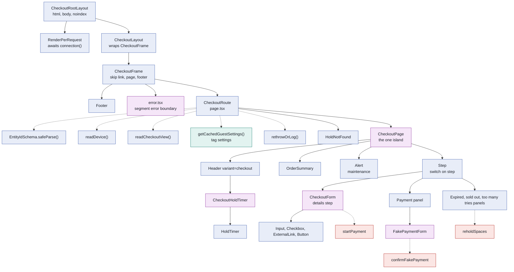
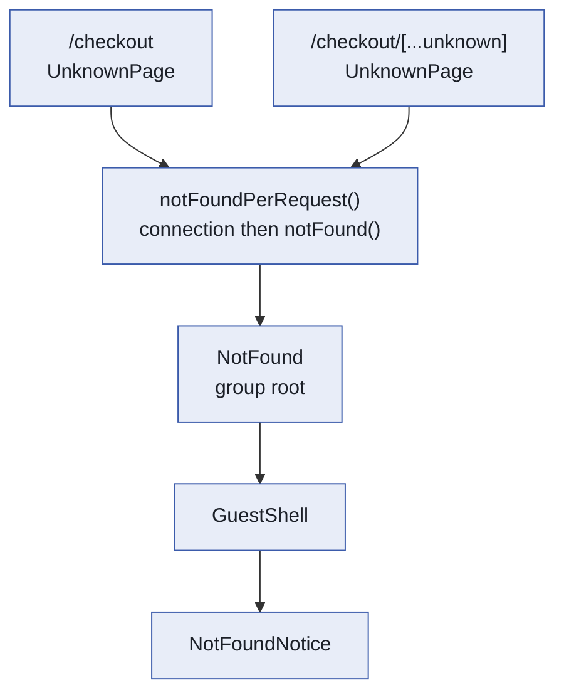
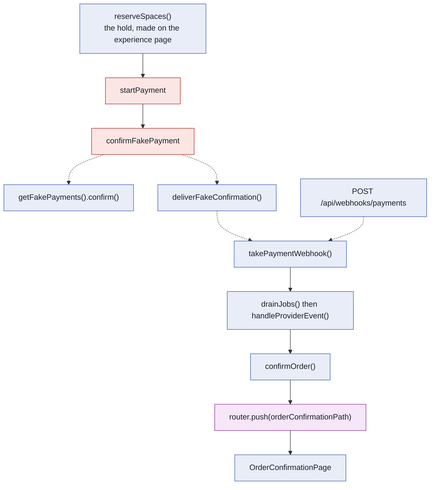

# Checkout page map

Routes: `/checkout/[holdId]`, `/checkout`, `/checkout/[...unknown]`

Read from main at 2db68ea (2026-11-15). A PR that changes this tree (a component, a Suspense or client boundary, a cache tag, an action) updates this file in the same PR.

## Legend

server = rendered on the server per request; cached = `'use cache'` read; streamed = inside a Suspense boundary; client = `'use client'` island; action = server action.

Nothing on this page is streamed: the route has no Suspense boundary, so the whole page is one request-time render. Plain functions in `src/lib` and `src/server` are drawn as server nodes and say so in their notes.

## Render tree

The checkout page, from the root layout of the `(checkout)` group down to the panels.

| Component | Kind | File | Notes |
| --- | --- | --- | --- |
| CheckoutRootLayout | server | [layout.tsx](<../layout.tsx>) | The root layout for this group: there is no `src/app/layout.tsx`. It owns `html` and `body`, fonts and base styles, `robots: noindex`, and `instant = false`. |
| RenderPerRequest | server | [renderPerRequest.tsx](<../../renderPerRequest.tsx>) | Sits beside the children and awaits `connection()`, so the whole tree renders per request and every script carries the CSP nonce. It renders nothing. |
| CheckoutLayout | server | [layout.tsx](<layout.tsx>) | Wraps children in `CheckoutFrame`. It sits above `error.tsx`, so the frame is server-rendered. |
| CheckoutFrame | server | [CheckoutFrame.tsx](<../../../components/CheckoutPage/CheckoutFrame.tsx>) | A skip link, the page, and the footer. The page renders its own header because the header carries the hold timer. |
| Footer | server | [Footer.tsx](<../../../components/Footer/Footer.tsx>) | Link groups, tagline and copyright from `src/lib/pages/siteNav`. |
| error.tsx (CheckoutError) | client | [error.tsx](<error.tsx>) | The `'use client'` error boundary for this segment. It sits below the layout, so the frame stays. It shows the checkout header with no timer and `ErrorNotice` with a retry. It is not part of the happy render. |
| CheckoutRoute | server | [page.tsx](<[holdId]/page.tsx>) | Not cached and not streamed. It reads params, the device cookie, the hold view and the settings, then renders. Every refusal is rendered as `HoldNotFound` or an error panel, never thrown. |
| HoldNotFound | server | [page.tsx](<[holdId]/page.tsx>) | A `Header variant="checkout"` and `NotFoundNotice`, rendered rather than thrown, so the first flush has a heading and a stylesheet. |
| EntityIdSchema.safeParse() | server | [catalog](<../../../lib/catalog.ts>) | A plain function. A malformed id is no hold, and no query is made. |
| readDevice() | server | [device.ts](<../../../server/device.ts>) | A plain function. It reads the cookie and never sets one. No device means no hold. |
| readCheckoutView(device, holdId) | server | [checkoutView.ts](<../../../server/db/checkoutView.ts>) | Uncached. One transaction reads the hold, session, experience, host, price lines and the database clock. It returns null for another device's hold, or one that is missing, a gift, paid or released, so a guessed id learns nothing. It then reads current terms and the waiver and builds the view with `buildCheckoutView()`. |
| getCachedGuestSettings() | cached | [siteSettings.ts](<../../../server/siteSettings.ts>) | Tag `settings`, cache profile `settings` (stale 60 s, revalidate 5 minutes, expire 1 hour). It runs in parallel with the hold read. Only the `checkoutMaintenance` switch is used here. |
| rethrowOrLog() | server | [rethrowOrLog.ts](<../../../server/monitoring/rethrowOrLog.ts>) | A plain function. A failed read renders "We couldn't load checkout" with a retry link, and the hold stays. |
| CheckoutPage | client | [CheckoutPage.tsx](<../../../components/CheckoutPage/CheckoutPage.tsx>) | The page's one client island. It holds the step reducer, the summary toggle and focus. It takes `view`, `maintenance`, `focusTitle` and three server actions as props. It pushes to the next route on `already_confirmed`, on `held`, or on a paid payment. |
| Header variant="checkout" | server | [Header.tsx](<../../../components/Header/Header.tsx>) | No `'use client'` of its own, but it ships as client code because the island imports it. It takes the timer as a `holdTimer` slot, hidden only on the `sold_out` step. |
| CheckoutHoldTimer | client | [CheckoutHoldTimer.tsx](<../../../components/CheckoutPage/CheckoutHoldTimer.tsx>) | Has its own one-second tick (`useHoldCountdown`), so only the timer re-renders. It starts from `serverNow`, then keeps an offset from the browser clock. It calls `onEnd` once, which dispatches `timer_ended`. |
| HoldTimer | server | [HoldTimer.tsx](<../../../components/HoldTimer/HoldTimer.tsx>) | The display inside the timer island. It ships as client code. |
| OrderSummary | server | [OrderSummary.tsx](<../../../components/OrderSummary/OrderSummary.tsx>) | Experience, date, guests, line items, tax, total and the cancellation line. Collapsed on a phone, open from tablet width. It ships as client code. |
| Alert (maintenance) | server | [Alert.tsx](<../../../components/Alert/Alert.tsx>) | Replaces the whole flow when `checkoutMaintenance` is on. No payment is taken. |
| Step (switch on step) | server | [CheckoutPage.tsx](<../../../components/CheckoutPage/CheckoutPage.tsx>) | A switch in the same file, not exported. One panel shows at a time: `details` (the form), `payment`, `expired`, `sold_out`, `too_many_tries`. A panel that replaces the form takes focus. |
| CheckoutForm | client | [CheckoutForm.tsx](<../../../components/CheckoutPage/CheckoutForm.tsx>) | The details form: names, email, age and waiver answers, terms. It checks the fields with `formIssues()` before anything is sent. It has no `'use client'` of its own and ships as client code inside the island. Shown while the step is `details`. |
| Input, Checkbox, ExternalLink, Button | server | [components](<../../../components>) | Plain components. They ship as client code because the island imports them. |
| Payment panel | server | [CheckoutPage.tsx](<../../../components/CheckoutPage/CheckoutPage.tsx>) | Holds `FakePaymentForm`, plus a "Check again" link to the confirmation page when the answer was lost. |
| FakePaymentForm | client | [FakePaymentForm.tsx](<../../../components/FakePaymentForm/FakePaymentForm.tsx>) | A demo card form with its own reducer (`flowReducer`). It calls `confirm` with the payment id, the client secret and a plan (card, wallet or 3-D Secure). It is the only place a payment is confirmed. |
| Expired, sold out, too many tries panels | server | [CheckoutPage.tsx](<../../../components/CheckoutPage/CheckoutPage.tsx>) | Expired offers "Hold my spaces again" (calls `reserve`) or a link back to the experience. Sold out lists alternative dates as links. |
| startPayment | action | [checkout.ts](<../../../server/actions/checkout.ts>) | Turns the hold into an order plus an attempt, and a payment with a client secret. It reads the maintenance switch uncached first. See the payment path below. |
| confirmFakePayment | action | [fakePayment.ts](<../../../server/actions/fakePayment.ts>) | The `confirm` action. It retrieves the payment, compares the client secret in constant time, then calls `deliverFakeConfirmation()`. An unknown payment or a wrong secret answers `refused`; anything else throws. |
| reholdSpaces | action | [rehold.ts](<../../../server/actions/rehold.ts>) | The `reserve` action. Same device, lapsed hold only. It releases the old hold and reserves the same spaces again, returns `held`, and the page routes to `/checkout/<newId>?rehold=1`. It calls `claimLapsedHold()`, `reserveSpaces()` and `consumeRateLimit('reserve')`. There is no bot check here (ADR 0007), but the reserve try limit still counts. |

## Other addresses in the group

| Component | Kind | File | Notes |
| --- | --- | --- | --- |
| /checkout and /checkout/[...unknown] | server | [page.tsx](<page.tsx>), [page.tsx](<[...unknown]/page.tsx>) | Both are `UnknownPage`: `await notFoundPerRequest()`. |
| notFoundPerRequest() | server | [renderPerRequest.tsx](<../../renderPerRequest.tsx>) | Awaits `connection()` and then calls `notFound()`. |
| NotFound | server | [not-found.tsx](<../not-found.tsx>) | At the group root, above the checkout frame, so it brings its own `GuestShell` and `NotFoundNotice`. The status ends up 200, not 404, because the render resumes from an empty shell. |
| GuestShell | server | [GuestShell](<../../../components/GuestShell>) | The header and footer chrome for a guest page. |
| NotFoundNotice | server | [NotFoundNotice](<../../../components/NotFoundNotice.tsx>) | The not-found message. |

## The payment path

In order, from the hold to the confirmation page. The order page itself is mapped in [the site README](<../(site)/README.md>).

| Component | Kind | File | Notes |
| --- | --- | --- | --- |
| reserveSpaces() | server | [holds.ts](<../../../server/db/holds.ts>) | The hold. It is made earlier by the `reserveSpaces` action on the experience page, writes `holds` and `holdItems` for the device, and takes the seats. Its id is the address of this page. |
| startPayment | action | [checkout.ts](<../../../server/actions/checkout.ts>) | The hold becomes an order plus an attempt, and a payment with a client secret. |
| confirmFakePayment | action | [fakePayment.ts](<../../../server/actions/fakePayment.ts>) | The guest's card step reaches the fake gateway. |
| getFakePayments().confirm() | server | [gateway.ts](<../../../server/ports/payments/gateway.ts>), [fake.ts](<../../../server/ports/payments/fake.ts>) | A plain function. It records the outcome and returns the event it emitted (`payment.succeeded`, a decline, or a 3-D Secure step). A retry of a success recalls the stored event through `lastEventFor()`. The fake payments live in the database, so any instance finds them. |
| deliverFakeConfirmation() | server | [fakePaymentDelivery.ts](<../../../server/fakePaymentDelivery.ts>) | A plain function. It signs the event with `signWebhook()` and builds a `Request` to `http://localhost/api/webhooks/payments` that is never sent over the network. The request goes straight to `takePaymentWebhook()`, and then the queued job is drained. |
| takePaymentWebhook() | server | [paymentWebhook.ts](<../../../server/paymentWebhook.ts>) | The same intake the real route uses: a size cap, `verifyWebhook()` on the raw body, rate limits (`payment_webhook_failed` by address, `payment_webhook` overall), then `recordProviderEvent()`, which stores the event once with its job `process-provider-event`. |
| POST /api/webhooks/payments | server | [route.ts](<../../api/webhooks/payments/route.ts>) | The real door, one line: `paymentWebhookResponse(request)`. The fake path does not call it. A real provider would. |
| drainJobs() then handleProviderEvent() | server | [drain.ts](<../../../server/jobs/drain.ts>), [providerEvents.ts](<../../../server/jobs/providerEvents.ts>) | A plain function. It runs the queued job at once, inside `after()`, and the reply waits up to `fakeDrainWaitMs` for it. `prepareProviderEvent()` looks up Ramble ids first if the event carried none. |
| confirmOrder() | server | [confirmOrder.ts](<../../../server/db/confirmOrder.ts>) | A plain function. It runs inside the job's transaction, under the session, hold and order locks. It decides with `confirmDecision()`: confirm the booking, report `already_confirmed`, or take the refund path (seats sold after a lapse). On confirm it calls `revalidateTagsForChanges()` for the session's spaces. |
| router.push(orderConfirmationPath(reference, token)) | client | [CheckoutPage.tsx](<../../../components/CheckoutPage/CheckoutPage.tsx>), [routes.ts](<../../../lib/routes.ts>) | `onPaid` runs when `FakePaymentForm` gets `succeeded`. The token travels as `?t=`. |
| OrderConfirmationPage | server | [page.tsx](<../(site)/orders/[reference]/page.tsx>) | Picks the token from the cookie or `?t=` (`src/proxy.ts` moves it into a cookie and redirects without it), calls `readOrderPage(reference, token)`, and calls `notFound()` on any refusal. It passes `getOrderStatus` to `OrderConfirmation` as the poller for an order not yet confirmed. |

## What arrives when

1. **One render, per request.** The root layout, frame, header, summary, form and footer arrive together. The route reads the hold and the settings in parallel, so the page waits on the slower of the two. There is no skeleton.
2. **Hydration.** `CheckoutPage` wakes up as one island, with `Header`, `OrderSummary`, `CheckoutForm` and the panels inside it. `CheckoutHoldTimer` starts ticking from the server's clock.
3. **Later, on a tap.** `startPayment`, then `confirmFakePayment`. Nothing is called on load or refresh, so reloading spends none of the hold's five tries.

## Key user path through the actions

1. The guest lands from the experience page's `reserveSpaces`, with the hold id in the address.
2. Tap Continue: `startPayment`. An answer of `requires_payment` moves the step to `payment`; `already_confirmed` routes straight to the order page; `held` goes to a fresh checkout.
3. Tap Pay: `confirmFakePayment`. `succeeded` calls `onPaid`, and the router goes to the order page.
4. The timer ends: the step becomes `expired`, and `reholdSpaces` offers the same spaces again.

## Cache invalidation

| Change | What clears | When the guest sees it |
| --- | --- | --- |
| An ops user saves settings | Tag `settings`, through `updateTagsForChanges()` in the settings save | The next request. This is the only cached read on this page. |
| A payment is confirmed | `revalidateTagsForChanges()` from `confirmOrder()` in the job, for the session's `spaces` change, which clears the `session:<id>` tag | Stale while revalidating (`revalidateTag(tag, 'max')`), so one response after the call may still show the old space count on the experience page. |
| A hold is released, or a lapsed hold is held again | `updateTagsForChanges()` from the action in `holds.ts`, for the session's `spaces` change | The next request, so the experience page rebuilds its space counts. |

The hold view is never cached.

## Worth knowing

- **There is no root `src/app/layout.tsx`.** `(checkout)/layout.tsx` is the root layout and draws `html` and `body`. The `(site)` layout that serves orders, manage and gift does not wrap checkout.
- **The page is one big island.** `Header`, `OrderSummary`, `Alert`, `CheckoutForm`, `Input` and the rest have no `'use client'` but all ship as client code, because `CheckoutPage` imports them. The server page passes three server actions in as props, so the island never imports them. Only `CheckoutPage`, `CheckoutHoldTimer` and `FakePaymentForm` carry the directive.
- **The fake webhook is never an HTTP call.** `deliverFakeConfirmation()` signs an event and calls `takePaymentWebhook()` directly in the same process. The route `/api/webhooks/payments` exists for a real provider (see the `TODO(U-046)` in `fakePaymentDelivery.ts`), and the fake's secret is random per process, so a delivery nobody in this process signed is refused.
- **Paying and confirming the order are two separate steps.** The webhook only stores the event and a job. `confirmOrder()` runs in the job, which the action drains in `after()` and waits for only a few seconds. If the drain is slow, the guest lands on the order page before the order is confirmed, which is why that page polls `getOrderStatus`.
- **The hold timer and the page's step share one reducer.** `onEnd` from `CheckoutHoldTimer` dispatches into `CheckoutPage`'s state, and `showsHoldTimer(step)` hides the timer in the header only on the `sold_out` step, so it stays visible beside the expired panel.
- **Unknown checkout addresses answer 200, not 404.** `/checkout` and the catch-all call `notFoundPerRequest()`; the comment in `renderPerRequest.tsx` says the status cannot change once the render resumes from the empty shell. A bad hold id on the real route is also a rendered "not found" panel, not a thrown one.
- **The maintenance switch is read twice by two different functions.** The page reads it through the cached `getCachedGuestSettings()`, while `startCheckoutPayment()` reads it through the uncached `getGuestSettings()`, so the action stays correct when the cached page is stale. A failed read fails closed.
- **No bot check on checkout.** ADR 0007 keeps BotID off it; the limits are the device's `reserve` tries and the hold's `payment_tries`.

Rendered view: https://defaultdave.github.io/ramble-pm/maps/checkout.html
