# Guest area page map

Routes covered: `/`, `/help`, `/help/[slug]`, `/legal/[doc]`, `/contact`, `/accessibility`, `/picks/[slug]`, `/guide/[slugAndId]`, `/hosts/[slug]`, `/experiences/[slugAndId]/private-session`, `/gifts`, `/gift/[token]`, `/gifts/checkout/[experienceId]`, and the not-found and error pages.

Read from main at 2db68ea (2026-11-15). A PR that changes this tree (a component, a Suspense or client boundary, a cache tag, an action) updates this file in the same PR.

## Legend

server = rendered on the server per request; cached = `'use cache'` read; streamed = inside a Suspense boundary; client = `'use client'` island; action = server action.

## Other guest trees

- [`new-york/README.md`](new-york/README.md): browse and landing pages.
- [`experiences/[slugAndId]/README.md`](experiences/[slugAndId]/README.md): the experience page.
- [`sign-in/README.md`](sign-in/README.md): sign-in and account.
- [`../(checkout)/checkout/README.md`](../(checkout)/checkout/README.md): checkout.
- [`../(checkout)/(site)/README.md`](../(checkout)/(site)/README.md): orders, manage and the gift stubs under the checkout group.

## Render tree

### Guest layout (shown once)

Every page below renders inside this layout, except the gift routes under `(checkout)`, which have their own (see Gifting). There is no `src/app/layout.tsx`: each route group (guest, checkout, host, ops) owns its own `<html>` and `<body>`. The page goes in `children`, inside `<main id="main">`. The boundaries for it are `(guest)/error.tsx` and `(guest)/not-found.tsx`.

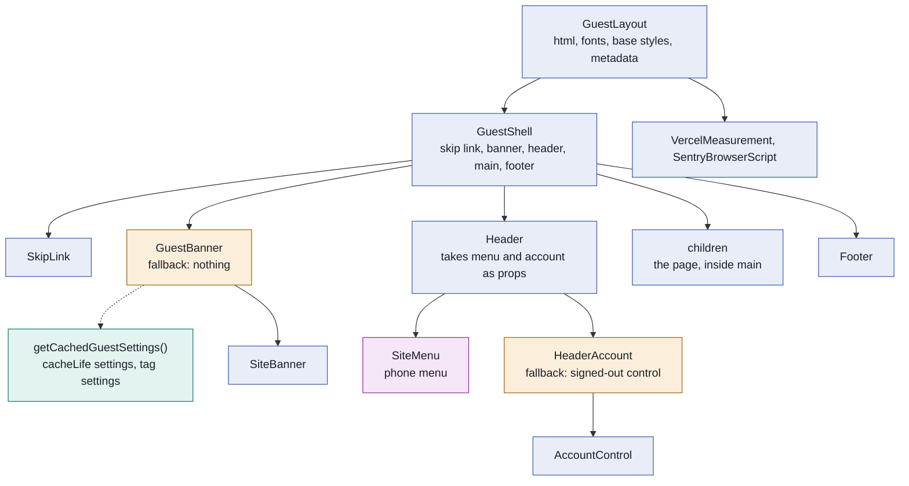

| Component | Kind | File | Notes |
| --- | --- | --- | --- |
| GuestLayout | server | [`layout.tsx`](layout.tsx) | Owns html and body, fonts, base styles and metadata. |
| GuestShell | server | [`GuestShell.tsx`](../../components/GuestShell/GuestShell.tsx) | Skip link, banner, Header, main, Footer. The page goes in main. |
| SkipLink | server | [`SkipLink`](../../components/SkipLink) | Its links come from `mainLinks` and `footerGroups` in `src/lib/pages/siteNav.ts`, as do the Header and Footer links. |
| GuestBanner | streamed | [`GuestBanner.tsx`](GuestBanner.tsx) | Calls `connection()`, so it renders per request. The fallback is nothing. A failed read leaves the banner out. |
| getCachedGuestSettings() | cached | [`siteSettings.ts`](../../server/siteSettings.ts) | `cacheLife` `settings`, tag `settings`. |
| SiteBanner | server | [`SiteBanner.tsx`](../../components/GuestShell/SiteBanner.tsx) | Draws the banner text. |
| Header | server | [`Header.tsx`](../../components/Header/Header.tsx) | Logo, main nav, search link, gifts link. Takes the menu and the account control as props. |
| SiteMenu | client | [`SiteMenu.tsx`](../../components/GuestShell/SiteMenu.tsx) | The phone menu. It also receives the account control, so the control appears in the page twice. |
| HeaderAccount | streamed | [`HeaderAccount.tsx`](HeaderAccount.tsx) | Reads the session from request headers, once per request through React `cache()`. The fallback is `AccountControl` with `signedIn={false}`. |
| AccountControl | server | [`AccountControl.tsx`](../../components/Header/AccountControl.tsx) | Sign-in link or account link. |
| children | server | [`page.tsx`](page.tsx) | Every page in this map renders here. |
| Footer | server | [`Footer`](../../components/Footer) | Footer links. |
| VercelMeasurement, SentryBrowserScript | server | [`analytics`](../../server/analytics), [`monitoring`](../../server/monitoring) | Emit the analytics and error-tracking scripts. |

### Home page (`/`)

How the home page is assembled and how the search form reaches the browse page. The page has no server actions and no page-specific client islands. `HomePage` is only a Suspense boundary: its fallback is `HomeSkeleton` and everything else is `HomeContent`.

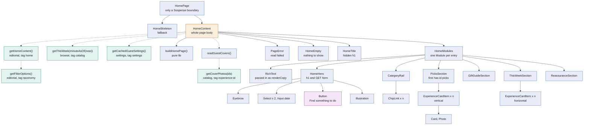

| Component | Kind | File | Notes |
| --- | --- | --- | --- |
| HomePage | server | [`page.tsx`](page.tsx) | Only a Suspense boundary. The fallback is `HomeSkeleton`, which holds the hero, category row and first Picks row in place, with a hidden h1. |
| HomeSkeleton | server | [`HomeSkeleton.tsx`](../../components/HomeStates/HomeSkeleton.tsx) | Uses `Skeleton kind="card"` three times. |
| HomeContent | streamed | [`HomeContent.tsx`](HomeContent.tsx) | The whole page body. Awaits `connection()` first, because the day and the week come from the clock. Reads in parallel, builds the view, then reads the Picks covers. |
| getHomeContent() | cached | [`home.ts`](../../server/home.ts) | `cacheLife` `editorial`, tag `home`, plus `experience:<id>` for each Pick card. Returns modules, Picks, gift guide, categories, neighborhoods and the Pick cards without covers (`covers: false`). Reads `listHomeModules`, `listHomePicks`, `getHomeGiftGuide` and `listHomeExperiences`. |
| getFilterOptions() | cached | [`filterOptions.ts`](../../server/filterOptions.ts) | `cacheLife` `editorial`, tag `taxonomy`. Category and neighborhood names, nested inside the home entry. |
| getThisWeek(minuteAsOf(now)) | cached | [`home.ts`](../../server/home.ts) | `cacheLife` `browse`, tag `catalog`, plus `experience:<id>` for each card. Experiences with an open session in the next 7 days, with their covers (`covers: true`). Keyed by the minute. |
| getCachedGuestSettings() | cached | [`siteSettings.ts`](../../server/siteSettings.ts) | `cacheLife` `settings`, tag `settings`. Only `giftsEnabled` is used here. It is the same entry the banner reads. |
| buildHomePage() | server | [`home.ts`](../../lib/pages/home.ts) | Pure function. Drops a module with nothing to show, marks the first Picks module with the picks anchor, and decides whether the page needs its own h1. The file also holds `homeCardIds` and `withHomeCovers`. |
| readGuestCovers() | server | [`guestCovers.ts`](../../server/guestCovers.ts) | Reads the cover photos of the Picks cards. A failure is logged and the cards render with no image. |
| getCoverPhotos(ids) | cached | [`coverPhotos.ts`](../../server/coverPhotos.ts) | `cacheLife` `catalog`, tag `experience:<id>` for each id. |
| PageError | server | [`PageError.tsx`](../../components/PageError/PageError.tsx) | Shown when a read fails: "We couldn't load the home page", with a retry link to `/`. Next.js's own prerender-end errors are rethrown, not shown. |
| HomeEmpty | server | [`HomeEmpty.tsx`](../../components/HomeStates/HomeEmpty.tsx) | Shown when no module has anything to show. A heading, a line of copy and a link to browse. Uses `PageHeading`. |
| HomeTitle | server | [`HomeTitle.tsx`](../../components/HomeStates/HomeTitle.tsx) | A hidden h1, used when there are modules but no hero. The hero normally carries the page's h1. |
| HomeModules | server | [`HomeModules.tsx`](../../components/HomeModules/HomeModules.tsx) | One `Module` switch per entry, in the order staff arranged them. It takes today and a `renderCopy` function, so it never imports the rich-text renderer. |
| RichText | server | [`RichText`](../../components/RichText) | Marked `server-only`. Passed in as `renderCopy`. Draws the hero body and the gift guide body. |
| HomeHero | server | [`HomeHero.tsx`](../../components/HomeModules/HomeHero.tsx) | The page's h1 and a plain GET form to `/new-york/browse`. Works with no script. |
| Eyebrow | server | [`HomeModules`](../../components/HomeModules) | Shared by the hero, Picks and gift guide. |
| Select x 2, Input date | server | [`Select`](../../components/Select), [`Input`](../../components/Input) | Neighborhood, guests, and the day (starts as today, in New York time). |
| Button | client | [`Button.tsx`](../../components/Button/Button.tsx) | The submit button, "Find something to do". The file is `'use client'`, so a button that only submits a form still ships as client code. |
| Illustration | server | [`Illustration`](../../components/Illustration) | Decorative art in the hero. |
| CategoryRail | server | [`CategoryRail.tsx`](../../components/HomeModules/CategoryRail.tsx) | The row of category chips. |
| ChipLink x n | server | [`ChipLink.tsx`](../../components/Chip/ChipLink.tsx) | Links to each category page, with `prefetch={false}`. |
| PicksSection | server | [`PicksSection.tsx`](../../components/HomeModules/PicksSection.tsx) | The first one gets `id="picks"`, the target of `/#picks`. Ends with a "See all N picks" link. |
| ExperienceCardItem x n (vertical) | server | [`ExperienceCardItem.tsx`](../../components/ExperienceCard/ExperienceCardItem.tsx) | Vertical layout, h3. Shows the rating when the card carries one (the card model adds it from five visible reviews). |
| Card, Photo | server | [`Card`](../../components/Card), [`Photo`](../../components/Photo) | The card frame and the cover image. |
| GiftGuideSection | server | [`GiftGuideSection.tsx`](../../components/HomeModules/GiftGuideSection.tsx) | Left out when gifts are switched off. Eyebrow, copy, a `ButtonLink` to the gift guide, a fixed sponsor line and an Illustration. |
| ThisWeekSection | server | [`ThisWeekSection.tsx`](../../components/HomeModules/ThisWeekSection.tsx) | The "On this week" row. |
| ExperienceCardItem x n (horizontal) | server | [`ExperienceCardItem.tsx`](../../components/ExperienceCard/ExperienceCardItem.tsx) | Horizontal layout, h3. Up to the `thisWeekShown` cards. |
| ReassuranceSection | server | [`ReassuranceSection.tsx`](../../components/HomeModules/ReassuranceSection.tsx) | Three fixed facts from `homeCopy`, each with an icon. |

### Help center (`/help`)

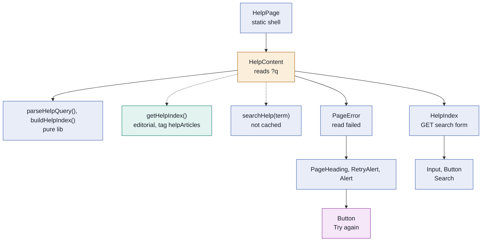

| Component | Kind | File | Notes |
| --- | --- | --- | --- |
| HelpPage | server | [`help/page.tsx`](help/page.tsx) | Static shell. `generateMetadata` reads `?q` (`helpIndexHead`). The fallback while the content streams is `PageHeading` with the title. |
| HelpContent | streamed | [`help/HelpContent.tsx`](help/HelpContent.tsx) | Awaits `searchParams` to get `?q`, so it renders per request. No `connection()` call is needed. |
| parseHelpQuery(), buildHelpIndex() | server | [`help.ts`](../../lib/pages/help.ts) | Pure functions. |
| getHelpIndex() | cached | [`help.ts`](../../server/help.ts) | `cacheLife` `editorial`, tag `helpArticles`. With no query it returns all published articles. |
| searchHelp(term) | server | [`help.ts`](../../server/help.ts), [`db/help.ts`](../../server/db/help.ts) | Not cached, on purpose: free text would make one cache entry per term. |
| PageError | server | [`PageError.tsx`](../../components/PageError/PageError.tsx) | Shown when a read fails. Retry goes to `/help` and drops the query. |
| PageHeading, RetryAlert, Alert | server | [`PageHeading.tsx`](../../components/PageHeading.tsx), [`RetryAlert.tsx`](../../components/PageError/RetryAlert.tsx), [`Alert`](../../components/Alert) | The error frame with the page heading kept. |
| Button (Try again) | client | [`Button.tsx`](../../components/Button/Button.tsx) | `Button` is a client module, so it ships even from this server-rendered form. |
| HelpIndex | server | [`HelpIndex.tsx`](../../components/HelpCenter/HelpIndex.tsx) | A GET search form (works with no script), the results list and a contact link. |
| Input, Button (Search) | server | [`Input`](../../components/Input), [`Button`](../../components/Button) | The search field and its submit button. The button file is a client module. |

### Help article (`/help/[slug]`)

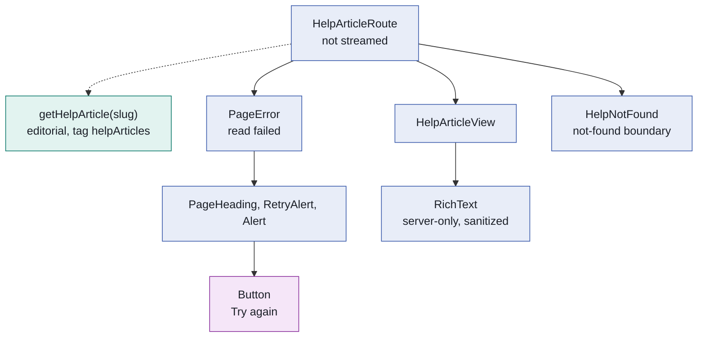

| Component | Kind | File | Notes |
| --- | --- | --- | --- |
| HelpArticleRoute | server | [`help/[slug]/page.tsx`](help/[slug]/page.tsx) | Not streamed: the whole page awaits the read. `generateStaticParams` returns the fake slug `_`, so the build prerenders only a not-found. |
| getHelpArticle(slug) | cached | [`help.ts`](../../server/help.ts) | `cacheLife` `editorial`, tag `helpArticles`. Also read by `generateMetadata`; one cache entry serves both. |
| PageError | server | [`PageError.tsx`](../../components/PageError/PageError.tsx) | Retry goes to `helpArticlePath(slug)`. |
| PageHeading, RetryAlert, Alert | server | [`RetryAlert.tsx`](../../components/PageError/RetryAlert.tsx) | The error frame. |
| Button (Try again) | client | [`Button.tsx`](../../components/Button/Button.tsx) | A client module, so it ships even from this server-rendered form. |
| HelpArticleView | server | [`HelpArticleView.tsx`](../../components/HelpCenter/HelpArticleView.tsx) | The article page. |
| RichText | server | [`RichText`](../../components/RichText) | Marked `server-only`, so the tiptap renderer can never enter a client bundle. Content is sanitized first. |
| HelpNotFound | server | [`help/not-found.tsx`](help/not-found.tsx) | A missing article calls `notFound()`. This nearest boundary shows "We can't find that help article" and a link to `/help`. |

### Legal documents (`/legal/[doc]`)

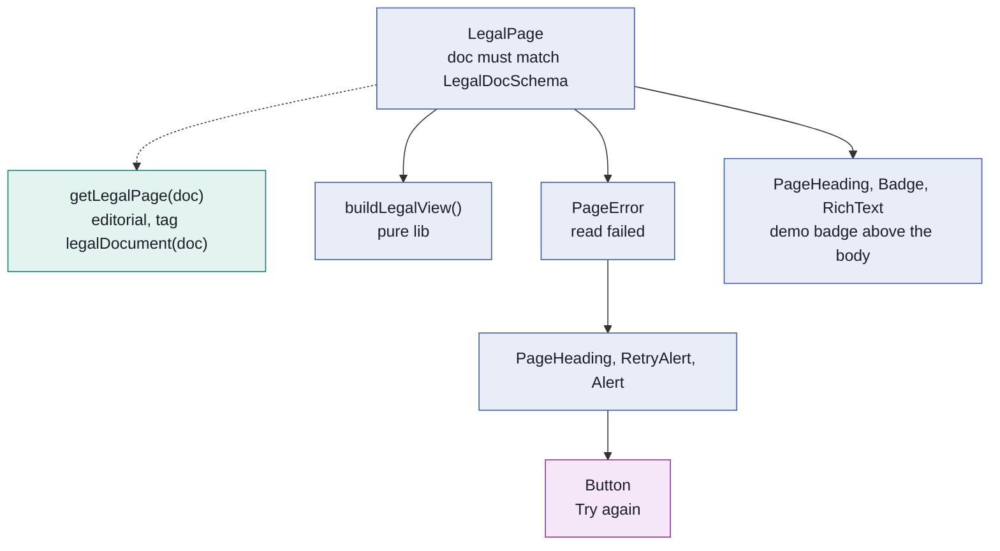

| Component | Kind | File | Notes |
| --- | --- | --- | --- |
| LegalPage | server | [`legal/[doc]/page.tsx`](legal/[doc]/page.tsx) | `doc` must match `LegalDocSchema` (terms, privacy, host-agreement, or `waiver-<slug>`) or it is a 404 before any read. Prerender uses `sample`, which fails the schema, so the build prerenders a not-found. |
| getLegalPage(doc) | cached | [`legalPage.ts`](../../server/legalPage.ts) | `cacheLife` `editorial`, tag `legalDocument(doc)`. A bad key or a miss switches to `cacheLife` `uncached`, so made-up keys fill nothing. |
| buildLegalView() | server | [`legal.ts`](../../lib/pages/legal.ts) | Pure function. |
| PageError | server | [`PageError.tsx`](../../components/PageError/PageError.tsx) | Retry goes to `legalDocPath(doc)`. |
| PageHeading, RetryAlert, Alert | server | [`RetryAlert.tsx`](../../components/PageError/RetryAlert.tsx) | The error frame. |
| Button (Try again) | client | [`Button.tsx`](../../components/Button/Button.tsx) | A client module, so it ships even from this server-rendered form. |
| PageHeading, Badge, RichText | server | [`PageHeading.tsx`](../../components/PageHeading.tsx), [`Badge`](../../components/Badge), [`RichText`](../../components/RichText) | A yellow demo badge above the document body. |

### Contact (`/contact`)

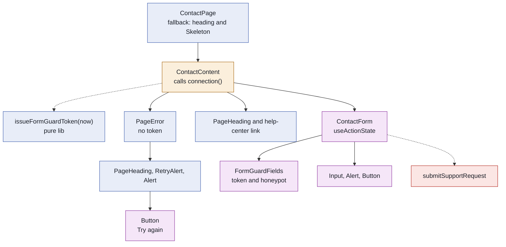

| Component | Kind | File | Notes |
| --- | --- | --- | --- |
| ContactPage | server | [`contact/page.tsx`](contact/page.tsx) | Static metadata. The fallback is `PageHeading` plus `Skeleton`. |
| ContactContent | streamed | [`contact/ContactContent.tsx`](contact/ContactContent.tsx) | Calls `connection()`: the form token starts a minimum fill time, so a prerendered one would arrive stale. |
| issueFormGuardToken(now) | server | [`formGuard.ts`](../../server/formGuard.ts) | Pure function with `systemClock`. |
| PageError | server | [`PageError.tsx`](../../components/PageError/PageError.tsx) | No token means the form cannot be sent, so the page says so. Retry goes to `/contact`. |
| PageHeading, RetryAlert, Alert | server | [`RetryAlert.tsx`](../../components/PageError/RetryAlert.tsx) | The error frame. |
| Button (Try again) | client | [`Button.tsx`](../../components/Button/Button.tsx) | A client module, so it ships even from this server-rendered form. |
| PageHeading and help-center link | server | [`PageHeading.tsx`](../../components/PageHeading.tsx) | The heading above the form. |
| ContactForm | client | [`contact/ContactForm.tsx`](contact/ContactForm.tsx) | Uses `useActionState`. Moves focus to the first invalid field or to the notice. Shows rate-limited, expired and failed notices. |
| FormGuardFields | client | [`FormGuardFields`](../../components/FormGuardFields) | Client because the island imports it. Carries the token and the honeypot field. |
| Input, Alert, Button | client | [`Input`](../../components/Input), [`Alert`](../../components/Alert), [`Button`](../../components/Button) | Client because the island imports them. |
| submitSupportRequest | action | [`contact.ts`](../../server/actions/contact.ts) | Checks the guard (a refused guard looks like success), parses with zod, calls `consumeRateLimit('forms')`, then in one transaction runs `insertSupportRequest` and enqueues an ops-notice job through `enqueue`. |

### Accessibility statement (`/accessibility`)

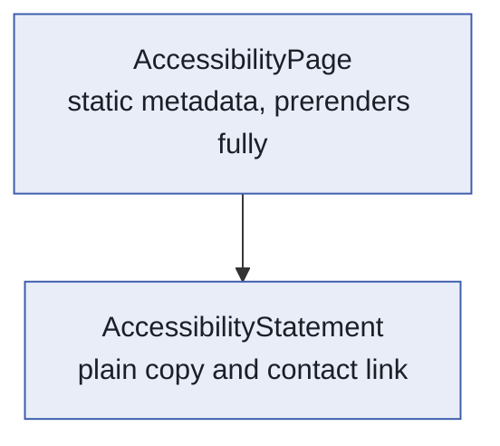

| Component | Kind | File | Notes |
| --- | --- | --- | --- |
| AccessibilityPage | server | [`accessibility/page.tsx`](accessibility/page.tsx) | Static metadata. No reads and no Suspense: it prerenders fully. |
| AccessibilityStatement | server | [`AccessibilityStatement.tsx`](../../components/AccessibilityStatement/AccessibilityStatement.tsx) | Plain copy with a contact link. |

### Picks (`/picks/[slug]`)

`CollectionRoute` is shared with the gift guide (see Gifting).

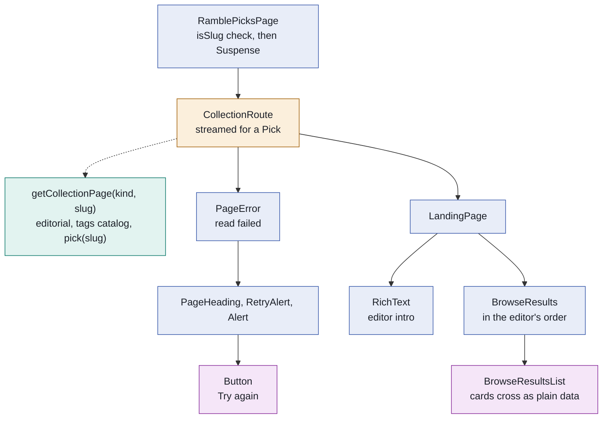

| Component | Kind | File | Notes |
| --- | --- | --- | --- |
| RamblePicksPage | server | [`picks/[slug]/page.tsx`](picks/[slug]/page.tsx) | If `isSlug` fails, it is a 404 before any read (the build's placeholder slug ends there). Otherwise it renders `CollectionRoute` inside a `Suspense` with no fallback, because an unknown slug is a miss read with `cacheLife('uncached')`, which a prerender of the shell cannot hold: outside Suspense the repeat requests alternated between 200 and 500 (#1002). A real Pick renders on its first request and is then cached. |
| CollectionRoute | streamed | [`picks/CollectionRoute.tsx`](picks/CollectionRoute.tsx) | Shared with the gift guide, which still awaits the read with no Suspense. For a Pick it runs inside the page's `Suspense`, so an unknown slug calls `notFound()` in the request; the response status is 200 with the not-found page and `noindex`, as on any not-found reached after the shell. `collectionMetadata` reads the same entry. |
| getCollectionPage(kind, slug) | cached | [`collections.ts`](../../server/collections.ts) | `cacheLife` `editorial`, tags `catalog` and `pick(slug)`. Reads the Pick, then its experiences as home cards (`listHomeExperiences`, with covers), and tags each experience too. A miss is uncached; a non-slug is refused before the cache. |
| PageError | server | [`PageError.tsx`](../../components/PageError/PageError.tsx) | Retry goes to the collection path. |
| PageHeading, RetryAlert, Alert | server | [`RetryAlert.tsx`](../../components/PageError/RetryAlert.tsx) | The error frame. |
| Button (Try again) | client | [`Button.tsx`](../../components/Button/Button.tsx) | A client module, so it ships even from this server-rendered form. |
| LandingPage | server | [`LandingPage.tsx`](../../components/LandingPage/LandingPage.tsx) | Heading, editor intro, a "Pick a day" link, a noscript skip link, then the results. |
| RichText | server | [`RichText`](../../components/RichText) | Renders the editor intro. |
| BrowseResults | server | [`BrowseResults.tsx`](../../components/BrowseResults/BrowseResults.tsx) | Fed by `collectionView()`, in the editor's order. The same component as the browse page. |
| BrowseResultsList | client | [`BrowseResultsList.tsx`](../../components/BrowseResults/BrowseResultsList.tsx) | Client so the cards cross as plain data. Holds `ExperienceCardItem` and `TargetButton`. |

### Guide entry (`/guide/[slugAndId]`)

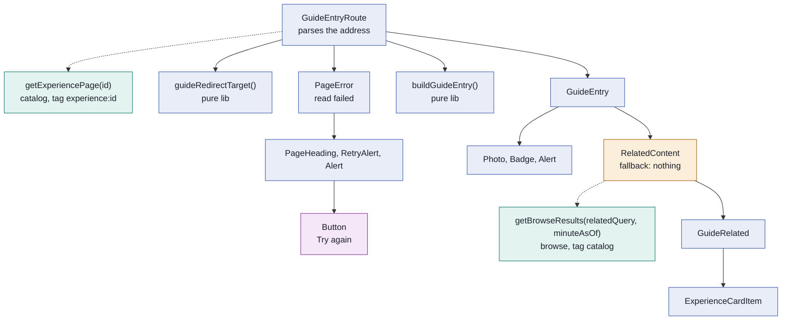

| Component | Kind | File | Notes |
| --- | --- | --- | --- |
| GuideEntryRoute | server | [`guide/[slugAndId]/page.tsx`](guide/[slugAndId]/page.tsx) | Parses the address with `parseExperienceAddress` (a bad address is a 404). Prerender uses `sample`. |
| getExperiencePage(id) | cached | [`experiencePage.ts`](../../server/experiencePage.ts) | `cacheLife` `catalog`, tag `experience:<id>`. The same cached read the experience page uses. |
| guideRedirectTarget() | server | [`src/lib/pages/guide.ts`](../../lib/pages/guide.ts) | Pure function in lib. A live experience gets a `permanentRedirect` to its experience page; a wrong or retired slug is redirected to the current guide URL. |
| PageError | server | [`PageError.tsx`](../../components/PageError/PageError.tsx) | Retry goes to `guidePath(address)`. |
| PageHeading, RetryAlert, Alert | server | [`RetryAlert.tsx`](../../components/PageError/RetryAlert.tsx) | The error frame. |
| Button (Try again) | client | [`Button.tsx`](../../components/Button/Button.tsx) | A client module, so it ships even from this server-rendered form. |
| buildGuideEntry() | server | [`guide.ts`](../../lib/pages/guide.ts) | Pure function. |
| GuideEntry | server | [`GuideEntry.tsx`](../../components/GuideEntry/GuideEntry.tsx) | Photo, a "From the Ramble guide" badge, facts, a "Not bookable on Ramble" alert, an outbound link (sponsored or plain rel), the about text, then the related slot. |
| Photo, Badge, Alert | server | [`Photo`](../../components/Photo), [`Badge`](../../components/Badge), [`Alert`](../../components/Alert) | Parts of the entry. |
| RelatedContent | streamed | [`guide/[slugAndId]/RelatedContent.tsx`](guide/[slugAndId]/RelatedContent.tsx) | The fallback is nothing. Calls `connection()` and reads browse for the current minute. A failed read hides the module; the entry stays. |
| getBrowseResults(relatedQuery, minuteAsOf) | cached | [`browse.ts`](../../server/browse.ts) | `cacheLife` `browse`, tag `catalog` plus each experience. |
| GuideRelated | server | [`GuideRelated.tsx`](../../components/GuideEntry/GuideRelated.tsx) | "Category you can book". Renders nothing when empty. |
| ExperienceCardItem | server | [`ExperienceCardItem.tsx`](../../components/ExperienceCard/ExperienceCardItem.tsx) | The same card as the browse page. |

### Host profile (`/hosts/[slug]`)

All markup is inline in `HostContent`; there is no host component folder.

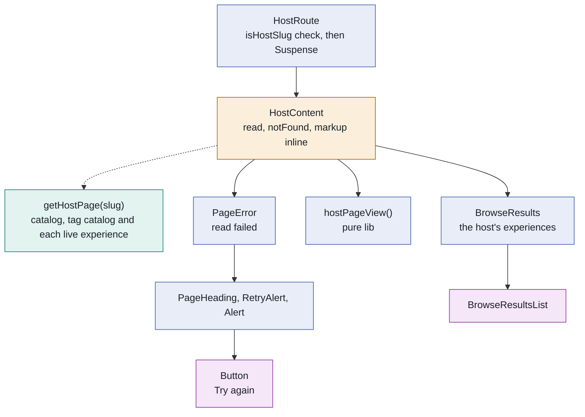

| Component | Kind | File | Notes |
| --- | --- | --- | --- |
| HostRoute | server | [`hosts/[slug]/page.tsx`](hosts/[slug]/page.tsx) | If `isHostSlug` fails, it is a 404 before any read. Prerender uses a placeholder slug. Otherwise it renders `HostContent` inside a `Suspense` with no fallback (see HostContent). |
| HostContent | streamed | [`hosts/[slug]/HostContent.tsx`](hosts/[slug]/HostContent.tsx) | Reads the host and calls `notFound()` for a miss. A miss is read with `cacheLife('uncached')`, which a prerender of the shell cannot hold, so outside Suspense the repeat requests for an unknown slug alternated between 200 and 500 (#1002). The status of that not-found is 200 with `noindex`, as on any not-found reached after the shell. |
| getHostPage(slug) | cached | [`hostPage.ts`](../../server/hostPage.ts) | `cacheLife` `catalog`, tag `catalog` plus each live experience. Returns the host, live experiences as cards, and cancellation tiers. A miss is uncached. |
| PageError | server | [`PageError.tsx`](../../components/PageError/PageError.tsx) | Retry goes to `hostPath(slug)`. |
| PageHeading, RetryAlert, Alert | server | [`RetryAlert.tsx`](../../components/PageError/RetryAlert.tsx) | The error frame. |
| Button (Try again) | client | [`Button.tsx`](../../components/Button/Button.tsx) | A client module, so it ships even from this server-rendered form. |
| hostPageView() | server | [`host.ts`](../../lib/pages/host.ts) | Pure function. Builds the avatar initial, about paragraphs, the browse view, and cancellation (shared text, or one row per experience). |
| BrowseResults | server | [`BrowseResults.tsx`](../../components/BrowseResults/BrowseResults.tsx) | The host's experiences. The same component as the home and browse pages. |
| BrowseResultsList | client | [`BrowseResultsList.tsx`](../../components/BrowseResults/BrowseResultsList.tsx) | Client so the cards cross as plain data. |

### Private session request (`/experiences/[slugAndId]/private-session`)

Linked from the experience page.

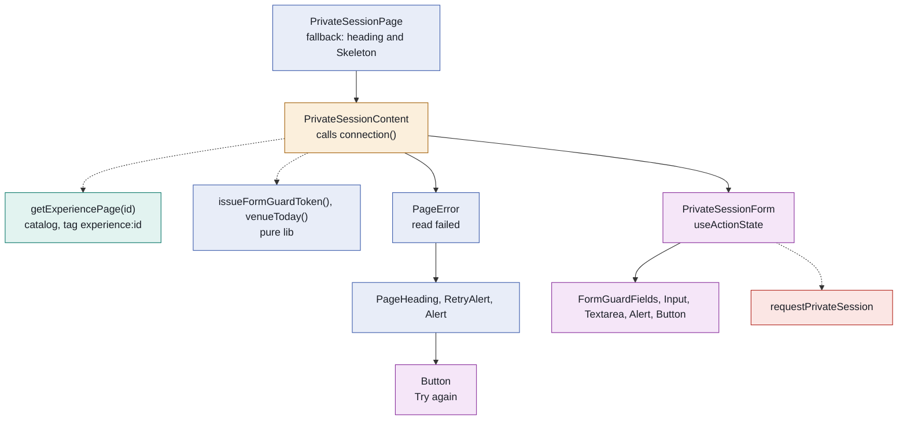

| Component | Kind | File | Notes |
| --- | --- | --- | --- |
| PrivateSessionPage | server | [`private-session/page.tsx`](experiences/[slugAndId]/private-session/page.tsx) | Static metadata. `params` is passed down as a promise, so the page itself reads nothing. The fallback is `PageHeading` plus `Skeleton`. |
| PrivateSessionContent | streamed | [`PrivateSessionContent.tsx`](experiences/[slugAndId]/private-session/PrivateSessionContent.tsx) | A bad address or an experience a guest cannot see is a 404. Then `connection()`: the token and today's date in New York are per request. |
| getExperiencePage(id) | cached | [`experiencePage.ts`](../../server/experiencePage.ts) | `cacheLife` `catalog`, tag `experience:<id>`. Shared with the experience page, which links here. |
| issueFormGuardToken(), venueToday() | server | [`formGuard.ts`](../../server/formGuard.ts), [`venue.ts`](../../lib/venue.ts) | Pure functions. |
| PageError | server | [`PageError.tsx`](../../components/PageError/PageError.tsx) | Retry goes to `privateSessionPath(address)`. |
| PageHeading, RetryAlert, Alert | server | [`RetryAlert.tsx`](../../components/PageError/RetryAlert.tsx) | The error frame. |
| Button (Try again) | client | [`Button.tsx`](../../components/Button/Button.tsx) | A client module, so it ships even from this server-rendered form. |
| PrivateSessionForm | client | [`PrivateSessionForm.tsx`](experiences/[slugAndId]/private-session/PrivateSessionForm.tsx) | Date, group size, budget, name, email, message. Uses `useActionState`; after "sent" it offers a link back to the experience. |
| FormGuardFields, Input, Textarea, Alert, Button | client | [`components`](../../components) | Client because the island imports them. |
| requestPrivateSession | action | [`privateSession.ts`](../../server/actions/privateSession.ts) | Same shape as the contact action: guard, id check, zod with today's date, rate limit, then in one transaction `insertPrivateRequest` plus an ops-notice job. Emails go to ops, not the host. |

### Gifting (`/gifts`, `/gift/[token]`, `/gifts/checkout/[experienceId]`)

Parked. The owner has put gifting on hold. What exists is the gift guide (live behind the gifts switch) and stubs for redeeming and buying a gift. Nothing here is built past a placeholder, so treat this group as a record of what is in the code, not a plan. The gift guide renders inside the guest layout; the two stub routes live under `(checkout)` and have a different frame.

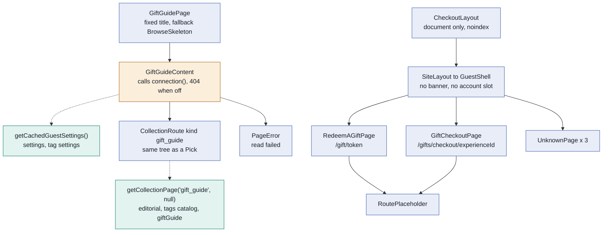

| Component | Kind | File | Notes |
| --- | --- | --- | --- |
| GiftGuidePage | server | [`gifts/page.tsx`](gifts/page.tsx) | Fixed title (the head cannot wait for the gifts switch). The fallback is `BrowseSkeleton filters={false}`. Inside the guest layout. |
| GiftGuideContent | streamed | [`gifts/GiftGuideContent.tsx`](gifts/GiftGuideContent.tsx) | Calls `connection()`, reads the gifts switch, and returns a 404 when it is off. A failed read shows `PageError`. |
| getCachedGuestSettings() | cached | [`siteSettings.ts`](../../server/siteSettings.ts) | `cacheLife` `settings`, tag `settings`. Read for `giftsEnabled`. |
| CollectionRoute kind="gift_guide" | server | [`picks/CollectionRoute.tsx`](picks/CollectionRoute.tsx) | The same tree as a Pick (see Picks). |
| getCollectionPage("gift_guide", null) | cached | [`collections.ts`](../../server/collections.ts) | `cacheLife` `editorial`, tags `catalog` plus `giftGuide` instead of `pick(slug)`. |
| PageError | server | [`PageError.tsx`](../../components/PageError/PageError.tsx) | Shown when the read fails. |
| CheckoutLayout | server | [`(checkout)/layout.tsx`](../(checkout)/layout.tsx) | Document only, `robots: noindex`, `instant = false`. Renders `RenderPerRequest`, which awaits `connection()` so every script carries the CSP nonce. |
| SiteLayout to GuestShell | server | [`(checkout)/(site)/layout.tsx`](../(checkout)/(site)/layout.tsx) | The guest frame with no banner, no account slot and no analytics tags (ADR 0007). The header is always signed-out. |
| RedeemAGiftPage | server | [`gift/[token]/page.tsx`](../(checkout)/(site)/gift/[token]/page.tsx) | `/gift/<token>`. A placeholder: title "Redeem a gift", "Covers PRD-33", and the token printed on the page. |
| RoutePlaceholder | server | [`RoutePlaceholder.tsx`](../../components/RoutePlaceholder.tsx) | The shared stub component. |
| GiftCheckoutPage | server | [`gifts/checkout/[experienceId]/page.tsx`](../(checkout)/(site)/gifts/checkout/[experienceId]/page.tsx) | `/gifts/checkout/<experienceId>`. Also a `RoutePlaceholder`: "Gift checkout", PRD-33. |
| UnknownPage x 3 | server | [`gift/page.tsx`](../(checkout)/(site)/gift/page.tsx), [`gift/[...unknown]`](../(checkout)/(site)/gift/[...unknown]), [`gifts/checkout/page.tsx`](../(checkout)/(site)/gifts/checkout/page.tsx), [`gifts/checkout/[...unknown]`](../(checkout)/(site)/gifts/checkout/[...unknown]) | `/gift`, `/gift/a/b`, `/gifts/checkout` and below call `notFoundPerRequest()`: a 404 by design. |

### Not found and errors

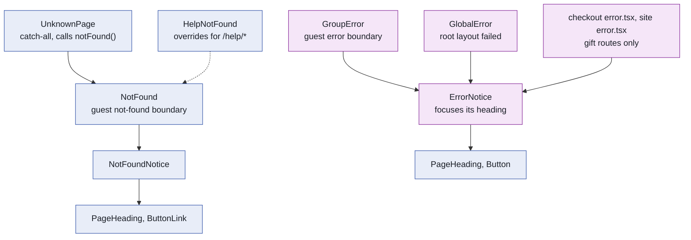

| Component | Kind | File | Notes |
| --- | --- | --- | --- |
| UnknownPage | server | [`[...unknown]/page.tsx`](<[...unknown]/page.tsx>) | A guest URL no route matches. Calls `notFound()` directly, with no per-request wrapper, unlike the gift routes. |
| NotFound | server | [`not-found.tsx`](not-found.tsx) | Boundary for every guest route that calls `notFound()`. Renders inside the guest layout, so the header and footer stay. |
| NotFoundNotice | server | [`NotFoundNotice.tsx`](../../components/NotFoundNotice.tsx) | "Not found" heading, body, and a link home. Copy from `commonCopy.notFound`. |
| PageHeading, ButtonLink | server | [`PageHeading.tsx`](../../components/PageHeading.tsx), [`Button`](../../components/Button) | The heading and the home link. |
| HelpNotFound | server | [`help/not-found.tsx`](help/not-found.tsx) | Overrides the boundary above for `/help/*` only. |
| GroupError | client | [`error.tsx`](error.tsx) | The Next error boundary for a throw during render in a guest page. Inside the guest layout, so the frame stays. The prop is named `retry`. |
| ErrorNotice | client | [`ErrorNotice.tsx`](../../components/ErrorNotice.tsx) | Client because the error files import it; it has no `'use client'` of its own. Focuses its heading on mount so the error is announced. The Try again button calls `retry`, so it needs script. |
| PageHeading, Button | server | [`PageHeading.tsx`](../../components/PageHeading.tsx), [`Button`](../../components/Button) | Imported by `ErrorNotice`. |
| GlobalError | client | [`global-error.tsx`](../global-error.tsx) | The last resort when the root layout fails. Brings its own html, head and main, with base and token CSS only. Uses the same `ErrorNotice`. |
| checkout error.tsx, site error.tsx | client | [`(checkout)/error.tsx`](../(checkout)/error.tsx), [`(checkout)/(site)/error.tsx`](../(checkout)/(site)/error.tsx) | Gift routes only. The `(site)` error keeps the guest frame from its layout. The group-level one wraps `ErrorNotice` in `ErrorFrame`, not `GuestShell`, to keep the nav code out of a client module. |

## What arrives when (home page)

1. Shell. The layout, skip link, header, footer and `HomeSkeleton`. The header shows signed-out. No page content is in the shell, because `HomeContent` waits for the request before it reads anything.
2. Streamed in. The banner and the signed-in account control replace their fallbacks. `HomeContent` replaces the skeleton in one piece: hero, rails, Picks, gift guide, this week and the reassurance row arrive together, not one by one.
3. Hydration. Two islands: `SiteMenu` and the hero's submit `Button`. The search form, the chips and every card link work with scripting off.

## The key user path: the hero search

1. The guest picks a neighborhood, a day and a party size in the `HomeHero` form. Nothing runs in the browser; these are plain form fields.
2. Submit is an ordinary GET to `/new-york/browse`, with `neighborhood`, `date` and `guests` in the address. The browse page reads them.
3. No server action runs on the home page. Category chips, Pick cards, "See all" and the gift guide button are links.

The other paths in this area end in a server action: the contact form calls `submitSupportRequest` and the private session form calls `requestPrivateSession`. Both write the request and an ops-notice job in one transaction.

## How the caches are cleared

Five cached reads feed the home page, on five kinds of tag. Each change goes through `tagsForChanges()` in [`src/lib/cacheTags.ts`](../../lib/cacheTags.ts). Cache profiles are in [`src/lib/cacheProfiles.ts`](../../lib/cacheProfiles.ts): `editorial` is 5 minutes stale, 1 hour revalidate and 1 day expire; `catalog` is 5 minutes and 15 minutes; `browse` is 30 seconds and 60 seconds; `settings` is 1 minute and 5 minutes.

| Change | What clears | When the guest sees it |
| --- | --- | --- |
| Home modules saved (`homeModules`) | `home`, which rebuilds `getHomeContent` | After the tag is cleared. |
| A Pick or gift guide changes | `home`, plus its own `pick:<slug>` or `giftGuide` tag | After the tag is cleared. |
| An experience's sessions or photos change | `experience:<id>`, which reaches `getHomeContent`, `getThisWeek` and `getCoverPhotos` for any card that shows the experience | After the tag is cleared. `getHomeContent` tags every ID a Pick names, even one a guest cannot see yet, so publishing it adds its card. |
| A listing is published, edited or taken down | `catalog` (what `getThisWeek` is tagged with) and the experience's own tag | After the tag is cleared. |
| Settings saved (no screen yet: `updateSettings` has no caller, `TODO(U-078)`) | `settings`: the banner, and the gift guide module's on/off | After the tag is cleared. |
| A category or neighborhood is added, renamed, moved, retired or brought back | `taxonomy` (the `taxonomy` change, from the ops editorial area) | Next request after the ops action; also when the editorial profile runs out (revalidate 1 hour). |
| A booking or hold | Only `session:<id>`, which nothing on this page carries | "On this week" catches up when its minute-keyed entry rolls over, about 60 seconds. |
| Help articles or legal documents change | `helpArticles`, or `legalDocument(doc)` | After the tag is cleared. |
| A host's own settings change | `catalog`, which `getHostPage` carries | After the tag is cleared. An ops edit to a host's name or about text shows only when the catalog profile runs out. |

## Worth knowing

- The whole home page is streamed. `HomeContent` calls `connection()` before anything, so even the cached editorial content never reaches the static shell. Every visitor first sees `HomeSkeleton`. The comment gives the reason: the day and the week are request-time values.
- The "On this week" cards bring their own covers, the Picks cards do not. `getHomeContent` reads with `covers: false`, then `HomeContent` makes a second read through `readGuestCovers`. `getThisWeek` reads with `covers: true`. That is two ways of getting a cover on one page.
- A cover failure is silent, a content failure is not. A failed cover read renders cards without images; a failed content read shows `PageError`. A failed settings read inside the same try block also shows `PageError`, although the banner, which reads the same entry, quietly hides itself.
- The only page-level client code on the home page is a submit button. `Button` is `'use client'`, and the hero is otherwise all server. `SiteMenu` is the other island, and it comes from the shell.
- The gift guide depends on two switches. It needs `giftsEnabled` (settings, 5 minute revalidate) and a module row, so turning gifts off hides it only after the settings entry is cleared, and the home entry itself does not carry the settings.
- There is no root layout file. `(guest)/layout.tsx` renders `<html>`. Each route group (guest, checkout, host, ops) has its own, so html-level changes are made per group.
- The home h1 can come from three places: the hero, `HomeTitle` (no hero), or the skeleton's hidden one while loading. `HomeEmpty` has its own through `PageHeading`.
- Every data read has the same error path. A read that throws is caught, passed to `rethrowOrLog`, and shown as `PageError` with the page's heading kept. Its Try again is a GET form to the same address, so it works with no script. The Next error boundary (`error.tsx`) is the fallback for anything else, and its button needs script.
- Misses are not cached, except on help. Legal, collection, host and experience reads switch to `cacheLife('uncached')` on a miss, so made-up addresses fill nothing. The help reads in `src/server/help.ts` keep the `editorial` profile on a miss, so a made-up help slug does fill a cache entry. Invalid slugs and ids are refused before the cache is asked.
- Prerender uses fake params. `/help/[slug]` returns `_`, `/legal/[doc]` returns `sample` (which fails the schema), picks and hosts use placeholder slugs, and guide and private-session use `sample`. The build has no database, so each prerenders a not-found or a shell, and real pages render on first request.
- Gift routes under `(checkout)` can return 200 for a 404. `notFoundPerRequest()` renders the not-found page with the CSP nonce, but the status is 200 because the render resumes from an empty shell. The guest catch-all uses plain `notFound()` with no such wrapper.
- The gift guide reuses the Picks page. `/gifts` is `CollectionRoute` behind the `giftsEnabled` switch, read per request, so turning gifts off makes the page a 404. `/gift/[token]` and `/gifts/checkout/[experienceId]` are only `RoutePlaceholder` pages that print "Covers PRD-33" and the address value.
- Guide entries redirect. A guide URL for an experience that has gone live gets a `permanentRedirect` to its experience page; a wrong slug is sent to the current one, since the id is the key.
- Two forms, one pattern. Contact and private session both read per request (`connection()`) for a form-guard token, post to a server action that checks the guard, rate-limits on the `forms` counter, and writes the request plus an ops-notice job in one transaction. The private session request goes to ops, not to the host.
- Client code arrives by import. `ErrorNotice` and the form fields have no `'use client'` but ship as client code because an island imports them. `Button` is itself a client module, so even the "server" Try again and Search buttons ship its code.
- Host pages go stale for ops edits. `getHostPage` carries only `tags.catalog`. A host's own settings change clears it; an ops edit to a host's name or about text shows when the catalog profile runs out.
- Not-found is per branch. Help has its own `not-found.tsx`; the checkout group has one that brings its own `GuestShell`. The host and ops groups have their own catch-alls and boundaries, not mapped here.

Rendered view: https://defaultdave.github.io/ramble-pm/maps/home.html

Rendered view: https://defaultdave.github.io/ramble-pm/maps/content-and-gifts.html
