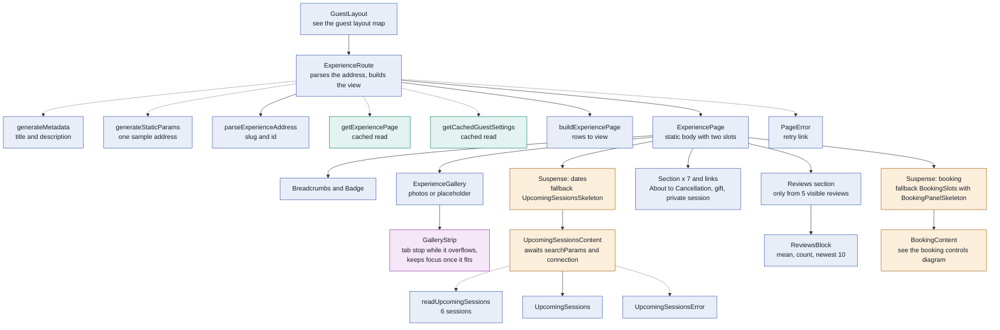
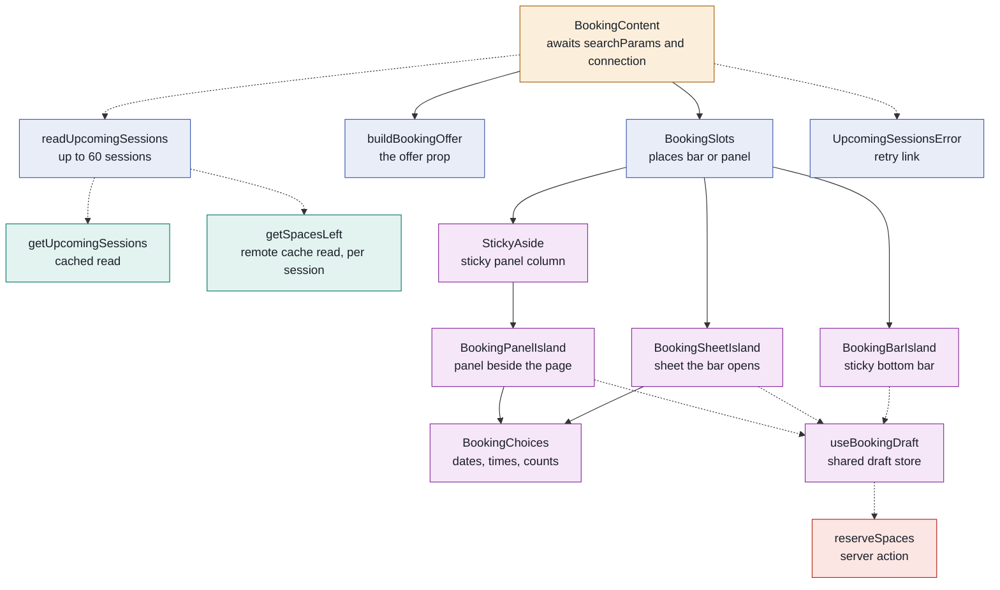

# Experience page map

Routes: `/experiences/[slugAndId]`

Read from main at 2db68ea (2026-11-15). A PR that changes this tree (a component, a Suspense or client boundary, a cache tag, an action) updates this file in the same PR.

## Legend

server = rendered on the server per request; cached = `'use cache'` read; streamed = inside a Suspense boundary; client = `'use client'` island; action = server action.

## Render tree

The guest layout (header, footer, phone menu, banner, account control) is mapped in [the guest layout map](../../README.md), so this page starts at the route. The private-session subpage at `/experiences/[slugAndId]/private-session` is mapped there too.

### The page

| Component | Kind | File | Notes |
| --- | --- | --- | --- |
| GuestLayout | server | [`layout.tsx`](../../layout.tsx) | Shared by every guest page. Mapped in [the guest layout map](../../README.md). |
| ExperienceRoute | server | [`page.tsx`](./page.tsx) | Parses the address, loads the page data and the settings in parallel, and builds the view. A bad address is a 404. A failed read shows `PageError` with a retry link. |
| generateMetadata | server | [`page.tsx`](./page.tsx) | Reads the same cached `getExperiencePage` entry for the title and description. A failed read falls back to the plain title. |
| generateStaticParams | server | [`page.tsx`](./page.tsx) | Returns one sample address, `sample`, so the route has a static param to build from. |
| parseExperienceAddress | server | [`src/lib/routes.ts`](../../../../lib/routes.ts) | A plain function. Splits the slug from the id. |
| getExperiencePage | cached | [`src/server/experiencePage.ts`](../../../../server/experiencePage.ts) | `cacheLife('catalog')`, tag `experience:<id>`. A missing experience is not cached (it switches to the `uncached` profile). Also reads the experience's rating and its newest visible reviews ([`reviewsRead.ts`](../../../../server/db/reviewsRead.ts)), so a new review clears it through the same tag. |
| getCachedGuestSettings | cached | [`src/server/siteSettings.ts`](../../../../server/siteSettings.ts) | `cacheLife('settings')`, tag `settings`. Gives `giftsEnabled` and `bookingsPaused`. |
| buildExperiencePage | server | [`src/lib/pages/experience.ts`](../../../../lib/pages/experience.ts) | A plain function. Turns the rows plus `giftsEnabled` and `bookingsPaused` into the view the components render. The reviews part comes from `reviewsView` in [`reviewList.ts`](../../../../lib/reviewList.ts): null below five reviews, else the mean, the count, and the newest ten, each with a first name only. |
| ExperiencePage | server | [`ExperiencePage.tsx`](../../../../components/ExperiencePage/ExperiencePage.tsx) | The static body. It takes two slots, `dates` and `booking`, that the route streams in. |
| Breadcrumbs and Badge | server | [`ExperiencePage.tsx`](../../../../components/ExperiencePage/ExperiencePage.tsx) | Rendered inside the page body. |
| ExperienceGallery | server | [`ExperienceGallery.tsx`](../../../../components/ExperienceGallery/ExperienceGallery.tsx) | Renders each `Photo` on the server, or a placeholder when there are none (the case locally). The lead `Photo` draws a hidden copy at the card's width first, which a guest who came from a card already has cached, then the full photo over it. |
| GalleryStrip | client | [`GalleryStrip.tsx`](../../../../components/ExperienceGallery/GalleryStrip.tsx) | Wraps the server-rendered photos. It gives the strip a tab stop while it overflows, and if the strip stops overflowing while it has focus it keeps focus, with `tabindex` -1, until blur. |
| Suspense: dates | streamed | [`page.tsx`](./page.tsx) | Fallback is `UpcomingSessionsSkeleton`. Fills the "Upcoming dates" section. |
| UpcomingSessionsContent | streamed | [`UpcomingSessionsContent.tsx`](./UpcomingSessionsContent.tsx) | Awaits `searchParams` (for `?date=`) and `connection()`, then reads the time. |
| readUpcomingSessions | server | [`src/server/upcomingSessions.ts`](../../../../server/upcomingSessions.ts) | A plain function, not itself cached. It wraps the cached `getUpcomingSessions` and then reads each session's spaces. See "How caches are cleared". Here it asks for the list's six sessions within 90 days. |
| UpcomingSessions | server | [`src/components/UpcomingSessions/`](../../../../components/UpcomingSessions/) | The dates list. |
| UpcomingSessionsError | server | [`src/components/UpcomingSessions/`](../../../../components/UpcomingSessions/) | Shown when the read fails, with a retry link. |
| Section x 7 and links | server | [`ExperiencePage.tsx`](../../../../components/ExperiencePage/ExperiencePage.tsx) | About, What's included, Your host (link to `/hosts/<slug>`), Meeting point (Maps `ButtonLink`), Accessibility, Weather, Cancellation, then the gift link (when gifts are on) and the private-session link. |
| Reviews section | server | [`ExperiencePage.tsx`](../../../../components/ExperiencePage/ExperiencePage.tsx) | After "Your host". Left out whole when the view has no reviews (fewer than five). No sort, no replies, no paging. |
| ReviewsBlock | server | [`ReviewsBlock.tsx`](../../../../components/ExperiencePage/ReviewsBlock.tsx) | The mean and count as one spoken sentence, then one list item per review: rating (spoken), first name, day, words. |
| Suspense: booking | streamed | [`page.tsx`](./page.tsx) | Fallback is `BookingSlots` with `BookingPanelSkeleton`, so the panel's space is held. |
| BookingContent | streamed | [`BookingContent.tsx`](./BookingContent.tsx) | Detailed in the next diagram. |
| PageError | server | [`src/components/PageError/`](../../../../components/PageError/) | Shown instead of the page when the page data or settings read fails. |

### The booking controls

| Component | Kind | File | Notes |
| --- | --- | --- | --- |
| BookingContent | streamed | [`BookingContent.tsx`](./BookingContent.tsx) | Reads the sessions with `bookingRead`, then builds one `offer` for every island. If the read fails it renders `UpcomingSessionsError` in the panel slot and no bar. |
| readUpcomingSessions | server | [`src/server/upcomingSessions.ts`](../../../../server/upcomingSessions.ts) | The same function the dates list uses, here with `bookingRead` (up to 60 sessions in a wider, bounded window). |
| getUpcomingSessions | cached | [`src/server/upcomingSessions.ts`](../../../../server/upcomingSessions.ts) | `cacheLife('browse')`, tag `experience:<id>`. `asOf` is rounded to the minute, so the key changes at most once a minute. Not exported. |
| getSpacesLeft | cached | [`src/server/spacesLeft.ts`](../../../../server/spacesLeft.ts) | A remote cache read (`'use cache: remote'`), `cacheLife('spacesLeft')`, tag `session:<id>`. One entry per session. A failure of the runtime cache falls back to Postgres. For display only, never a decision. |
| buildBookingOffer | server | [`src/lib/pages/experienceBooking.ts`](../../../../lib/pages/experienceBooking.ts) | A plain function. Builds the `offer`, the one plain-data prop every booking island gets. |
| BookingSlots | server | [`ExperiencePage.tsx`](../../../../components/ExperiencePage/ExperiencePage.tsx) | Places the controls: the bar under the tablet width, the panel beside the page above it. Each is hidden where the other shows. |
| BookingBarIsland | client | [`BookingBarIsland.tsx`](../../../../components/BookingBar/BookingBarIsland.tsx) | Sticky bottom bar: price, Continue, or the paused and sold-out states. |
| BookingSheetIsland | client | [`BookingSheetIsland.tsx`](../../../../components/BookingSheet/BookingSheetIsland.tsx) | The sheet the bar opens, with `BookingChoices` inside. |
| StickyAside | client | [`StickyAside.tsx`](../../../../components/ExperiencePage/StickyAside.tsx) | CSS makes it sticky. The script only handles a panel taller than the window, so both its ends can be reached. |
| BookingPanelIsland | client | [`BookingPanelIsland.tsx`](../../../../components/BookingPanel/BookingPanelIsland.tsx) | Pulls in `BookingPanel`, `BookingModeSwitch` and `BookingChoices`. They have no `'use client'` of their own but ship as client code because an island imports them. |
| BookingChoices | client | [`BookingChoices.tsx`](../../../../components/BookingChoices/BookingChoices.tsx) | `DatePicker` (React Aria calendar, imported directly, not lazy), `TimeSlot`, `Chip`, `Stepper`, `Button`. |
| useBookingDraft | client | [`useBookingDraft.ts`](../../../../components/BookingChoices/useBookingDraft.ts) | One module-level store keyed by experience id, read through `useSyncExternalStore`. Bar, sheet and panel all call it. |
| reserveSpaces | action | [`src/server/actions/holds.ts`](../../../../server/actions/holds.ts) | Runs the bot check and the device's try limit, then places the hold. |
| UpcomingSessionsError | server | [`src/components/UpcomingSessions/`](../../../../components/UpcomingSessions/) | Shown in place of the panel when the read fails. |

## What arrives when

1. **Shell.** The layout, header, gallery and every section render from the cached page data. The header shows signed-out, and the dates and booking slots show skeletons.
2. **Streamed in.** The banner, the signed-in account control, the upcoming dates and the booking controls each replace their fallback as they finish. They read the clock and the address's `?date=`, which is why they cannot be part of the cached shell.
3. **Hydration.** Five islands wake up: `SiteMenu`, `GalleryStrip`, `StickyAside`, and the bar and sheet or the panel. With scripting off, everything but those still renders.

## Pressing Continue

1. The bar, the sheet and the panel all call `useBookingDraft(offer)`. It is one module-level store keyed by experience id, read with `useSyncExternalStore`, so a date picked in the sheet is already picked in the panel.
2. `submit` calls the server action `reserveSpaces` in [`src/server/actions/holds.ts`](../../../../server/actions/holds.ts). The bot check and the device's try limit run first.
3. A held booking routes to `/checkout/<holdId>`. A sold-out session or a lost race comes back as an effect the islands show, with nearby alternatives.

## How caches are cleared

| Change | What clears | When the guest sees it |
| --- | --- | --- |
| Publishing or editing the experience, or taking it down | Tag `experience:<id>` (and the other tags the listing change names) through `tagsForChanges()` in [`src/lib/cacheTags.ts`](../../../../lib/cacheTags.ts). This clears `getExperiencePage` and `getUpcomingSessions`. | The next request rebuilds the shell and the session lists. |
| Sessions or photos change, or the pulse job extends the schedule | Tag `experience:<id>` through `updateTagsForChanges()` or `revalidateTagsForChanges()` in [`src/server/cache/invalidate.ts`](../../../../server/cache/invalidate.ts). The pulse job in [`src/server/pulse.ts`](../../../../server/pulse.ts) uses the revalidate form. | An action's change shows on the next request. A job's change may show one response late (stale-while-revalidate). |
| A hold is placed, released or superseded, a booking is made or cancelled, the cleanup job runs, or capacity changes | Tag `session:<id>` (a `spaces` change), which clears the remote `getSpacesLeft` entry for that session. | The next request reads the new count. The entry also lives only a few seconds (`spacesLeft`), for deadlines that pass without a write. |
| A review is written | Tag `experience:<id>` (an `experience` change) through `updateTagsForChanges()`, called by `submitReview` in [`src/server/reviewForm.ts`](../../../../server/reviewForm.ts) after the commit. This clears the page above and every cached browse or home entry that lists the experience, whose cards show its rating. | The next request. |
| Site settings change (bookings paused, gifts on) | Tag `settings`, which clears `getCachedGuestSettings`. | The next request. |
| A category or neighborhood is renamed | No tag reaches it. | When the `catalog` profile of the cached page runs out. |

Cached code never reads who is signed in. That is what the streamed `HeaderAccount` in the layout is for.

## Worth knowing

- `readUpcomingSessions` is a plain function. Only `getUpcomingSessions` (inside it) and `getSpacesLeft` are cached, so the spaces in a date can be up to a minute stale. The reserve decides, not the display.
- The dates list and the booking controls both call `readUpcomingSessions` with different reads (6 sessions within 90 days, and up to 60). They share the experience tag but are separate cache entries.
- A failure of either read throws to the page's error state on purpose, so a sold-out date is never silently missing.
- `releaseHold` in [`src/server/actions/holds.ts`](../../../../server/actions/holds.ts) has no caller on this page yet. Its TODO names U-041, the booking sheet, as the first caller.
- `BookingPanel`, `BookingModeSwitch` and `BookingChoices` carry no `'use client'` of their own but ship as client code because the islands import them.
- `DatePicker` is imported directly into `BookingChoices`, not loaded lazily, so it ships with the booking islands.
- The two streamed reads take the time from `new Date()`, with a TODO(U-005) to use the Clock port once it exists.
- Island list as approved in `.claude/standards/architecture.md` (client islands allowlist) and design doc section 4.1 in `ramble-pm/plan/01-design-doc.md`.

Rendered view: https://defaultdave.github.io/ramble-pm/maps/experience-page.html
