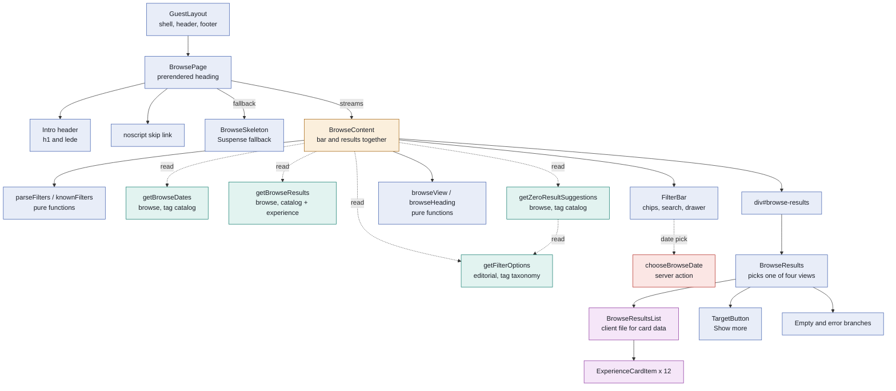
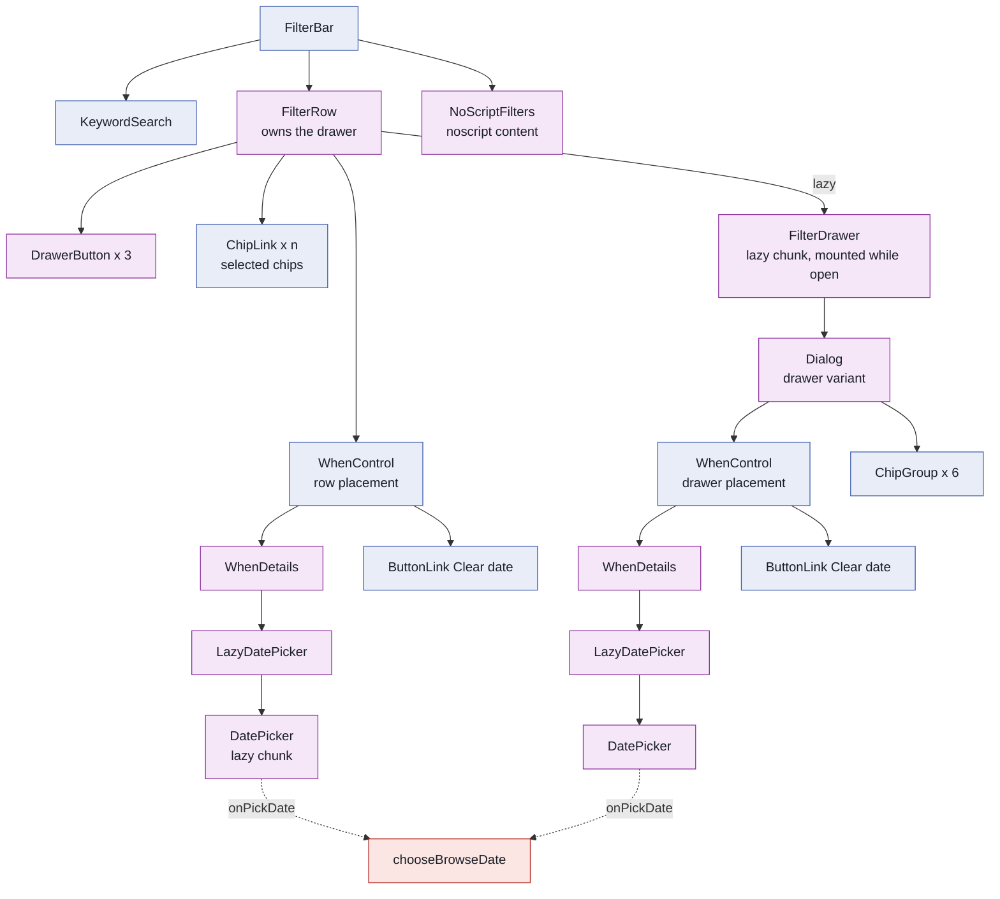
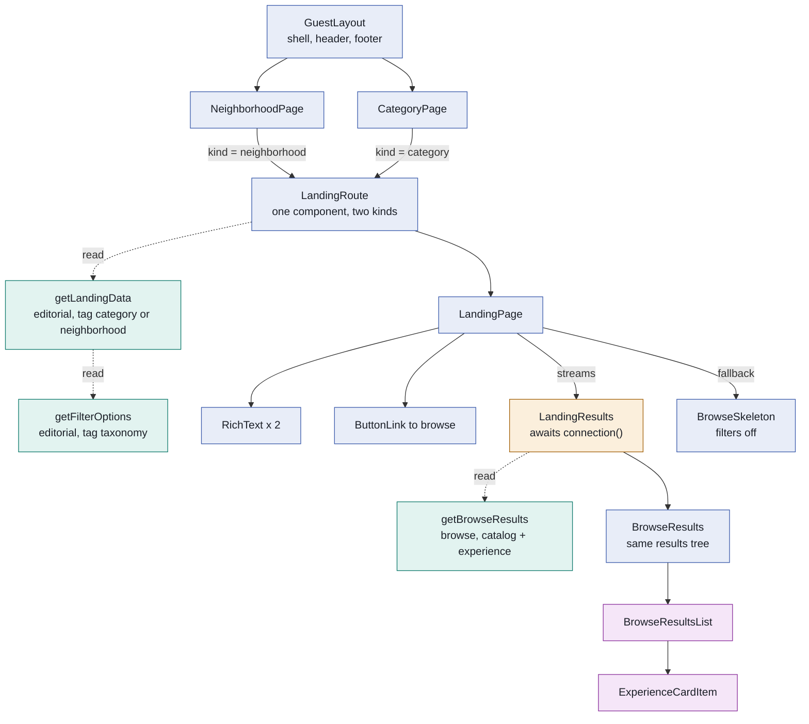

# Browse page map

`/new-york/browse`, `/new-york/neighborhoods/[neighborhood]`, `/new-york/things-to-do/[category]`

Read from main at 2db68ea (2026-11-15). A PR that changes this tree (a component, a Suspense or client boundary, a cache tag, an action) updates this file in the same PR.

How browse is assembled: the filters held in the address, the filter bar and drawer, the lazily loaded calendar, and the results. The two landing pages that reuse its results are mapped after it. The shared guest layout (header, footer, phone menu, banner, account) is mapped in the [guest layout README](../README.md) and appears here as one node.

## Legend

server = rendered on the server per request; cached = `'use cache'` read; streamed = inside a Suspense boundary; client = `'use client'` island; action = server action.

## Filters live in the address

There is no filter state in the browser. The address is the state: `category` and `neighborhood` (both lists, up to 8), `date`, `guests`, `price`, `age`, `setting`, `q`, and `after`, defined once in `browseParamNames` in [`lib/filters.ts`](../../../lib/filters.ts). `parseFilters()` drops anything malformed, so a bad value is the same as an absent one, and it sorts lists so one set of filters has one address. Every chip is a link to the address with that chip toggled. A page's cache key is the parsed filters plus the minute, so people with the same filters share one entry.

## Render tree

### Browse page

The page shell, the streamed content, and the results.

| Component                                              | Kind                                                            | File                                                                                                            | Notes                                                                                                                                                                                                |
| ------------------------------------------------------ | --------------------------------------------------------------- | --------------------------------------------------------------------------------------------------------------- | ---------------------------------------------------------------------------------------------------------------------------------------------------------------------------------------------------- |
| `GuestLayout`                                          | server                                                          | [`(guest)/layout.tsx`](../layout.tsx)                                                                           | Mapped in the [guest layout README](../README.md). It holds the header, footer, phone menu, and the streamed banner and account slots.                                                               |
| `BrowsePage`                                           | server                                                          | [`browse/page.tsx`](browse/page.tsx)                                                                            | Prerenders the heading and intro. `generateMetadata` parses the address and reads `getBrowseTitle()` for the title. Any filtered or paged address is marked `noindex, follow`.                       |
| Intro header                                           | server                                                          | [`browse/page.tsx`](browse/page.tsx)                                                                            | The h1 "Browse experiences" and a one-line intro.                                                                                                                                                    |
| noscript skip link                                     | server                                                          | [`browse/page.tsx`](browse/page.tsx)                                                                            | "Skip to results", shown only with scripting off, because the results sit after the footer in the document then.                                                                                     |
| `BrowseSkeleton`                                       | server                                                          | [`components/BrowseSkeleton/BrowseSkeleton.tsx`](../../../components/BrowseSkeleton/BrowseSkeleton.tsx)         | A filter-bar skeleton plus card skeletons, so the space is held until the stream arrives.                                                                                                            |
| `BrowseContent`                                        | streamed                                                        | [`browse/BrowseContent.tsx`](browse/BrowseContent.tsx)                                                          | The whole filter bar and the results stream together behind one Suspense. It awaits `searchParams` and `connection()`. A failed read renders the error view and the status line in place of the bar. |
| `parseFilters()`, `knownFilters()`                     | server (pure function)                                          | [`lib/filters.ts`](../../../lib/filters.ts)                                                                     | Parse the address into a `BrowseQuery`. Bad values are dropped, and lists are sorted and capped at 8. Only slugs the catalog has, and days inside the 121-day window, reach a cache key.             |
| `getFilterOptions()`                                   | cached, `editorial`, tag `taxonomy`                             | [`server/filterOptions.ts`](../../../server/filterOptions.ts)                                                   | Every category and neighborhood. Also read by the page title, the landing pages, and the zero-result reads.                                                                                          |
| `getBrowseDates(filters)`                              | cached, `browse`, tag `catalog`                                 | [`server/browse.ts`](../../../server/browse.ts)                                                                 | Days that have a session. The date is left out of its key, so picking a day does not miss the calendar entry.                                                                                        |
| `getBrowseResults(query, asOf)`                        | cached, `browse`, tags `catalog` and `experience:<id>` per card | [`server/browse.ts`](../../../server/browse.ts)                                                                 | One page per filter combination, cursor, and minute. A cursor nobody can see switches itself to `uncached`.                                                                                          |
| `getZeroResultSuggestions()`                           | cached, `browse`, tag `catalog`                                 | [`server/browse.ts`](../../../server/browse.ts)                                                                 | Read only when the page is empty and filtered. The cached part throws on failure, and the wrapper forgives it, so the empty state shows without suggestions.                                         |
| `browseView()`, `withSuggestions()`, `browseHeading()` | server (pure function)                                          | [`lib/pages/browse.ts`](../../../lib/pages/browse.ts)                                                           | Build the one view the results component renders, and the text of the always-present `role="status"` line.                                                                                           |
| `FilterBar`                                            | server                                                          | [`components/FilterBar/FilterBar.tsx`](../../../components/FilterBar/FilterBar.tsx)                             | Takes only plain data: option names, the parsed filters, `today`, `availableDates`, and `onPickDate`. Its subtree is in the next diagram.                                                            |
| `chooseBrowseDate`                                     | action                                                          | [`server/actions/browse.ts`](../../../server/actions/browse.ts)                                                 | Bound to the current filters by `BrowseContent`. Parses the filters and the date again, then `redirect()`s to the address with `date` set.                                                           |
| `div#browse-results`                                   | server                                                          | [`browse/BrowseContent.tsx`](browse/BrowseContent.tsx)                                                          | Wrapper with `data-reveal-without-script`, and the target of the skip link.                                                                                                                          |
| `BrowseResults`                                        | server                                                          | [`components/BrowseResults/BrowseResults.tsx`](../../../components/BrowseResults/BrowseResults.tsx)             | Picks list, empty (suggestions, a next-day link, or "Clear all filters"), error (`RetryAlert`), or a first-page link for a cursor nobody can see.                                                    |
| `BrowseResultsList`                                    | client                                                          | [`components/BrowseResults/BrowseResultsList.tsx`](../../../components/BrowseResults/BrowseResultsList.tsx)     | A client file so the cards cross the boundary as plain data, not one server element each. The card code therefore ships to the browser.                                                              |
| `ExperienceCardItem` x 12                              | client (pulled in by the list island)                           | [`components/ExperienceCard/ExperienceCardItem.tsx`](../../../components/ExperienceCard/ExperienceCardItem.tsx) | Page size is 12. The first card preloads its photo. Uses `Photo` and `Card`. It has no directive of its own and ships because the client list imports it.                                            |
| `TargetButton` "Show more"                             | server                                                          | [`components/BrowseResults/TargetButton.tsx`](../../../components/BrowseResults/TargetButton.tsx)               | A `next/form` GET to the same address with `after=<last id>` as a hidden field. A cursor, not an offset.                                                                                             |
| Empty and error branches                               | server                                                          | [`components/BrowseResults/BrowseResults.tsx`](../../../components/BrowseResults/BrowseResults.tsx)             | `ButtonLink`, `RemoveFilterLinks` (one link per filter worth taking off), and `RetryAlert`.                                                                                                          |

### Browse filter bar

The subtree of `FilterBar`: the chip row, the date popover, the lazy drawer, and the no-script copy.

| Component                               | Kind                | File                                                                                              | Notes                                                                                                                                                                                                                                                                                                                               |
| --------------------------------------- | ------------------- | ------------------------------------------------------------------------------------------------- | ----------------------------------------------------------------------------------------------------------------------------------------------------------------------------------------------------------------------------------------------------------------------------------------------------------------------------------- |
| `FilterBar`                             | server              | [`components/FilterBar/FilterBar.tsx`](../../../components/FilterBar/FilterBar.tsx)               | Builds every chip as a link to the address with that chip toggled. Holds no filter state.                                                                                                                                                                                                                                           |
| `KeywordSearch`                         | server              | [`components/FilterBar/KeywordSearch.tsx`](../../../components/FilterBar/KeywordSearch.tsx)       | A plain GET form (`q`) that keeps the other filters as hidden fields. Works with no script.                                                                                                                                                                                                                                         |
| `FilterRow`                             | client              | [`components/FilterBar/FilterDrawerHost.tsx`](../../../components/FilterBar/FilterDrawerHost.tsx) | The row of chips and owner of the drawer. Holds `open`, `busy`, and `failed` state, shares them with its buttons through a context, and remembers focus so a chip that clears itself hands focus to Filters.                                                                                                                        |
| `DrawerButton` x 3                      | client              | [`components/FilterBar/FilterDrawerHost.tsx`](../../../components/FilterBar/FilterDrawerHost.tsx) | Filters (with the active count), Neighborhood (hidden once one is chosen), and Guests (hidden once set). All three open the same drawer. A press shows `aria-busy` until the chunk arrives.                                                                                                                                         |
| `ChipLink` (selected) x n               | server              | [`components/Chip/ChipLink.tsx`](../../../components/Chip/ChipLink.tsx)                           | One per active filter. Pressing one is a link to the address without it.                                                                                                                                                                                                                                                            |
| `WhenControl` (row)                     | server              | [`components/FilterBar/FilterBar.tsx`](../../../components/FilterBar/FilterBar.tsx)               | A server function in the same file. It renders the date chip as a popover in the row.                                                                                                                                                                                                                                               |
| `WhenDetails`                           | client              | [`components/FilterBar/WhenDetails.tsx`](../../../components/FilterBar/WhenDetails.tsx)           | A `
` disclosure, so the chip opens with no script. Counts opens, closes itself when the day changes, and returns focus to the chip.                                                                                                                                                                                        |
| `LazyDatePicker`                        | client              | [`components/FilterBar/LazyDatePicker.tsx`](../../../components/FilterBar/LazyDatePicker.tsx)     | Shows a box the size of the month, with a live status message, until the calendar chunk arrives. A failed fetch says so and the next open tries again. Once loaded it is never remounted.                                                                                                                                           |
| `DatePicker`                            | client (lazy chunk) | [`components/DatePicker/DatePicker.tsx`](../../../components/DatePicker/DatePicker.tsx)           | React Aria calendar, fetched through `import()` in `datePickerLoader.ts`. Days with no session are disabled from `availableDates`. Picking a day calls `onPickDate`.                                                                                                                                                                |
| `ButtonLink` "Clear date"               | server              | [`components/Button`](../../../components/Button)                                                 | Only when a day is chosen. A plain link to the same filters without the day.                                                                                                                                                                                                                                                        |
| `chooseBrowseDate`                      | action              | [`server/actions/browse.ts`](../../../server/actions/browse.ts)                                   | Redirects to the address with the chosen day. Every other filter navigates by link and calls no action.                                                                                                                                                                                                                             |
| `FilterDrawer`                          | client (lazy chunk) | [`components/FilterDrawer/FilterDrawer.tsx`](../../../components/FilterDrawer/FilterDrawer.tsx)   | Not in the first bundle, and mounted only while open, so its calendar mounts fresh each time. It has no directive of its own and is a client module through the host that imports it and its `Dialog`. `FilterRow` fetches the chunk when the browser is idle, or on hover or focus of a chip, unless the guest asked to save data. |
| `Dialog`                                | client              | [`components/Dialog/Dialog.tsx`](../../../components/Dialog/Dialog.tsx)                           | The drawer variant. The footer has "Clear all" (pushes `browsePath`) and the apply button, "Show results".                                                                                                                                                                                                                          |
| `WhenControl` (When group)              | server              | [`components/FilterBar/FilterBar.tsx`](../../../components/FilterBar/FilterBar.tsx)               | The same control again, this time in the flow of the drawer. Built on the server and passed in as drawer children.                                                                                                                                                                                                                  |
| `WhenDetails` (drawer copy)             | client              | [`components/FilterBar/WhenDetails.tsx`](../../../components/FilterBar/WhenDetails.tsx)           | Same component as in the row, mounted a second time.                                                                                                                                                                                                                                                                                |
| `LazyDatePicker` (drawer copy)          | client              | [`components/FilterBar/LazyDatePicker.tsx`](../../../components/FilterBar/LazyDatePicker.tsx)     | Same component as in the row. A late mount gets an already-fetched module from `loadedDatePicker()`.                                                                                                                                                                                                                                |
| `DatePicker` (drawer copy)              | client (lazy chunk) | [`components/DatePicker/DatePicker.tsx`](../../../components/DatePicker/DatePicker.tsx)           | Same lazy chunk as in the row.                                                                                                                                                                                                                                                                                                      |
| `ButtonLink` "Clear date" (drawer copy) | server              | [`components/Button`](../../../components/Button)                                                 | Same link as in the row.                                                                                                                                                                                                                                                                                                            |
| `ChipGroup` x 6                         | server              | [`components/FilterBar/ChipGroup.tsx`](../../../components/FilterBar/ChipGroup.tsx)               | Guests, Neighborhood, Category, Price, Age, and Indoor or outdoor. Each chip is a `ChipLink`, so a press navigates. "Show results" only closes the drawer.                                                                                                                                                                          |
| `NoScriptFilters`                       | client              | [`components/FilterBar/NoScriptFilters.tsx`](../../../components/FilterBar/NoScriptFilters.tsx)   | Only the `<noscript>` content: a "Show this day" GET form and all six chip groups again as links. It is a client file on purpose, so the framework does not stream the chips as templates that cannot be swapped into a `<noscript>`.                                                                                               |

### Landing pages

`/new-york/neighborhoods/[neighborhood]` and `/new-york/things-to-do/[category]` are one component, `LandingRoute`, called with a different `kind`.

| Component                              | Kind                                                                | File                                                                                                            | Notes                                                                                                                                                                                                                            |
| -------------------------------------- | ------------------------------------------------------------------- | --------------------------------------------------------------------------------------------------------------- | -------------------------------------------------------------------------------------------------------------------------------------------------------------------------------------------------------------------------------- |
| `GuestLayout`                          | server                                                              | [`(guest)/layout.tsx`](../layout.tsx)                                                                           | Same shell as browse. See the [guest layout README](../README.md).                                                                                                                                                               |
| `NeighborhoodPage`                     | server                                                              | [`neighborhoods/[neighborhood]/page.tsx`](neighborhoods/[neighborhood]/page.tsx)                                | A thin file: awaits `params` and hands `kind` and `slug` to `LandingRoute`. `generateStaticParams` prerenders only the placeholder slug `not_a_slug`, because the build has no database. Any real slug renders on first request. |
| `CategoryPage`                         | server                                                              | [`things-to-do/[category]/page.tsx`](things-to-do/[category]/page.tsx)                                          | The twin of `NeighborhoodPage` for `/new-york/things-to-do/[category]`.                                                                                                                                                          |
| `LandingRoute`                         | server                                                              | [`_landing/LandingRoute.tsx`](_landing/LandingRoute.tsx)                                                        | Reads the page data. A failed read shows `PageError` with a retry link. An unknown slug is a 404.                                                                                                                                |
| `getLandingData(kind, slug)`           | cached, `editorial`, tag `category:<slug>` or `neighborhood:<slug>` | [`server/landing.ts`](../../../server/landing.ts)                                                               | The name plus the editor's copy. A miss is `uncached`, and a malformed slug is refused before the cache is asked. Also called by `generateMetadata` for the title and description.                                               |
| `getFilterOptions()`                   | cached, `editorial`, tag `taxonomy`                                 | [`server/filterOptions.ts`](../../../server/filterOptions.ts)                                                   | Read inside `getLandingData` to turn a slug into a name.                                                                                                                                                                         |
| `LandingPage`                          | server                                                              | [`components/LandingPage/LandingPage.tsx`](../../../components/LandingPage/LandingPage.tsx)                     | Heading, intro, a "browse with more filters" link, the results slot, then the body copy.                                                                                                                                         |
| `RichText` x 2                         | server                                                              | [`components/RichText`](../../../components/RichText)                                                           | The editor's intro and body.                                                                                                                                                                                                     |
| `ButtonLink` to browse                 | server                                                              | [`components/Button`](../../../components/Button)                                                               | `landingBrowseHref()` builds the browse address with this one category or neighborhood already set.                                                                                                                              |
| `LandingResults`                       | streamed                                                            | [`_landing/LandingRoute.tsx`](_landing/LandingRoute.tsx)                                                        | Awaits `connection()` for the minute. The fallback is `BrowseSkeleton filters={false}`.                                                                                                                                          |
| `BrowseSkeleton`                       | server                                                              | [`components/BrowseSkeleton/BrowseSkeleton.tsx`](../../../components/BrowseSkeleton/BrowseSkeleton.tsx)         | Card skeletons only, with no filter bar.                                                                                                                                                                                         |
| `getBrowseResults(landingQuery, asOf)` | cached, `browse`, tags `catalog` and `experience:<id>` per card     | [`server/browse.ts`](../../../server/browse.ts)                                                                 | The same function as browse, called with the first page of one filter.                                                                                                                                                           |
| `BrowseResults`                        | server                                                              | [`components/BrowseResults/BrowseResults.tsx`](../../../components/BrowseResults/BrowseResults.tsx)             | The same results tree as browse. "Show more" posts to browse (see Worth knowing).                                                                                                                                                |
| `BrowseResultsList`                    | client                                                              | [`components/BrowseResults/BrowseResultsList.tsx`](../../../components/BrowseResults/BrowseResultsList.tsx)     | Same client island as browse.                                                                                                                                                                                                    |
| `ExperienceCardItem`                   | client (pulled in by the list island)                               | [`components/ExperienceCard/ExperienceCardItem.tsx`](../../../components/ExperienceCard/ExperienceCardItem.tsx) | Same cards as browse.                                                                                                                                                                                                            |

## What arrives when (browse)

1. Shell. The layout, header, the heading and intro, and `BrowseSkeleton` in place of the bar and results.
2. Streamed in. The banner and account, then `BrowseContent`: the filter bar and the first 12 cards land together and replace the skeleton. They need `searchParams` and the clock.
3. Hydration. `SiteMenu`, `FilterRow` with its buttons and date chip, `WhenDetails`, `LazyDatePicker` (placeholder only), and the results list. No filter works only through these: every chip, the search, and "Show more" are plain links or forms.
4. Idle. The drawer chunk and the calendar chunk are fetched when the browser is idle, or on first hover or focus of a chip, unless data saving is on.

## Picking a day

1. The guest opens the date chip. `WhenDetails` counts the open, and `LazyDatePicker` fetches the calendar if the idle warm-up has not.
2. Choosing a day calls the server action `chooseBrowseDate` in [`server/actions/browse.ts`](../../../server/actions/browse.ts), bound to the current filters by `BrowseContent`.
3. The action parses both the filters and the date again, because both come from the browser, then `redirect()`s to the address with `date` set. No state is stored.
4. The new address renders, and `WhenDetails` sees the date change and closes.

Every other filter, and the drawer's chips, navigate by link and call no action.

## Landing pages compared with browse

| Shared with browse | Different |
| --- | --- |
| The results tree (`BrowseResults`, the list island, the cards, `BrowseSkeleton`), `getBrowseResults`, `getFilterOptions`, the `minuteAsOf` clock, and the `connection()` stream boundary. | No filter bar, drawer, calendar, or search, so none of those islands ship. Only two things are read besides the results: the editor's copy and the name. The heading and copy sit in the prerendered shell, and only the experiences stream. There is no `searchParams`, because the page has one filter, fixed by the address. |

## Cache invalidation

The three schedule reads (`getBrowseResults`, `getBrowseDates`, and the zero-result suggestions) use the short `browse` profile (revalidate 60 s, expire 120 s) and carry `catalog`. Profiles are in [`lib/cacheProfiles.ts`](../../../lib/cacheProfiles.ts) and tags in [`lib/cacheTags.ts`](../../../lib/cacheTags.ts).

| Change | What clears | When the guest sees it |
| --- | --- | --- |
| A listing is published, edited, or taken down | `catalog`, which clears every browse read; also `experience:<id>`, and the `category:<slug>` and `neighborhood:<slug>` tags of that listing | The next request after the change |
| A host profile changes (`hostProfile`) | `catalog` | The next request after the change |
| An experience's sessions or photos change (`experience`) | `experience:<id>`, which clears each cached results page that lists that experience | The next request after the change, for pages that list it |
| A session is added to an experience that is on no cached page | Nothing; the entry waits for the minute to run out | Within about a minute (revalidate 60 s, expire 120 s) |
| A category or neighborhood is renamed | Nothing; no change reaches `taxonomy` | When the `editorial` profile runs out (revalidate 1 hour, expire 24 hours) |
| Landing copy is edited (`categoryCopy`, `neighborhoodCopy`) | `category:<slug>` or `neighborhood:<slug>` | The next request after the change |

## Worth knowing

- One boundary holds both bar and results. The filter bar sits inside `BrowseContent`, so on a first load it waits for the same reads as the cards, and the skeleton stands in for both. The bar is not independent of the results: a failed read replaces it with the error view.
- The calendar is loaded two ways and mounted twice. It appears in the chip row and, inside the drawer, again as its own `WhenControl`. The drawer mounts its copy fresh each time it opens, which is why `loadedDatePicker()` hands an already-fetched module to a late mount. The loader is [`datePickerLoader.ts`](../../../components/FilterBar/datePickerLoader.ts), next to `FilterBar`.
- Shared state between islands is small. `FilterRow` shares `open` and `busy` with its buttons through a context. `datePickerLoader.ts` holds one module-level variable that every `LazyDatePicker` and the warm-up read. `WhenDetails` passes the open count to the picker by context.
- The drawer's chips are not controlled inputs. They are links built on the server. "Show results" only closes the drawer, since pressing a chip has already navigated. The button cannot say how many results, and the code says so.
- `NoScriptFilters` and `BrowseResultsList` are client files for a render reason, not interactivity. Both exist to keep the markup from being streamed as templates (noscript content, and a row past about 3,200 bytes). The card code ships to the browser as a result.
- The server action takes filters from the browser. `chooseBrowseDate.bind(null, filters)` sends the filters through the client, so the action re-validates all of them.
- Landing results share browse's cache. `landingQuery()` is the first page of one filter, which is a query browse also issues for `?category=x`, so the entry can be shared.
- A landing page's "Show more" leaves the landing page. The landing view reuses `browseView()`, whose `targetFor()` posts to `browsePath` with the category or neighborhood and `after`. The second page is therefore browse, not another landing page. Its empty state is the exception: `landingView()` rewrites it so it is not "filtered".
- The page title reads the options a second time. `generateMetadata` calls `getFilterOptions()` through `getBrowseTitle()` as well. It is the same cached entry, so there is no extra database read. `getBrowseTitle()` itself is not cached.
- `FilterDrawer` has no `'use client'` directive of its own. It is a client module because the client `FilterRow` host imports it and it renders the client `Dialog`.

Rendered view: https://defaultdave.github.io/ramble-pm/maps/browse.html
