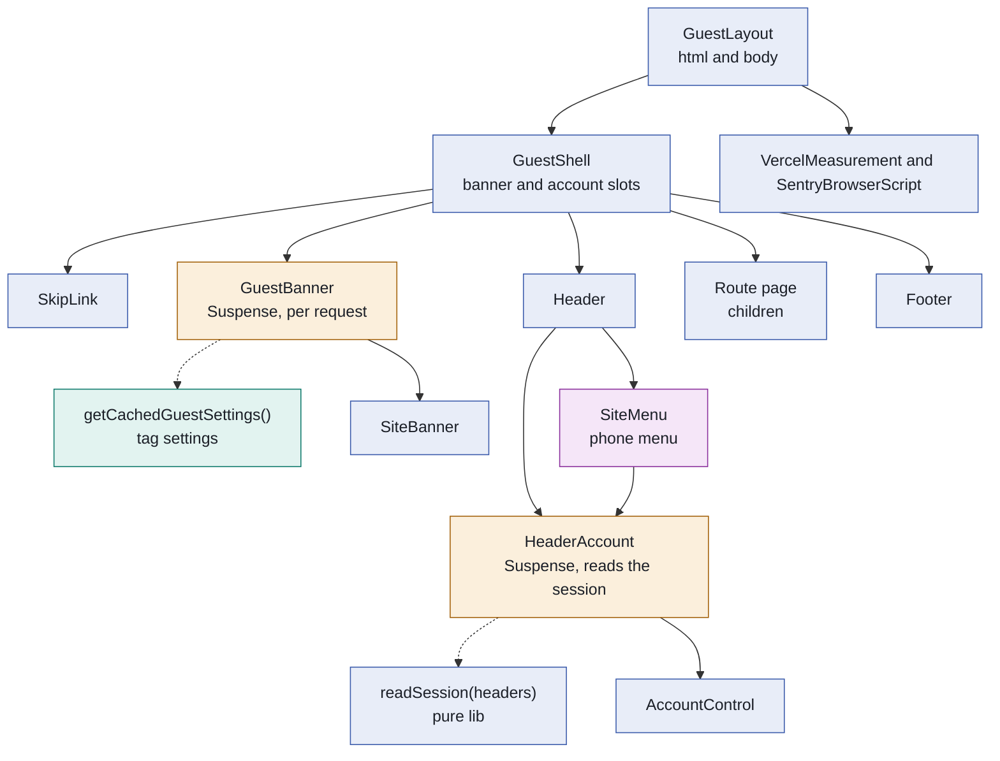
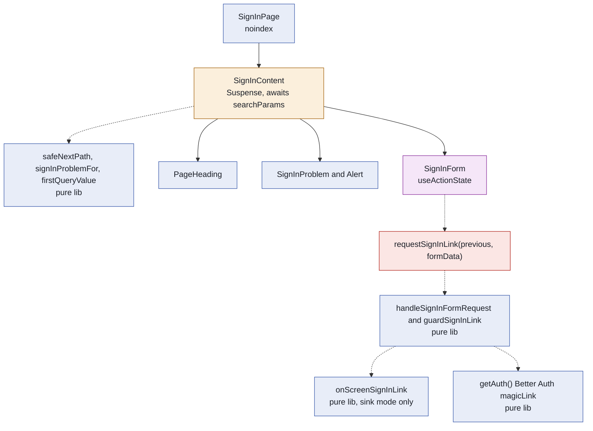
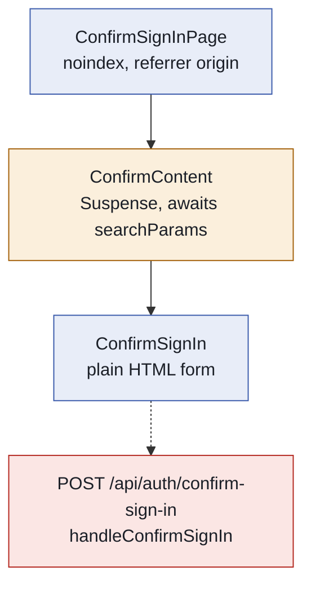
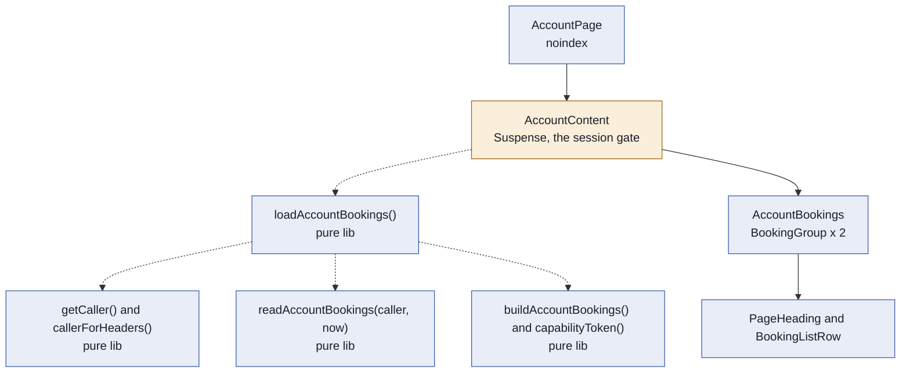

# Sign-in and account page map

Routes: `/sign-in`, `/sign-in/confirm`, `/account` (the `/account` code is in [`../account/`](../account/)).

Read from main at 2db68ea (2026-11-15). A PR that changes this tree (a component, a Suspense or client boundary, a cache tag, an action) updates this file in the same PR.

How a guest asks for a sign-in link, confirms it, and reaches their bookings: every component from the layout down, which action or route handler sets the session, and how the caller and its roles are read. The guest layout, banner and footer are mapped in [`../README.md`](../README.md); this file keeps the account control and the session reads because they are the point of this map.

## Legend

server = rendered on the server per request; cached = `'use cache'` read; streamed = inside a Suspense boundary; client = `'use client'` island; action = server action.

## Render tree

### Layout, banner and account control

The shell every route here sits in. Plain library functions (the auth and data reads) are drawn as server nodes with a note.

| Component | Kind | File | Notes |
| --- | --- | --- | --- |
| GuestLayout | server | `src/app/(guest)/layout.tsx` | The root layout for this route group: html, body, fonts, base styles. There is no `src/app/layout.tsx`; each group (guest, host, ops, checkout) owns its own html and body. Unlike the host and ops layouts it renders no `RenderPerRequest`. |
| GuestShell | server | `src/components/GuestShell/GuestShell.tsx` | Skip link, banner, header, the page inside `main`, footer. Takes the banner and the account control as slots. |
| SkipLink | server | `src/components/SkipLink/` | Skip to main content link. |
| GuestBanner | streamed | `src/app/(guest)/GuestBanner.tsx` | Awaits `connection()`, so it renders per request. Fallback: nothing. A failed read drops the banner and logs. |
| getCachedGuestSettings() | cached | `src/server/siteSettings.ts` | The ops banner text comes from the cached guest settings (cache tag `settings`). |
| SiteBanner | server | `src/components/GuestShell/SiteBanner.tsx` | One-line notice, shown only when ops set text. |
| Header | server | `src/components/Header/Header.tsx` | Home link, main nav, search, Gifts. Puts the `account` slot in the bar from tablet up and passes the same slot to the menu. |
| SiteMenu | client | `src/components/GuestShell/SiteMenu.tsx` | Phone menu. The account control is its last item, so the same element renders twice on one page. |
| HeaderAccount | streamed | `src/app/(guest)/HeaderAccount.tsx` | Reads `headers()` and asks whether a session exists. Wrapped in React `cache()` so the header and the phone menu share one read. Fallback: `AccountControl signedIn={false}`. A read that throws shows Sign in. |
| readSession(headers) | server | `src/server/auth/session.ts` | Better Auth `api.getSession` on the request cookie. Returns id, user id, created and expiry times, or null. Does not read roles. |
| AccountControl | server | `src/components/Header/AccountControl.tsx` | Signed out: a Sign in link to `/sign-in`. Signed in: a My bookings link to `/account` and a Sign out form that posts to `/api/auth/end-session`. No JavaScript needed. |
| Route page | server | `src/app/(guest)/` | The page for the route, in the `children` slot of the shell. Detailed in the diagrams below. |
| Footer | server | `src/components/Footer/` | Site footer. |
| VercelMeasurement and SentryBrowserScript | server | `src/server/analytics/`, `src/server/monitoring/` | Analytics and error-tracking scripts. |

### /sign-in

| Component | Kind | File | Notes |
| --- | --- | --- | --- |
| SignInPage | server | `src/app/(guest)/sign-in/page.tsx` | `/sign-in`. Metadata title, `robots: noindex`. Wraps the content in Suspense. Fallback: `PageHeading` with a text `Skeleton`. |
| SignInContent | streamed | `src/app/(guest)/sign-in/SignInContent.tsx` | Awaits `searchParams`. `?next=` is cleaned by `safeNextPath`; `?error=` becomes a problem notice (INVALID_TOKEN is "expired or already used", anything else is "could not sign you in"). |
| safeNextPath, signInProblemFor, firstQueryValue | server | `src/lib/signIn.ts`, `src/lib/text.ts` | Pure library functions. Only a path on this site survives; anything else becomes `/`. Checks several layers of percent-decoding, backslashes, control characters and dot segments. |
| PageHeading | server | `src/components/PageHeading.tsx` | Page heading. |
| SignInProblem and Alert | server | `src/components/SignIn/SignInProblem.tsx` | The problem notice shown for an `?error=` value. |
| SignInForm | client | `src/components/SignIn/SignInForm.tsx` | `useActionState` on the action passed in as a prop. States: idle, invalid, sent, link, rate limited, failed. `link` is the on-screen sign-in link: a success `Alert` ("Your sign-in link is ready", copy in `src/lib/copy/signIn.ts`) with a `Continue` `ButtonLink` to `/sign-in/confirm?token=&next=` in place of the form, shown only while `EMAIL_MODE` is `sink`. Moves focus to the first invalid field or to the notice. Renders `Alert`, `Input`, `Button`, `ButtonLink`. |
| requestSignInLink(previous, formData) | action | `src/server/actions/signIn.ts` | Trims and validates the email, then builds an in-process POST to `/api/auth/sign-in/magic-link` with `callbackURL` set to the clean `next`, and hands it to `handleSignInFormRequest` (not `handleAuthRequest`, which is the `/api/auth` route's). Maps 200 (the body is read with `onScreenHrefFromBody` in `src/lib/signIn.ts`: a `signInPath` that is the confirm page with a token of the accepted shape becomes `link`; any other body is `sent`; a body that is not JSON throws, is logged with its error kind, and becomes `failed`), 429 (with Retry-After), 400 and the rest to form states. Never logs the address or the link. |
| handleSignInFormRequest and guardSignInLink | server | `src/server/auth/handler.ts` | Pure library. `handleAuthRequest` (the `/api/auth` route) and `handleSignInFormRequest` (only the action) share one body; only the second can return an on-screen link, as `{ status: true, signInPath }`, because Next passes a route handler its second argument and an option there would be reachable from outside. Refuses a body over 4096 bytes, bad JSON or a bad address, then counts the address with `consumeRateLimit('sign_in_link', email)` in the `rate_limits` table. A counter failure refuses the request (503): nothing is sent uncounted. Responses carry `no-store`. |
| onScreenSignInLink | server | `src/server/auth/onScreenLink.ts` | Pure library. Reads `holdsAnyRoleGrant(email)` (a subject-based read, no `Caller`, as `readRoleGrants` is) and the email mode on every call, so the first query is the same either way; then `signInLinkDelivery` (`src/lib/signIn.ts`) decides: `sink` and no role grant (host, staff, ops or admin) makes a token with `createSignInLinkToken` (the plugin's own row, single use, 5 minutes), emails it through `sendSignInLinkEmail` (`src/server/auth/signInLinkEmail.ts`, the helper `sendMagicLink` uses too) and returns the confirm path; anything else returns null and Better Auth sends the link as before. A role holder's reply is therefore the plain "link sent" one and its link stays in the dev mailbox. |
| getAuth() Better Auth magicLink | server | `src/server/auth/auth.ts` | Pure library, built on first use. Stores the token as an HMAC (`SIGN_IN_LINK_SECRET`) in `auth_verifications`, lives 5 minutes. `sendMagicLink` (the path for role holders in sink mode, and for everyone in other modes) rewrites the link to `/sign-in/confirm?token=&next=` and calls `sendEmail` with the `sign-in-link` template. |

### /sign-in/confirm

| Component | Kind | File | Notes |
| --- | --- | --- | --- |
| ConfirmSignInPage | server | `src/app/(guest)/sign-in/confirm/page.tsx` | `/sign-in/confirm`. Metadata: noindex, nofollow, `referrer: origin` so the token does not leak in a Referer (and not `no-referrer`, which makes the form post send `Origin: null`). Same Suspense and skeleton as sign-in. |
| ConfirmContent | streamed | `src/app/(guest)/sign-in/confirm/ConfirmContent.tsx` | Awaits `searchParams`. Checks the token shape with `ConfirmSignInSchema` (letters and digits, up to 128). It never calls Better Auth: opening the page uses nothing up. A bad token shows the expired notice and an "Ask for a new link" `ButtonLink`. |
| ConfirmSignIn | server | `src/components/SignIn/ConfirmSignIn.tsx` | A plain HTML form: hidden `token` and `next`, one Sign in `Button`, posting to `/api/auth/confirm-sign-in`. Works with no JavaScript (the `Button` module itself is `'use client'`). |
| POST /api/auth/confirm-sign-in | action | `src/app/api/auth/confirm-sign-in/route.ts`, `src/server/auth/forms.ts` | A route handler, not a server action. Only POST is exported, so a prefetch or a mail scanner GET is a 405. Refuses a foreign Origin (403), reads at most 2048 bytes, rebuilds a GET to `/api/auth/magic-link/verify` and passes it to Better Auth. **Better Auth sets the session cookie here.** Answers 303 to `next`; a refused link goes to `/sign-in?next=…&error=INVALID_TOKEN`. |

### /account

| Component | Kind | File | Notes |
| --- | --- | --- | --- |
| AccountPage | server | `src/app/(guest)/account/page.tsx` | `/account`. Title "My bookings", noindex. Suspense fallback: `PageHeading` with a text skeleton. |
| AccountContent | streamed | `src/app/(guest)/account/AccountContent.tsx` | The page is the gate, not the layout: a layout does not render again on a client navigation. Signed out: `redirect(signInHref('/account'))`. |
| loadAccountBookings() | server | `src/server/accountBookings.ts` | Pure library. Calls `getCaller()`; no user id returns `signed_out`. Otherwise reads the rows, builds each manage token at the order's current version, returns the view. |
| getCaller() and callerForHeaders() | server | `src/server/auth/caller.ts` | Pure library. Reads the session, drops it if past its idle deadline or 8 hour ceiling, moves the idle deadline forward (at most once a minute), reads `role_grants`, and builds the caller. |
| readAccountBookings(caller, now) | server | `src/server/db/accountBookings.ts` | Pure library. Joins orders to guests to auth users on the email address, only where `email_verified` is true. Upcoming first, soonest first, then past, latest first, capped at 100. |
| buildAccountBookings() and capabilityToken() | server | `src/lib/accountBookings.ts`, `src/server/tokens.ts` | Pure library. Splits upcoming from past and builds each Manage link. |
| AccountBookings | server | `src/app/(guest)/account/AccountBookings.tsx` | "Upcoming" and "Past" sections (two `BookingGroup`s), or "You have no bookings yet" with a link to browse. Each row is a `BookingListRow` linking to the manage page. |
| PageHeading and BookingListRow | server | `src/components/PageHeading.tsx`, `src/components/BookingListRow/` | Heading and one row per booking. |

## What arrives when

1. **Shell.** Layout, header with a Sign in link, footer, and the page's heading with a text skeleton. Nothing on these three routes is cached; the only `'use cache'` read is the banner's settings.
2. **Streamed in.** The banner, the real account control (Sign in, or My bookings and Sign out), and each page's content. Sign-in and confirm wait on `searchParams`; account waits on the session and then the bookings read.
3. **Hydration.** `SiteMenu`, and on `/sign-in` only, `SignInForm`. The confirm page and sign out are plain form posts. Without scripting, the sign-in form does not submit through the action.

## The sign-in path

1. A guest opens `/account` signed out. `AccountContent` redirects to `/sign-in?next=%2Faccount` through `signInHref`.
2. They submit an email. The server action `requestSignInLink` goes through `handleSignInFormRequest`, which rate limits per address. The form says "if this address can sign in, a link is on its way", whether or not an account exists. While `EMAIL_MODE` is `sink` (email is off in the demo), an address with no role grant instead gets a `Continue` link on the page, to the same confirm page the email carries; a role holder still gets "a link is on its way" and its link goes to the dev mailbox only.
3. The email, or the on-screen `Continue` link, goes to `/sign-in/confirm?token=…&next=…`, a page that only shows a button. This is so a mail scanner that fetches the link cannot use it up.
4. The button posts to `/api/auth/confirm-sign-in`. `handleConfirmSignIn` asks Better Auth to verify the token; the session cookie is set on that response. A 303 sends the guest to `next`, so they land on `/account`. A used or expired link lands on `/sign-in` with a notice.
5. Sign out is a form post to `/api/auth/end-session`, which calls Better Auth sign-out with the cookie and sends a 303 to `/`.

## Roles, the caller, and where hosts and ops go

`getCaller()` (`src/server/auth/caller.ts`) is the one place a caller is made. It dynamically imports the session, grants and session-extend code, so files that only call `requireRole` do not load Better Auth. Anonymous is `{ userId: null, roles: [] }`. Everyone signed in gets the `guest` role; `role_grants` rows add `host_owner` and `host_staff` (each tied to one host) and `ops` and `admin` (tied to none). A grant that does not match its scope is skipped. At most 200 grants are read.

There is no redirect by role. Sign-in lands on `next` or `/` whoever signs in. Each host page checks itself: signed out goes to `/sign-in?next=…`, signed in without a host gets the area's not-found page. Ops pages check `holdsOpsRole` and otherwise show `OpsAccessDenied`, which tells the person to sign in with a team account and links to `/sign-in?next=…`. Ops reads its caller through `readOpsCaller`, which treats a failed read as anonymous.

## Caches and what clears them

These routes have no tagged reads of their own, so nothing here is invalidated by a content edit.

| Change | What clears | When the guest sees it |
| --- | --- | --- |
| Site settings change (no screen yet: `updateSettings` has no caller, `TODO(U-078)`) | The `settings` tag, which `getCachedGuestSettings()` carries | On the next request that streams the banner. |
| Any auth request (sign-in link, confirm, sign out) | Nothing to clear: responses are sent `Cache-Control: no-store` because they may set or clear the cookie. The on-screen link rides a server action's POST answer, which is not cached either | Immediately. |
| A sign-in link ages out | The verification row's 5 minute expiry and its single use, not a cache | The next confirm attempt shows the expired notice. |

## Worth knowing

- **No app-level layout.** `src/app/layout.tsx` does not exist on main. The guest layout is itself the root and renders the html and body, so the header's account control is rebuilt per route group, and the host and ops areas have their own shells with no `HeaderAccount`.
- **The header and the page read the session differently.** `HeaderAccount` calls `readSession` only. `getCaller` (used by `/account`) also checks the 8 hour ceiling and moves the 30 minute idle deadline. Browsing public pages never extends the session, and the header shows My bookings to any signed-in user, hosts and ops included.
- **One element, two places.** The same `account` slot is rendered inside the header and inside the `SiteMenu` island's panel. `cache()` keeps it to one session read per request.
- **The sign-in action calls the auth handler in process.** It builds a synthetic Request with an `Origin` header and passes it to `handleSignInFormRequest` rather than fetching its own API. The rate limit still applies because it lives in that handler.
- **Better Auth's own limiter is off.** Its counter would sit in the memory of one serverless instance. The count is in the `rate_limits` table instead.
- **The on-screen link is a known hole while email is off.** Anyone who types an existing guest's address is shown that guest's link and signs in as them. It is shown only when `EMAIL_MODE` is exactly `sink`, evaluated on the server, and never for an address holding a role grant. Turning email on removes it with no code change.
- **Two ways to make a token.** `createSignInLinkToken` (`src/server/auth/signInLink.ts`) writes the same verification row as the plugin, for callers that need their own email wording. The `/sign-in` form uses the plugin's path.
- **The guest check in `readAccountBookings` is not what scopes the data.** `requireRole(caller, Guest, { ownerId: caller.userId })` compares the caller to itself. What limits the rows is the join on an email with `email_verified` true.
- **The account redirect runs inside Suspense.** By then the shell has started streaming, so Next will most likely deliver it as a client-side redirect rather than a 307. Worth confirming in a browser trace.
- **The auth proxy skips `/api`.** `src/proxy.ts` sets the CSP and nonce for pages but its matcher excludes `/api`, so the confirm, end-session and Better Auth responses carry only the headers the handlers set.

Key files: `src/server/auth/` (auth, caller, forms, handler, session, signInLink, signInToken), `src/lib/signIn.ts`, `src/lib/auth.ts`, `src/lib/roleGrants.ts`, and the three route handlers under `src/app/api/auth/`.

Rendered view: https://defaultdave.github.io/ramble-pm/maps/sign-in-and-account.html
