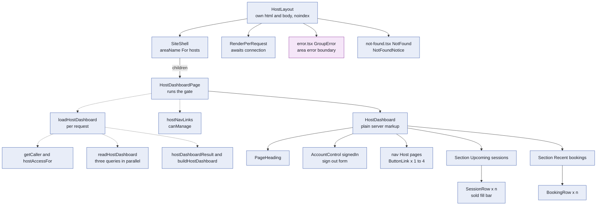
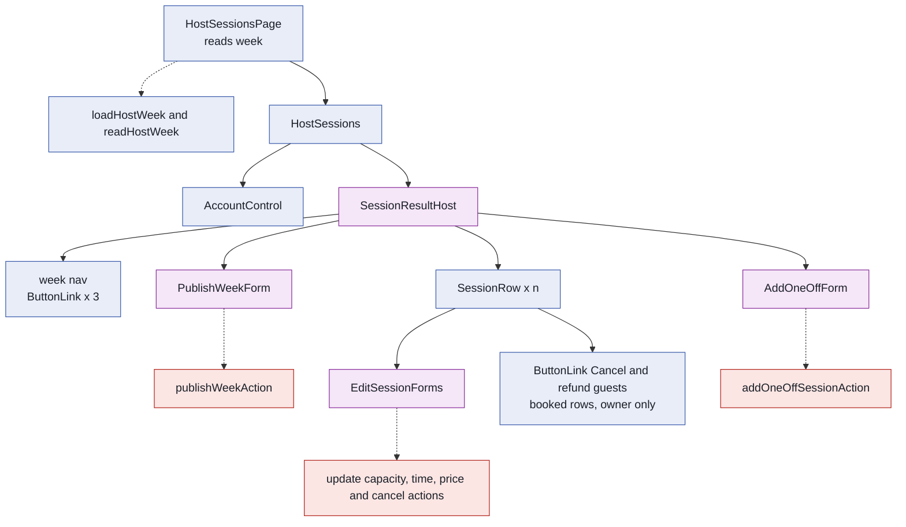
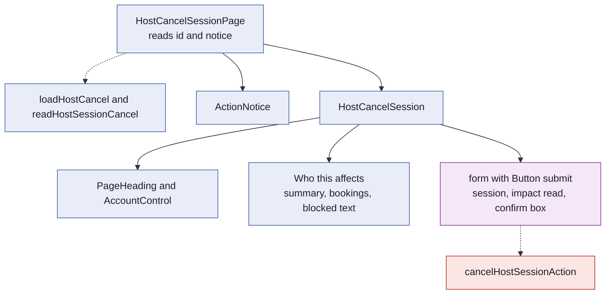
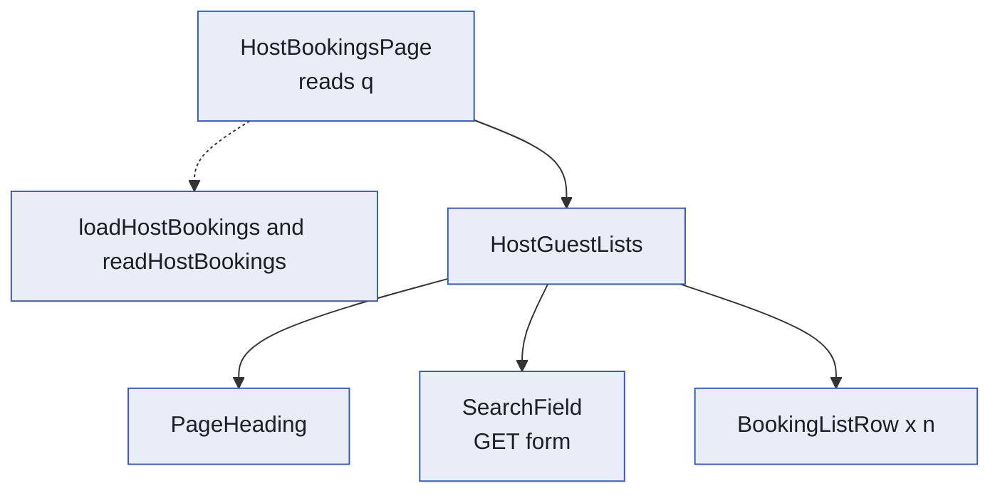
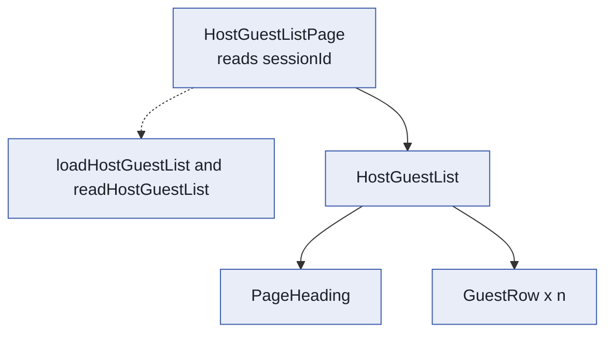
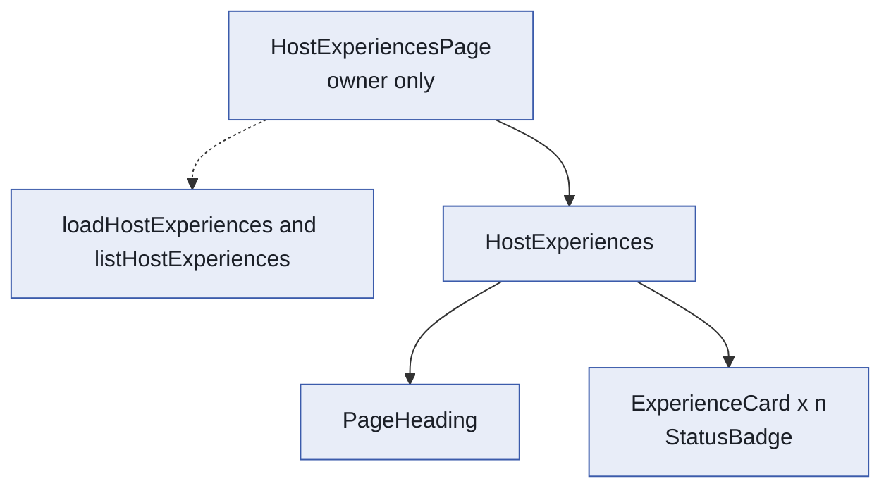
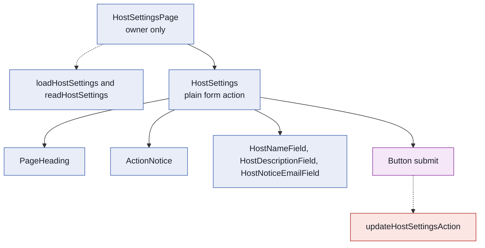
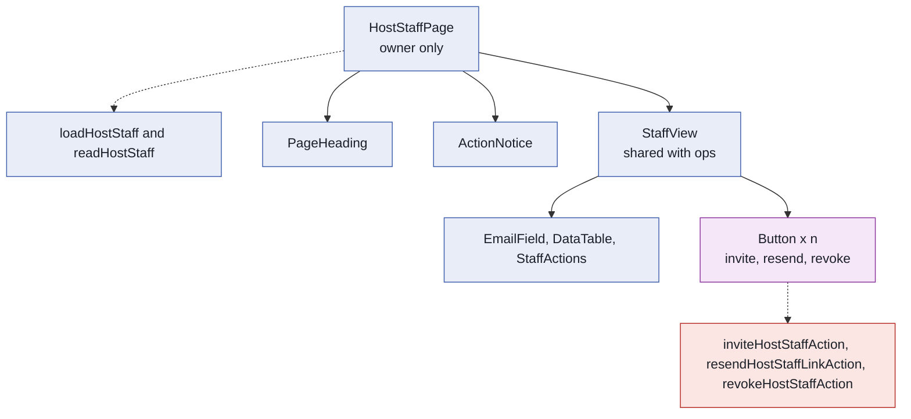
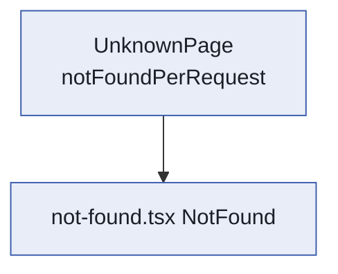

# Host area page map

`/host`, `/host/sessions`, `/host/sessions/[id]/cancel`, `/host/bookings`, `/host/bookings/session/[sessionId]`, `/host/experiences`, `/host/settings`, `/host/staff`, `/host/[...unknown]`

Read from main at 2db68ea (2026-11-15). A PR that changes this tree (a component, a Suspense or client boundary, a cache tag, an action) updates this file in the same PR.

Every page under `src/app/(host)/` is for signed-in hosts. The area shares one layout, has a dashboard and seven more pages, has no cached reads and no Suspense boundary, and ships very little client code.

## Legend

server = rendered on the server per request; cached = `'use cache'` read; streamed = inside a Suspense boundary; client = `'use client'` island; action = server action.

Dotted edges are a server action call or a data read. Nothing in this area is cached or streamed, so those two kinds do not appear in the diagrams.

## Render tree

### Layout and dashboard (`/host`)

| Component | Kind | File | Notes |
| --- | --- | --- | --- |
| HostLayout | server | [layout.tsx](./layout.tsx) | Has its own `html` and `body`, not the guest layout. Sets `robots: noindex` and `instant = false`. It makes no role check, because a layout is not rendered again on a client navigation. |
| SiteShell | server | [SiteShell.tsx](../../components/SiteShell.tsx) | Skip link, header with the brand link and the area name "For hosts", `main#main` and footer. It is not the guest shell: no menu island, no banner, no streamed account control. |
| RenderPerRequest | server | [renderPerRequest.tsx](../renderPerRequest.tsx) | Awaits `connection()` and renders nothing. It sits beside the shell so every script tag carries the request's CSP nonce and the page still renders in the first stage. |
| error.tsx, GroupError | client | [error.tsx](./error.tsx) | Error boundary for the area. It shows `ErrorNotice` with a retry when a host read throws, instead of a page with missing rows. |
| not-found.tsx, NotFound | server | [not-found.tsx](./not-found.tsx) | Renders `NotFoundNotice`. A non-host sees this, and it never says the area exists. |
| HostDashboardPage | server | [host/page.tsx](./host/page.tsx) | Runs the gate itself. `signed_out` redirects to sign in and back, a refused call runs `notFound()`, otherwise it renders the dashboard. |
| loadHostDashboard | server read | [hostDashboard.ts](../../server/hostDashboard.ts) | Per request, not cached. Calls `loadForHostArea(read, decide, allowStaff = true)`: caller, access, host id, the read, then the decision. |
| getCaller, hostAccessFor | server read | [caller.ts](../../server/auth/caller.ts), [hostAccess.ts](../../lib/hostAccess.ts) | Turns the session cookie into a caller, then reads the caller's own grants into signed_out, no_host_role, owner or staff. The host id never comes from the address. |
| readHostDashboard | server read | [hostDashboard.ts](../../server/db/hostDashboard.ts) | Checks `requireAnyRole(host_owner, host_staff)` for that host first, then runs three queries in parallel: the host name, the next scheduled sessions with seats sold, and the latest bookings. All are cut to that host. |
| hostDashboardResult, buildHostDashboard | pure lib | [hostAccess.ts](../../lib/hostAccess.ts), [hostDashboard.ts](../../lib/hostDashboard.ts) | Turn access plus rows into signed_out, refused, or ok with the view and `canManage` (true for an owner only). |
| hostNavLinks | pure lib | [hostStaff.ts](../../lib/hostStaff.ts) | Owner gets Manage sessions, Your experiences, Host settings and Staff. Staff get Sessions only. |
| HostDashboard | server | [HostDashboard.tsx](../../components/HostDashboard/HostDashboard.tsx) | Plain server markup. It has no island of its own on this page. |
| PageHeading | server | [PageHeading.tsx](../../components/PageHeading.tsx) | Title "Host dashboard" and the host name. |
| AccountControl signedIn | server | [AccountControl.tsx](../../components/Header/AccountControl.tsx) | My bookings link and a Sign out form that posts to a plain action path, so it works with no script. Reused from the guest header. |
| nav Host pages, ButtonLink x 1 to 4 | server | [ButtonLink.tsx](../../components/Button/ButtonLink.tsx) | Links come from `hostNavLinks`. `ButtonLink` is a server component. |
| Section Upcoming sessions | server | [HostDashboard.tsx](../../components/HostDashboard/HostDashboard.tsx) | Shows empty text when there are no sessions. |
| SessionRow x n | server | [HostDashboard.tsx](../../components/HostDashboard/HostDashboard.tsx) | Experience, when, sold label and a fill bar. `soldFillStep` sets a data attribute, and the bar is hidden from screen readers. |
| Section Recent bookings | server | [HostDashboard.tsx](../../components/HostDashboard/HostDashboard.tsx) | Shows empty text when there are no bookings. |
| BookingRow x n | server | [HostDashboard.tsx](../../components/HostDashboard/HostDashboard.tsx) | Guest, experience and time, seats, total, status and reference. |

### Other pages

Each page fills the children slot of `SiteShell` under the same layout, error page and not-found page.

#### `/host/sessions`

| Component | Kind | File | Notes |
| --- | --- | --- | --- |
| HostSessionsPage | server | [sessions/page.tsx](./host/sessions/page.tsx) | Reads `?week=`. Owner or staff. Passes the six actions to the view as one prop. |
| loadHostWeek, readHostWeek | server read | [hostSessions.ts](../../server/hostSessions.ts), [sessions.ts](../../server/db/sessions.ts) | Per request. Repeats the gate by hand instead of using `loadForHostArea`. `buildHostWeek` sets `canEdit` for an owner only. |
| HostSessions | server | [HostSessions.tsx](../../components/HostSessions/HostSessions.tsx) | Heading, week nav, then the days and rows. |
| SessionResultHost | client | [HostSessionForms.tsx](../../components/HostSessions/HostSessionForms.tsx) | Wraps the sections. Holds the success notice of a cancelled session, whose own form unmounts when the row stops being editable, and focuses it. Uses Alert. |
| AccountControl | server | [AccountControl.tsx](../../components/Header/AccountControl.tsx) | Same sign out control as the dashboard. |
| week nav, ButtonLink x 3 | server | [ButtonLink.tsx](../../components/Button/ButtonLink.tsx) | Previous, current and next week links. |
| PublishWeekForm | client | [HostSessionForms.tsx](../../components/HostSessions/HostSessionForms.tsx) | Owner only. A `useActionState` form built on the shared `ActionForm`. |
| publishWeekAction | action | [hostSessions.ts](../../server/actions/hostSessions.ts) | For an owner of a host only. The host comes from the grant. |
| SessionRow x n | server | [HostSessions.tsx](../../components/HostSessions/HostSessions.tsx) | Server markup per session. |
| EditSessionForms | client | [HostSessionForms.tsx](../../components/HostSessions/HostSessionForms.tsx) | Owner, editable rows only. A `details` holding four forms (Alert, Button, Input, Select), with a hidden session id and expected version. |
| ButtonLink Cancel and refund guests | server | [HostSessions.tsx](../../components/HostSessions/HostSessions.tsx) | Owner only, on an upcoming scheduled session with seats sold (`cancelHref` from `rowView`). Goes to the cancel page below; the in-row cancel form is for unbooked sessions. |
| updateSessionCapacityAction, updateSessionTimeAction, updateSessionPriceAction, cancelSessionAction | action | [hostSessions.ts](../../server/actions/hostSessions.ts) | Each runs `run()`: schema parse, `getCaller()`, a db function that checks the session is on the caller's host, then `revalidatePath('/host/sessions')`. |
| AddOneOffForm | client | [HostSessionForms.tsx](../../components/HostSessions/HostSessionForms.tsx) | Owner with at least one experience. |
| addOneOffSessionAction | action | [hostSessions.ts](../../server/actions/hostSessions.ts) | Adds one session to an experience of the caller's host. |

#### `/host/sessions/[id]/cancel`

| Component | Kind | File | Notes |
| --- | --- | --- | --- |
| HostCancelSessionPage | server | [sessions/[id]/cancel/page.tsx](./host/sessions/%5Bid%5D/cancel/page.tsx) | Reads `params.id` and `?notice=`. Owner only. Signed out goes to sign in and back; staff, ops, admin, a guest, another host's session, a missing session and a bad id all end in not found. |
| loadHostCancel, readHostSessionCancel | server read | [hostCancelSession.ts](../../server/hostCancelSession.ts), [hostCancelSession.ts](../../server/db/hostCancelSession.ts) | Through `loadForHostArea` with staff not allowed. The read checks `requireRole(host_owner)` for the grant's host, finds the session on that host only, and reads the impact with `readImpact` (shared with the ops session page, in [sessionImpact.ts](../../server/db/sessionImpact.ts); it takes the caller and the host as its scope and refuses anyone but ops, admin or that host's owner). It writes no audit row. |
| buildHostCancelView, hostCancelCheck | pure lib | [hostCancelSession.ts](../../lib/hostCancelSession.ts) | Decides the state (ready, blocked, started, completed, cancelled), decides whether a submit is refused as ended, blocked or stale (`hostCancelCheck`; an already cancelled session proceeds), and words the impact with `impactView`, the same words ops shows. Copy is in [hostSessions.ts](../../lib/copy/hostSessions.ts). |
| ActionNotice | server | [ActionNotice](../../components/ActionNotice/) | The answer after a try: cancelled, payments left, already cancelled, stale, blocked, in the past, not found or invalid. |
| HostCancelSession | server | [HostCancelSession.tsx](../../components/HostCancelSession/HostCancelSession.tsx) | Session facts, then who it affects, then the confirmation. A session that cannot be cancelled shows its reason in place of the form. |
| PageHeading, AccountControl | server | [PageHeading.tsx](../../components/PageHeading.tsx), [AccountControl.tsx](../../components/Header/AccountControl.tsx) | Same as the other host pages. |
| Impact list | server | [HostCancelSession.tsx](../../components/HostCancelSession/HostCancelSession.tsx) | The summary line, each booking with its refund, how many more, and the blocked booking's text. |
| form, Button (submit) | client | [Button.tsx](../../components/Button/Button.tsx) | A plain `<form action={serverAction}>`: it works with no script. It posts the session id, the fingerprint of the impact that was read, and the ticked box. |
| cancelHostSessionAction | action | [hostCancelSession.ts](../../server/actions/hostCancelSession.ts) | Reads the form, gets the caller, takes the host from the owner's grant, calls `cancelSessionAsHost`, refreshes `/host/sessions`, and redirects back with a notice. |

#### `/host/bookings`

| Component | Kind | File | Notes |
| --- | --- | --- | --- |
| HostBookingsPage | server | [bookings/page.tsx](./host/bookings/page.tsx) | Reads `?q=`. Owner or staff. |
| loadHostBookings, readHostBookings | server read | [hostGuestLists.ts](../../server/hostGuestLists.ts), [hostGuestLists.ts](../../server/db/hostGuestLists.ts) | Runs `requireAnyRole` for the host, then narrows by the search term. |
| HostGuestLists | server | [HostGuestLists.tsx](../../components/HostGuestLists/HostGuestLists.tsx) | The list view. |
| PageHeading | server | [PageHeading.tsx](../../components/PageHeading.tsx) | Page title. |
| SearchField | server | [SearchField.tsx](../../components/SearchField/SearchField.tsx) | A GET form. The term lives in the address and it works with no script. |
| BookingListRow x n | server | [BookingListRow](../../components/BookingListRow/) | One row per booking. |

#### `/host/bookings/session/[sessionId]`

| Component | Kind | File | Notes |
| --- | --- | --- | --- |
| HostGuestListPage | server | [session/[sessionId]/page.tsx](./host/bookings/session/%5BsessionId%5D/page.tsx) | Reads `params.sessionId`. Owner or staff. A bad id, a missing session and another host's session all end in not found. |
| loadHostGuestList, readHostGuestList | server read | [hostGuestLists.ts](../../server/hostGuestLists.ts), [hostGuestLists.ts](../../server/db/hostGuestLists.ts) | Runs `parseSessionId`, then the read checks the session is on the caller's host. |
| HostGuestList | server | [HostGuestList.tsx](../../components/HostGuestList/HostGuestList.tsx) | Heading, a link back to bookings, then the guest rows. |
| PageHeading | server | [PageHeading.tsx](../../components/PageHeading.tsx) | Page title. |
| GuestRow x n | server | [HostGuestList.tsx](../../components/HostGuestList/HostGuestList.tsx) | One row per guest. |

#### `/host/experiences`

| Component | Kind | File | Notes |
| --- | --- | --- | --- |
| HostExperiencesPage | server | [experiences/page.tsx](./host/experiences/page.tsx) | Owner only. Staff are refused. |
| loadHostExperiences, listHostExperiences | server read | [hostExperiences.ts](../../server/hostExperiences.ts), [catalog.ts](../../server/db/catalog.ts) | Goes through `loadForHostArea` with staff not allowed. The read needs `host_owner` and returns every status. |
| HostExperiences | server | [HostExperiences.tsx](../../components/HostExperiences/HostExperiences.tsx) | Heading, cards, and a link back to the dashboard. |
| PageHeading | server | [PageHeading.tsx](../../components/PageHeading.tsx) | Page title. |
| ExperienceCard x n, StatusBadge | server | [HostExperiences.tsx](../../components/HostExperiences/HostExperiences.tsx) | One card per experience with its status. |

#### `/host/settings`

| Component | Kind | File | Notes |
| --- | --- | --- | --- |
| HostSettingsPage | server | [settings/page.tsx](./host/settings/page.tsx) | Owner only. Reads `?notice=` and `?fields=` for the answer after a save. |
| loadHostSettings, readHostSettings | server read | [hostSettings.ts](../../server/hostSettings.ts), [hostSettings.ts](../../server/db/hostSettings.ts) | Goes through `loadForHostArea`, owner only. |
| HostSettings | server | [HostSettings.tsx](../../components/HostSettings/HostSettings.tsx) | A plain `<form action={serverAction}>`. It has no `useActionState` and works with no script. |
| PageHeading | server | [PageHeading.tsx](../../components/PageHeading.tsx) | Page title. |
| ActionNotice | server | [ActionNotice](../../components/ActionNotice/) | Shows the answer after a save. |
| HostNameField, HostDescriptionField, HostNoticeEmailField | server | [HostSettings.tsx](../../components/HostSettings/HostSettings.tsx) | The three fields, with a link back to the dashboard. |
| Button (submit) | client | [Button.tsx](../../components/Button/Button.tsx) | `Button` is `'use client'` for its loading state. |
| updateHostSettingsAction | action | [hostSettings.ts](../../server/actions/hostSettings.ts) | Gate, parse, `updateHostSettings`, then a redirect back with a notice code. |

#### `/host/staff`

| Component | Kind | File | Notes |
| --- | --- | --- | --- |
| HostStaffPage | server | [staff/page.tsx](./host/staff/page.tsx) | Owner only. Staff are refused. Builds `PageHeading`, `ActionNotice` and `StaffView` itself. |
| loadHostStaff, readHostStaff | server read | [hostStaff.ts](../../server/hostStaff.ts), [staffRoles.ts](../../server/db/staffRoles.ts) | Owner only. |
| PageHeading | server | [PageHeading.tsx](../../components/PageHeading.tsx) | Page title. |
| ActionNotice | server | [ActionNotice](../../components/ActionNotice/) | Shows the notice code after an action. |
| StaffView | server | [StaffView.tsx](../../components/StaffAdmin/StaffView.tsx) | Shared with the ops staff admin. Invite form, a `DataTable` of staff, and per-row resend and revoke forms, all plain `<form action>`. |
| EmailField, DataTable, StaffActions | server | [StaffView.tsx](../../components/StaffAdmin/StaffView.tsx) | Parts of the staff view. |
| Button x n | client | [Button.tsx](../../components/Button/Button.tsx) | The invite, resend and revoke submits. |
| inviteHostStaffAction, resendHostStaffLinkAction, revokeHostStaffAction | action | [hostStaff.ts](../../server/actions/hostStaff.ts) | `ownerOrLeave` first, then the grant or email, then a redirect with a notice. Invite and resend email a single-use sign-in link, rate limited. |

#### `/host/[...unknown]`

| Component | Kind | File | Notes |
| --- | --- | --- | --- |
| UnknownPage | server | [[...unknown]/page.tsx](./host/%5B...unknown%5D/page.tsx) | Any other `/host/...` address. Calls `notFoundPerRequest()`, which awaits `connection()` then runs `notFound()`, so the not-found page renders with the nonce. The status is 200, not 404. |
| not-found.tsx, NotFound | server | [not-found.tsx](./not-found.tsx) | The same not-found page as above. |

## The role gate

The gate is not in the proxy or the layout. `src/proxy.ts` only sets the CSP nonce. The layout renders the shell for anyone, because a layout is not rendered again on a client navigation. So every page checks the caller itself.

1. **Page.** A `load...()` function calls `getCaller()`, then `hostAccessFor()`, which reads the caller's own grants: signed_out, no_host_role, owner or staff. The host is the grant's host, never one from the address. An owner of several hosts gets the first granted. Owning one host and staffing another gives the owned one.
2. **Read.** The read runs only if a host id came out. The db function checks the role again: `requireAnyRole` for owner or staff, `requireRole` for owner.
3. **Answer.** Signed out runs `redirect(signInHref(path))`, which returns to the same page. No host role, staff on an owner-only page, a host that is gone, or a session that is not theirs runs `notFound()`, drawn by `NotFoundNotice`, which does not say the area exists.
4. **Actions repeat it.** Each action fetches the caller again and uses the grant's host, so a posted host id or session id from another host changes nothing.

## Who sees what

| Page | Owner | Staff |
| --- | --- | --- |
| `/host` | yes, four links | yes, Sessions link only |
| `/host/sessions` | yes, with forms | read only, no forms |
| `/host/sessions/[id]/cancel` | yes | not found |
| `/host/bookings` and a session's guest list | yes | yes |
| `/host/experiences` | yes | not found |
| `/host/settings` | yes | not found |
| `/host/staff` | yes | not found |

Ops and admin hold no host grant, so here they are no_host_role and see not found. Signed out goes to sign in on every page.

## Arrival order

1. **One wait.** `RenderPerRequest` pins the area to per-request rendering and there is no Suspense, so nothing is prerendered. The reply starts after the page's caller lookup and database read finish.
2. **One piece.** The shell, the page and all its rows arrive together as server HTML. A failed read shows the area's error page instead.
3. **Hydration.** `Button` hydrates wherever a form uses it. `PublishWeekForm`, `EditSessionForms` and `AddOneOffForm` hydrate on the sessions page, and the error boundary hydrates if it shows. The dashboard, bookings and experiences pages have no island of their own.

## Actions by page

- `/host/sessions`: six actions through `useActionState`. Each returns a state (done, problem, invalid, failed) and the page refreshes with `revalidatePath('/host/sessions')`.
- `/host/sessions/[id]/cancel`: `cancelHostSessionAction`, a plain form post that ends in a redirect with `?notice=`. `cancelSessionAsHost` refuses a started session, a booking that cannot be refunded in full, and an impact that changed since the page was read, then calls `cancelSession` as the host's own cancellation. A repeat submit finds the session cancelled and answers already cancelled: one refund, one email per booking.
- `/host/settings`: `updateHostSettingsAction`, a plain form post that ends in a redirect with `?notice=`.
- `/host/staff`: invite, resend and revoke are plain form posts that redirect with a notice code.
- Dashboard, bookings, guest list and experiences: no actions. The bookings search is a GET form.

## What a host change clears in the guest caches

Host pages read the database every time, so their own pages need no clearing. These writes clear guest-side tags with `updateTagsForChanges()` (`updateTag`, so the next guest request sees the change) after the commit.

| Change | What clears | When the guest sees it |
| --- | --- | --- |
| Capacity saved | `session:<id>` | On the next request, in the spaces-left count of that session (`'use cache: remote'`). |
| Time changed, session cancelled | `experience:<id>` and `session:<id>` | On the next request, in the experience page data, its upcoming dates and the spaces left. |
| Booked session cancelled from its cancel page | `experience:<id>` and `session:<id>`, by `cancelSession` | The same as an unbooked cancel. Refunds and guest emails go through the outbox, not the page. |
| Price saved | `experience:<id>` | On the next request, in the experience page data and dates for that experience. |
| One-off session added | `experience:<id>` | On the next request, in the experience page and upcoming dates. |
| Week published | `experience:<id>` for each experience that gained a session | On the next request, in the same reads. A week that adds nothing clears nothing. |
| Name or about text saved | `catalog` (host profile) and `experience:<id>` for every experience the host owns | On the next request, in browse and home reads, the host page, and each experience page that shows the host. |
| Notice email saved | none | Never shown to a guest. |
| Staff invited, resent or revoked | none | Nothing guest-side. |

Tag names are in [cacheTags.ts](../../lib/cacheTags.ts). The settings changes come from `hostProfileChanges()` in [hostSetup.ts](../../lib/hostSetup.ts), which the ops host edit uses too, applied by `withLockedHost` once its transaction commits.

## Worth knowing

- The gate is repeated, not shared. The layout has no check by design, and each of the eight pages repeats the same three-line branch. Only the dashboard, experiences, settings and cancel loaders use `loadForHostArea` (in [hostArea.ts](../../server/hostArea.ts)). The week, bookings, guest list and staff loaders rebuild the caller, access and host steps by hand. A new host page that forgets the branch would render for anyone, with the read the only thing stopping it.
- The catch-all answers 200. An unknown `/host/x` shows the not-found page with status 200, and the page appears only once script runs, because the empty shell has no heading. The code comment says why: a render resumed from the shell cannot change the status.
- A capacity change clears less than a time or price change. It clears only `session:<id>`, not `experience:<id>`, so the experience page's cached data is not rebuilt by it.
- Staff are stopped twice on owner pages. The page refuses them, and the db read needs `host_owner`. On sessions they get the page without forms, and publishing uses the owned host only.
- `Button` is the common island. It is `'use client'`, so every host form that uses it (settings, staff, sessions, search) ships that code even though most of those forms are plain server `<form action>` posts.
- `StaffView` is shared with ops. It is the component the ops staff admin uses. The host page passes `managedRole="host_staff"` and its own three actions.
- Sign out needs no script. `AccountControl` is a server component with a plain form post, reused from the guest header.

Rendered view: https://defaultdave.github.io/ramble-pm/maps/host.html
