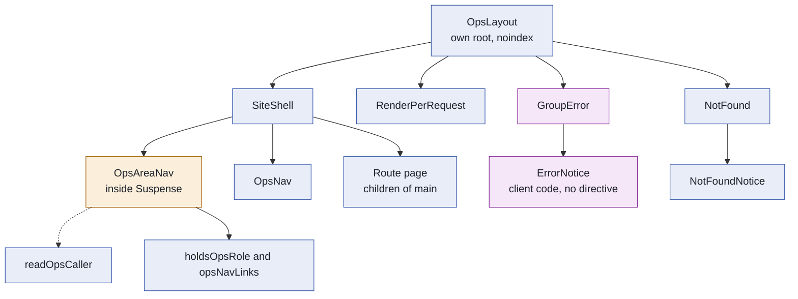
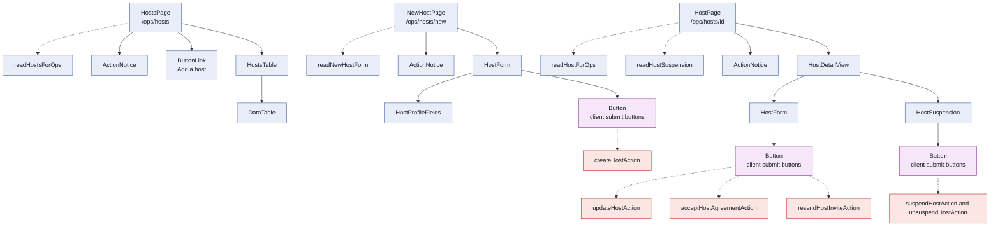
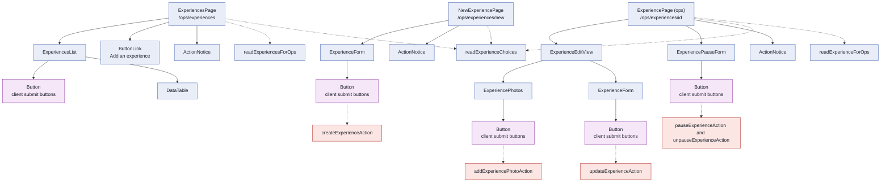
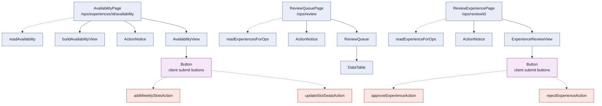
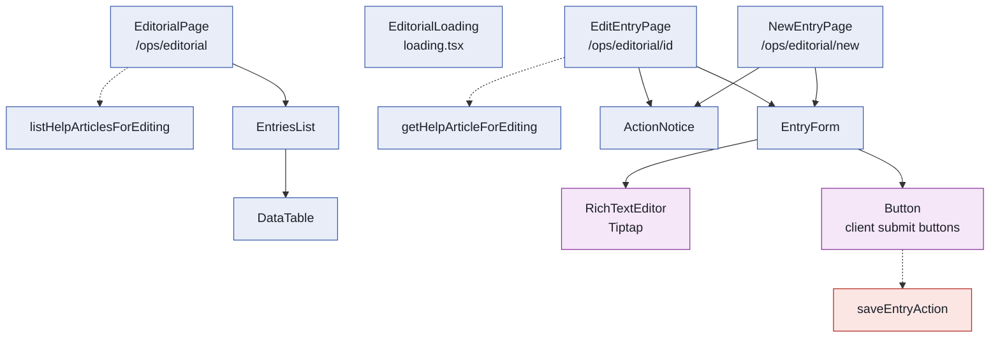

# Ops area page map

`/ops`, `/ops/mailbox`, `/ops/mailbox/[id]`, `/ops/dev`, `/ops/hosts`, `/ops/hosts/new`, `/ops/hosts/[id]`, `/ops/experiences`, `/ops/experiences/new`, `/ops/experiences/[id]`, `/ops/experiences/[id]/availability`, `/ops/editorial`, `/ops/editorial/new`, `/ops/editorial/[id]`, `/ops/review`, `/ops/review/[id]`, `/ops/sessions`, `/ops/sessions/[sessionId]`, `/ops/bookings`, `/ops/bookings/[id]`, `/ops/staff`, `/ops/support`, `/ops/requests`, `/ops/audit`, and any other address under `/ops`

Read from main at 2db68ea (2026-11-15). A PR that changes this tree (a component, a Suspense or client boundary, a cache tag, an action) updates this file in the same PR.

## Legend

server = rendered on the server per request; cached = `'use cache'` read; streamed = inside a Suspense boundary; client = `'use client'` island; action = server action.

Ops pages read the signed-in caller, so none is cached or prerendered, and no node below is a cached read. They render per request. Only the nav in the shared layout streams; nothing else uses Suspense. Forms post straight to server actions, and the result comes back as a `?notice=` code on a redirect, so the pages need no client state. A dotted edge is a data read or an action call. Server nodes marked DB read are Postgres reads in `src/server/db`, and pure lib nodes are plain functions in `src/lib`.

## Render tree

Every page is a server component that starts with `await Promise.all([searchParams, readOpsCaller()])`, then the role gate, then its reads. The gate is shown only where it differs. Each diagram has one `Button` node standing for every submit button on the page.

### Shared layout

Used by every page below.

| Component | Kind | File | Notes |
| --- | --- | --- | --- |
| OpsLayout | server | [src/app/(ops)/layout.tsx](layout.tsx) | Its own root: html, fonts, base styles, `robots: noindex`. It is not the guest layout. `instant = false`. |
| SiteShell | server | [src/components/SiteShell.tsx](../../components/SiteShell.tsx) | Skip link, header (brand link and the word Operations), main, footer. No account control, no banner. |
| OpsAreaNav | streamed | [src/app/(ops)/OpsAreaNav.tsx](OpsAreaNav.tsx) | Inside `Suspense fallback={null}`. Reads the caller, so it streams. Renders nothing unless the caller holds `ops`. It is not a gate. |
| readOpsCaller | server (DB read) | [src/server/opsCaller.ts](../../server/opsCaller.ts) | Wraps `getCaller()`. A failure is logged and becomes the anonymous caller, never a role. |
| holdsOpsRole and opsNavLinks | server (pure lib) | [src/lib/opsNav.ts](../../lib/opsNav.ts) | Roles must include `ops`; `admin` is not enough. Twelve links: Dashboard, Mailbox, Hosts, Experiences, Editorial, Support, Private requests, Review queue, Staff, Sessions, Audit log, Bookings. The test console is not listed. |
| OpsNav | server | [src/components/OpsShell/OpsShell.tsx](../../components/OpsShell/OpsShell.tsx) | A `nav` of plain links. |
| Route page | server |  | Every ops page below. The layout does not wrap it in Suspense, and no page does either. |
| RenderPerRequest | server | [src/app/renderPerRequest.tsx](../renderPerRequest.tsx) | Sits beside the shell, awaits `connection()`, renders nothing. Pins the whole tree to per-request rendering so every script carries the CSP nonce. |
| GroupError | client | [src/app/(ops)/error.tsx](error.tsx) | The route group's error boundary, with a retry. |
| ErrorNotice | client | [src/components/ErrorNotice.tsx](../../components/ErrorNotice.tsx) | Message and retry button. It has no directive of its own, but it is client code because the boundary imports it. |
| NotFound | server | [src/app/(ops)/not-found.tsx](not-found.tsx) | Renders `NotFoundNotice`. |
| NotFoundNotice | server | [src/components/NotFoundNotice.tsx](../../components/NotFoundNotice.tsx) | The message shown for a missing page. |

### Parts every page reuses

Named once here. The page trees below list only what is particular to them.

| Component | Kind | File | Notes |
| --- | --- | --- | --- |
| PageHeading | server | [src/components/PageHeading.tsx](../../components/PageHeading.tsx) | Every page's `header` and `h1`; the page body is its children. |
| OpsAccessDenied | server | [src/components/OpsShell/OpsShell.tsx](../../components/OpsShell/OpsShell.tsx) | What every gated page returns for a non-ops caller: a short message and a Sign in `ButtonLink` that returns to the page. The status stays 200. |
| ActionNotice | server | [src/components/ActionNotice/ActionNotice.tsx](../../components/ActionNotice/ActionNotice.tsx) | Shows the `?notice=` code from the last redirect, as an Alert. |
| DataTable, SearchField, StatusBadge, StatusFilterBar | server | [src/components/DataTable](../../components/DataTable), [SearchField](../../components/SearchField), [StatusBadge](../../components/StatusBadge) | Tables, search forms (a GET form, so the query lives in the address), status chips and filter links. All server components. |
| Input, Select, Textarea, CheckField, EmailField, HiddenFields | server | [src/components](../../components) | Form fields. Server components; forms are plain `<form action={serverAction}>`. |
| Button | client | [src/components/Button/Button.tsx](../../components/Button/Button.tsx) | Every submit button. The file is `'use client'`, but the forms post to the action without it. |
| ButtonLink | server | [src/components/Button/ButtonLink.tsx](../../components/Button/ButtonLink.tsx) | A link styled as a button. Server component; it imports only the types from `Button`. |

### The role gate

1. Page: `readOpsCaller()` then `holdsOpsRole(roles)`. Only the `ops` role passes; `admin` does not. A failure returns `OpsAccessDenied` with a Sign in link, status 200.
2. Read: every `src/server/db` function used here calls `requireOpsUserId` or `requireRole(Role.Ops)` again and throws `ForbiddenError`. The page check is a courtesy; this one is the gate.
3. Action: `opsCallerOrLeave(path)` runs first. A non-ops caller is redirected to the list page, where they see the refusal. The proxy does not gate `/ops`; it only writes the CSP.
4. Exceptions: the mailbox also admits a holder of the shared-secret cookie off production. The test console admits `ops` or `admin`, and shuts on a production deployment.

### Audit logging

- Writes: each change writes its audit row with `writeAudit(tx)` in the same transaction, so the row exists exactly when the change does. A change that differs by nothing writes neither.
- Reads: sensitive reads are recorded with `recordAudit` before they return. These are the ops home, hosts (list, one, new form), sessions (list, one), bookings (list, one), staff, support, private requests, audit view, and mailbox (list, message, unlock).
- Not recorded: experiences, review, availability, host suspension state, and the whole test console, including the demo data reset.

### Tools

The area home, the dev mailbox, the test console and the catch-all.

```mermaid
flowchart TD
    home["OperationsPage<br/>/ops"]:::server
    rec["recordOpsAccess"]:::server
    links["opsLandingLinks"]:::server
    land["OpsLanding"]:::server
    mb["MailboxPage<br/>/ops/mailbox"]:::server
    lm["loadMailbox"]:::server
    unl["MailboxUnlockForm"]:::server
    btn1["Button<br/>client submit buttons"]:::client
    unlact["unlockDevMailbox"]:::action
    mlist["MailboxList"]:::server
    mm["MailboxMessagePage<br/>/ops/mailbox/id"]:::server
    lmm["loadMailboxMessage"]:::server
    mmv["MailboxMessageView"]:::server
    dev["OpsDevPage<br/>/ops/dev"]:::server
    jobs["readRecentJobs"]:::server
    clock["readTestClock"]:::server
    an2["ActionNotice"]:::server
    con["OpsDevConsole"]:::server
    dt2["DataTable"]:::server
    btn2["Button<br/>client submit buttons"]:::client
    runjob["runOpsJobAction"]:::action
    drain["drainOpsJobsAction and runOpsPulseAction"]:::action
    setclock["setOpsClockAction"]:::action
    reset["resetDemoDataAction"]:::action
    unk["UnknownPage<br/>/ops/..."]:::server
    nfpr["notFoundPerRequest"]:::server
    home -.-> rec
    home -.-> links
    home --> land
    mb -.-> lm
    mb --> unl
    mb --> mlist
    unl --> btn1
    btn1 -.-> unlact
    mm -.-> lmm
    mm --> mmv
    dev -.-> jobs
    dev -.-> clock
    dev --> an2
    dev --> con
    con --> dt2
    con --> btn2
    btn2 -.-> runjob
    btn2 -.-> drain
    btn2 -.-> setclock
    btn2 -.-> reset
    unk -.-> nfpr
    classDef server fill:#e8edf8,stroke:#3b5bab,color:#1b1f27
    classDef cached fill:#e2f3f0,stroke:#0f7a6c,color:#1b1f27
    classDef streamed fill:#fbefdc,stroke:#a3610a,color:#1b1f27
    classDef client fill:#f5e6f8,stroke:#8a2f9c,color:#1b1f27
    classDef action fill:#fbe6e4,stroke:#b3261e,color:#1b1f27
```

| Component | Kind | File | Notes |
| --- | --- | --- | --- |
| OperationsPage | server | [src/app/(ops)/ops/page.tsx](ops/page.tsx) | Gate, then records that ops opened the area. |
| recordOpsAccess | server (DB read) | [src/server/db/audit.ts](../../server/db/audit.ts) | Audited: `ops.accessed`. Throws for a non-ops caller, as a second check. |
| opsLandingLinks | server (pure lib) | [src/lib/opsNav.ts](../../lib/opsNav.ts) | Every link but Dashboard. |
| OpsLanding | server | [src/components/OpsShell/OpsShell.tsx](../../components/OpsShell/OpsShell.tsx) | Heading and a list of areas with a summary each. |
| MailboxPage | server | [src/app/(ops)/ops/mailbox/page.tsx](ops/mailbox/page.tsx) | No `holdsOpsRole` check of its own. Access is decided in `loadMailbox`: the ops role, or a cookie proving the shared secret, off production. |
| loadMailbox | server (DB read) | [src/server/ports/email/mailbox.ts](../../server/ports/email/mailbox.ts) | Audited: `mailbox listed`, with how access was gained. Status is disabled, locked or open. |
| MailboxUnlockForm | server | [src/components/DevMailbox/DevMailbox.tsx](../../components/DevMailbox/DevMailbox.tsx) | Locked state: a secret field and a message for a wrong or rate-limited try. |
| Button | client | [src/components/Button/Button.tsx](../../components/Button/Button.tsx) | Every submit button. The file is `'use client'`, but the forms post to the action without it. |
| unlockDevMailbox | action | [src/server/actions/mailbox.ts](../../server/actions/mailbox.ts) | No `opsCallerOrLeave`. A right secret writes an audit row and sets an httpOnly cookie (8 hours, path `/ops/mailbox`). A wrong one is counted per client address, then redirects with `?denied` or `?limited`. |
| MailboxList | server | [src/components/DevMailbox/DevMailbox.tsx](../../components/DevMailbox/DevMailbox.tsx) | Open state: the captured emails, newest first, with sign-in links. |
| MailboxMessagePage | server | [src/app/(ops)/ops/mailbox/[id]/page.tsx](ops/mailbox/%5Bid%5D/page.tsx) | Same access as the list. A locked, disabled or unknown message is a 404. |
| loadMailboxMessage | server (DB read) | [src/server/ports/email/mailbox.ts](../../server/ports/email/mailbox.ts) | Audited: `mailbox message read`, only for a message that exists. |
| MailboxMessageView | server | [src/components/DevMailbox/DevMailbox.tsx](../../components/DevMailbox/DevMailbox.tsx) | One message with its links. |
| OpsDevPage | server | [src/app/(ops)/ops/dev/page.tsx](ops/dev/page.tsx) | Gate is wider: `ops` or `admin`. Then a second check: not a production deployment. |
| readRecentJobs | server (DB read) | [src/server/db/opsJobs.ts](../../server/db/opsJobs.ts) | Not audited. |
| readTestClock | server (DB read) | [src/server/testClock.ts](../../server/testClock.ts) | The tester's test time, from a cookie. |
| ActionNotice | server | [src/components/ActionNotice/ActionNotice.tsx](../../components/ActionNotice/ActionNotice.tsx) | Shows the `?notice=` code from the last redirect, as an Alert. |
| OpsDevConsole | server | [src/components/OpsDev/OpsDevConsole.tsx](../../components/OpsDev/OpsDevConsole.tsx) | Recent jobs table with a run button each, drain, pulse, clock controls and a reset form that needs a typed confirmation. |
| DataTable | server | [src/components/DataTable/DataTable.tsx](../../components/DataTable/DataTable.tsx) | Sort links and a Next link; the cursor is in the address. |
| Button | client | [src/components/Button/Button.tsx](../../components/Button/Button.tsx) | Every submit button. The file is `'use client'`, but the forms post to the action without it. |
| runOpsJobAction | action | [src/server/actions/opsDev.ts](../../server/actions/opsDev.ts) | Every action here checks the production guard, then the role, then runs on the real or test clock. |
| drainOpsJobsAction and runOpsPulseAction | action | [src/server/actions/opsDev.ts](../../server/actions/opsDev.ts) | The same drain and pulse the schedule runs. A hand-run pulse sends no heartbeat. |
| setOpsClockAction | action | [src/server/actions/opsDev.ts](../../server/actions/opsDev.ts) | Writes or clears the test-clock cookie. |
| resetDemoDataAction | action | [src/server/actions/opsDev.ts](../../server/actions/opsDev.ts) | `resetDemoData` after the confirmation text matches. No audit row; only a log line on failure. |
| UnknownPage | server | [src/app/(ops)/ops/[...unknown]/page.tsx](ops/%5B...unknown%5D/page.tsx) | Any other address under `/ops`. |
| notFoundPerRequest | server (pure lib) | [src/app/renderPerRequest.tsx](../renderPerRequest.tsx) | Awaits `connection()` first, then `notFound()`, so the group's not-found page renders with the nonce. |

### Supply: hosts

Set up hosts and their owners.

| Component | Kind | File | Notes |
| --- | --- | --- | --- |
| HostsPage | server | [src/app/(ops)/ops/hosts/page.tsx](ops/hosts/page.tsx) | Gate, then reads the page of hosts. |
| readHostsForOps | server (DB read) | [src/server/db/hostSetup.ts](../../server/db/hostSetup.ts) | Audited: `host list`, with the row written before it returns. Reads through `dbRead`. |
| ActionNotice | server | [src/components/ActionNotice/ActionNotice.tsx](../../components/ActionNotice/ActionNotice.tsx) | Shows the `?notice=` code from the last redirect, as an Alert. |
| ButtonLink | server | [src/components/Button/ButtonLink.tsx](../../components/Button/ButtonLink.tsx) | A link styled as a button. |
| HostsTable | server | [src/components/HostSetup/HostsTable.tsx](../../components/HostSetup/HostsTable.tsx) | Name, owner, agreement state; each row links to `/ops/hosts/<id>`. |
| DataTable | server | [src/components/DataTable/DataTable.tsx](../../components/DataTable/DataTable.tsx) | Sort links and a Next link; the cursor is in the address. |
| NewHostPage | server | [src/app/(ops)/ops/hosts/new/page.tsx](ops/hosts/new/page.tsx) | Gate, then reads the current agreement for the form. |
| readNewHostForm | server (DB read) | [src/server/db/hostSetup.ts](../../server/db/hostSetup.ts) | Audited: opening the empty form writes a row. |
| ActionNotice | server | [src/components/ActionNotice/ActionNotice.tsx](../../components/ActionNotice/ActionNotice.tsx) | Shows the `?notice=` code from the last redirect, as an Alert. |
| HostForm | server | [src/components/HostSetup/HostForm.tsx](../../components/HostSetup/HostForm.tsx) | Name, slug, about, time zone, owner email, and an "agreement accepted" box. |
| HostProfileFields | server | [src/components/HostSetup/HostProfileFields.tsx](../../components/HostSetup/HostProfileFields.tsx) | Uses Input, Textarea, EmailField and CheckField. |
| Button | client | [src/components/Button/Button.tsx](../../components/Button/Button.tsx) | Every submit button. The file is `'use client'`, but the forms post to the action without it. |
| createHostAction | action | [src/server/actions/hosts.ts](../../server/actions/hosts.ts) | Gate, parse, `createHost` (host, owner account, role grant, optional acceptance, audit: one transaction), then `inviteHostOwner` emails a sign-in link. Redirects to the new host with a notice. |
| HostPage | server | [src/app/(ops)/ops/hosts/[id]/page.tsx](ops/hosts/%5Bid%5D/page.tsx) | Gate, then the host and its suspension state. A bad or unknown id is a 404. |
| readHostForOps | server (DB read) | [src/server/db/hostSetup.ts](../../server/db/hostSetup.ts) | Audited: `host viewed`. |
| readHostSuspension | server (DB read) | [src/server/db/experiencePause.ts](../../server/db/experiencePause.ts) | Not audited. |
| ActionNotice | server | [src/components/ActionNotice/ActionNotice.tsx](../../components/ActionNotice/ActionNotice.tsx) | Shows the `?notice=` code from the last redirect, as an Alert. |
| HostDetailView | server | [src/components/HostSetup/HostDetailView.tsx](../../components/HostSetup/HostDetailView.tsx) | Profile form (HostForm fields), agreement state, the owner invite. Also uses StatusBadge and Alert. |
| HostForm | server | [src/components/HostSetup/HostForm.tsx](../../components/HostSetup/HostForm.tsx) | The same form as on the new-host page. |
| Button | client | [src/components/Button/Button.tsx](../../components/Button/Button.tsx) | Every submit button. The file is `'use client'`, but the forms post to the action without it. |
| updateHostAction | action | [src/server/actions/hosts.ts](../../server/actions/hosts.ts) | `updateHost` via `saveHostFields`. Writes nothing, audit row included, when nothing differs. No cache is cleared. |
| acceptHostAgreementAction | action | [src/server/actions/hosts.ts](../../server/actions/hosts.ts) | `recordHostAcceptance` for the chosen legal document. |
| resendHostInviteAction | action | [src/server/actions/hosts.ts](../../server/actions/hosts.ts) | `inviteHostOwner`: a fresh sign-in link by email. |
| HostSuspension | server | [src/components/HostSetup/HostSuspension.tsx](../../components/HostSetup/HostSuspension.tsx) | Suspend or unsuspend the whole host. |
| Button | client | [src/components/Button/Button.tsx](../../components/Button/Button.tsx) | Every submit button. The file is `'use client'`, but the forms post to the action without it. |
| suspendHostAction and unsuspendHostAction | action | [src/server/actions/experiencePause.ts](../../server/actions/experiencePause.ts) | `setHostSuspended`: every experience moves through the pause path, one audit row each, plus one for the host. Clears the guest listing tags. |

### Supply: experiences and review

Edit what guests can book, and approve what hosts submit.

| Component | Kind | File | Notes |
| --- | --- | --- | --- |
| ExperiencesPage | server | [src/app/(ops)/ops/experiences/page.tsx](ops/experiences/page.tsx) | Gate, then the choices for the filters, then a filtered page. |
| readExperienceChoices | server (DB read) | [src/server/db/experienceEditor.ts](../../server/db/experienceEditor.ts) | Hosts, categories, neighborhoods, default cancellation tier. Not audited. |
| readExperiencesForOps | server (DB read) | [src/server/db/experienceEditor.ts](../../server/db/experienceEditor.ts) | Not audited. |
| ActionNotice | server | [src/components/ActionNotice/ActionNotice.tsx](../../components/ActionNotice/ActionNotice.tsx) | Shows the `?notice=` code from the last redirect, as an Alert. |
| ButtonLink | server | [src/components/Button/ButtonLink.tsx](../../components/Button/ButtonLink.tsx) | A link styled as a button. |
| ExperiencesList | server | [src/components/ExperienceEditor/ExperiencesList.tsx](../../components/ExperienceEditor/ExperiencesList.tsx) | Filter bar (host, category, status) and the table; `experienceColumns()` is shared with the review queue. Also uses StatusFilterBar and Select. |
| DataTable | server | [src/components/DataTable/DataTable.tsx](../../components/DataTable/DataTable.tsx) | Sort links and a Next link; the cursor is in the address. |
| Button | client | [src/components/Button/Button.tsx](../../components/Button/Button.tsx) | Every submit button. The file is `'use client'`, but the forms post to the action without it. |
| NewExperiencePage | server | [src/app/(ops)/ops/experiences/new/page.tsx](ops/experiences/new/page.tsx) | Gate, then the choices. |
| ActionNotice | server | [src/components/ActionNotice/ActionNotice.tsx](../../components/ActionNotice/ActionNotice.tsx) | Shows the `?notice=` code from the last redirect, as an Alert. |
| ExperienceForm | server | [src/components/ExperienceEditor/ExperienceForm.tsx](../../components/ExperienceEditor/ExperienceForm.tsx) | Content, place, prices, cancellation tier, grouped in fieldsets. Uses Input, Select, Textarea and CheckField. |
| Button | client | [src/components/Button/Button.tsx](../../components/Button/Button.tsx) | Every submit button. The file is `'use client'`, but the forms post to the action without it. |
| createExperienceAction | action | [src/server/actions/experiences.ts](../../server/actions/experiences.ts) | `createExperience`: a draft, with an audit row. Nothing is guest-visible, so no cache is cleared. |
| ExperiencePage (ops) | server | [src/app/(ops)/ops/experiences/[id]/page.tsx](ops/experiences/%5Bid%5D/page.tsx) | Gate, then the experience and the choices in parallel. A bad or unknown id is a 404. |
| readExperienceForOps | server (DB read) | [src/server/db/experienceEditor.ts](../../server/db/experienceEditor.ts) | Not audited. |
| ActionNotice | server | [src/components/ActionNotice/ActionNotice.tsx](../../components/ActionNotice/ActionNotice.tsx) | Shows the `?notice=` code from the last redirect, as an Alert. |
| ExperiencePauseForm | server | [src/components/ExperienceEditor/ExperiencePauseForm.tsx](../../components/ExperienceEditor/ExperiencePauseForm.tsx) | Pause or unpause this experience. |
| Button | client | [src/components/Button/Button.tsx](../../components/Button/Button.tsx) | Every submit button. The file is `'use client'`, but the forms post to the action without it. |
| pauseExperienceAction and unpauseExperienceAction | action | [src/server/actions/experiencePause.ts](../../server/actions/experiencePause.ts) | `setExperiencePaused`: one audit row, then the listing tags are cleared. |
| ExperienceEditView | server | [src/components/ExperienceEditor/ExperienceEditView.tsx](../../components/ExperienceEditor/ExperienceEditView.tsx) | Status badge, the edit form and the photos. |
| ExperienceForm | server | [src/components/ExperienceEditor/ExperienceForm.tsx](../../components/ExperienceEditor/ExperienceForm.tsx) | The same form as on the new-experience page. |
| Button | client | [src/components/Button/Button.tsx](../../components/Button/Button.tsx) | Every submit button. The file is `'use client'`, but the forms post to the action without it. |
| updateExperienceAction | action | [src/server/actions/experiences.ts](../../server/actions/experiences.ts) | `updateExperience` on a locked row: audit row naming the changed fields. Clears the listing tags for the old and new place, only if the experience is guest-visible. |
| ExperiencePhotos | server | [src/components/ExperienceEditor/ExperiencePhotos.tsx](../../components/ExperienceEditor/ExperiencePhotos.tsx) | Existing photos (`Photo`, server-rendered) and the add-photo form with alt text and rights. |
| Button | client | [src/components/Button/Button.tsx](../../components/Button/Button.tsx) | Every submit button. The file is `'use client'`, but the forms post to the action without it. |
| addExperiencePhotoAction | action | [src/server/actions/experiencePhotos.ts](../../server/actions/experiencePhotos.ts) | Reads the file only once its size is within the limit, then `addPhoto` writes storage, the row and an audit row. Clears `experience:<id>` if guest-visible. |

Availability and the review queue, as a second diagram so each stays small.

| Component | Kind | File | Notes |
| --- | --- | --- | --- |
| AvailabilityPage | server | [src/app/(ops)/ops/experiences/[id]/availability/page.tsx](ops/experiences/%5Bid%5D/availability/page.tsx) | Gate, then the weekly slots and the upcoming sessions, read at the current time. |
| readAvailability | server (DB read) | [src/server/db/availability.ts](../../server/db/availability.ts) | Called as `readAvailability(caller, id, systemClock.now())`. Not audited. |
| buildAvailabilityView | server (pure lib) | [src/lib/availability.ts](../../lib/availability.ts) | Turns rows into slot groups for the experience's time zone. |
| ActionNotice | server | [src/components/ActionNotice/ActionNotice.tsx](../../components/ActionNotice/ActionNotice.tsx) | Shows the `?notice=` code from the last redirect, as an Alert. |
| AvailabilityView | server | [src/components/Availability/AvailabilityView.tsx](../../components/Availability/AvailabilityView.tsx) | Add-slots form (weekday ticks, time, seats) and one seats form per slot. Uses Input, Select and CheckField. |
| Button | client | [src/components/Button/Button.tsx](../../components/Button/Button.tsx) | Every submit button. The file is `'use client'`, but the forms post to the action without it. |
| addWeeklySlotsAction | action | [src/server/actions/availability.ts](../../server/actions/availability.ts) | `addWeeklySlots`: slot row and its generated sessions, one audit row per slot. Clears `experience:<id>` if any session was made. |
| updateSlotSeatsAction | action | [src/server/actions/availability.ts](../../server/actions/availability.ts) | `updateSlotSeats`: never below sold plus held; audit row; clears `session:<id>` for each followed session. |
| ReviewQueuePage | server | [src/app/(ops)/ops/review/page.tsx](ops/review/page.tsx) | Gate, then the experiences in review. Reuses the experiences read with a fixed status filter. |
| readExperiencesForOps | server (DB read) | [src/server/db/experienceEditor.ts](../../server/db/experienceEditor.ts) | Called with the `in_review` status filter. Not audited. |
| ActionNotice | server | [src/components/ActionNotice/ActionNotice.tsx](../../components/ActionNotice/ActionNotice.tsx) | Shows the `?notice=` code from the last redirect, as an Alert. |
| ReviewQueue | server | [src/components/ExperienceReview/ReviewQueue.tsx](../../components/ExperienceReview/ReviewQueue.tsx) | Rows link to the review page. |
| DataTable | server | [src/components/DataTable/DataTable.tsx](../../components/DataTable/DataTable.tsx) | Sort links and a Next link; the cursor is in the address. |
| ReviewExperiencePage | server | [src/app/(ops)/ops/review/[id]/page.tsx](ops/review/%5Bid%5D/page.tsx) | Gate, then the experience as the guest would see it. A bad or unknown id is a 404. |
| readExperienceForOps | server (DB read) | [src/server/db/experienceEditor.ts](../../server/db/experienceEditor.ts) | Not audited. |
| ActionNotice | server | [src/components/ActionNotice/ActionNotice.tsx](../../components/ActionNotice/ActionNotice.tsx) | Shows the `?notice=` code from the last redirect, as an Alert. |
| ExperienceReviewView | server | [src/components/ExperienceReview/ExperienceReviewView.tsx](../../components/ExperienceReview/ExperienceReviewView.tsx) | Content, `ExperiencePhotoList` (shared with the editor), the approve button and a reject form with a reason. Also uses Alert, StatusBadge and Select. |
| Button | client | [src/components/Button/Button.tsx](../../components/Button/Button.tsx) | Every submit button. The file is `'use client'`, but the forms post to the action without it. |
| approveExperienceAction | action | [src/server/actions/experienceReview.ts](../../server/actions/experienceReview.ts) | `decideExperienceReview`: refuses without photo alt text or with a suspended host; otherwise audit row, then clears the listing tags. |
| rejectExperienceAction | action | [src/server/actions/experienceReview.ts](../../server/actions/experienceReview.ts) | Needs a reason. Audit row; clears nothing, because an experience in review was never visible. |

### Bookings

Sessions and the orders on them.

```mermaid
flowchart TD
    ss["SessionsPage<br/>/ops/sessions"]:::server
    ros["readOpsSessions"]:::server
    sl["SessionsList"]:::server
    dt1["DataTable"]:::server
    sp["SessionPage<br/>/ops/sessions/sessionId"]:::server
    ro["readOpsSession"]:::server
    an2["ActionNotice"]:::server
    sd["SessionDetail"]:::server
    btn2["Button<br/>client submit buttons"]:::client
    cso["cancelOpsSessionAction"]:::action
    coa["changeOpsAllocationAction"]:::action
    poe["pauseOpsExperienceAction"]:::action
    bk["OpsBookingsPage<br/>/ops/bookings"]:::server
    rob["readOpsBookings"]:::server
    pbs["parseBookingSearch and searchSummary"]:::server
    an3["ActionNotice"]:::server
    obl["OpsBookingsList"]:::server
    dt3["DataTable"]:::server
    btn3["Button<br/>client submit buttons"]:::client
    rra["retryRefundAction"]:::action
    bp["OpsBookingPage<br/>/ops/bookings/id"]:::server
    rb["readOpsBooking"]:::server
    an4["ActionNotice"]:::server
    obd["OpsBookingDetailView"]:::server
    btn4["Button<br/>client submit buttons"]:::client
    cba["cancelBookingAction"]:::action
    rba["refundBookingAction"]:::action
    rra2["retryRefundAction"]:::action
    rca["resendConfirmationAction"]:::action
    vla["voidLinksAction"]:::action
    ss -.-> ros
    ss --> sl
    sl --> dt1
    sp -.-> ro
    sp --> an2
    sp --> sd
    sd --> btn2
    btn2 -.-> cso
    btn2 -.-> coa
    btn2 -.-> poe
    bk -.-> rob
    bk -.-> pbs
    bk --> an3
    bk --> obl
    obl --> dt3
    obl --> btn3
    btn3 -.-> rra
    bp -.-> rb
    bp --> an4
    bp --> obd
    obd --> btn4
    btn4 -.-> cba
    btn4 -.-> rba
    btn4 -.-> rra2
    btn4 -.-> rca
    btn4 -.-> vla
    classDef server fill:#e8edf8,stroke:#3b5bab,color:#1b1f27
    classDef cached fill:#e2f3f0,stroke:#0f7a6c,color:#1b1f27
    classDef streamed fill:#fbefdc,stroke:#a3610a,color:#1b1f27
    classDef client fill:#f5e6f8,stroke:#8a2f9c,color:#1b1f27
    classDef action fill:#fbe6e4,stroke:#b3261e,color:#1b1f27
```

| Component | Kind | File | Notes |
| --- | --- | --- | --- |
| SessionsPage | server | [src/app/(ops)/ops/sessions/page.tsx](ops/sessions/page.tsx) | Gate, then a searchable list; the status filter picks upcoming or past and the direction of the sort. |
| readOpsSessions | server (DB read) | [src/server/db/opsSessions.ts](../../server/db/opsSessions.ts) | Called with when, term and cursor. Audited: `sessions list`. |
| SessionsList | server | [src/components/OpsSessions/SessionsList.tsx](../../components/OpsSessions/SessionsList.tsx) | Search field, status filter bar, table. Also uses SearchField, StatusFilterBar and StatusBadge. |
| DataTable | server | [src/components/DataTable/DataTable.tsx](../../components/DataTable/DataTable.tsx) | Sort links and a Next link; the cursor is in the address. |
| SessionPage | server | [src/app/(ops)/ops/sessions/[sessionId]/page.tsx](ops/sessions/%5BsessionId%5D/page.tsx) | Gate, then the session with who it affects. A bad or unknown id is a 404. |
| readOpsSession | server (DB read) | [src/server/db/opsSessions.ts](../../server/db/opsSessions.ts) | Audited: `session viewed`. Returns the impact (bookings, holds, refunds) and a fingerprint of it. |
| ActionNotice | server | [src/components/ActionNotice/ActionNotice.tsx](../../components/ActionNotice/ActionNotice.tsx) | Shows the `?notice=` code from the last redirect, as an Alert. |
| SessionDetail | server | [src/components/OpsSessions/SessionDetail.tsx](../../components/OpsSessions/SessionDetail.tsx) | Impact list, a cancel form, an allocation form, a pause-the-experience form. The fingerprint travels as a hidden field. Also uses Impact, HiddenFields, Alert, StatusBadge, Input, Select and CheckField. |
| Button | client | [src/components/Button/Button.tsx](../../components/Button/Button.tsx) | Every submit button. The file is `'use client'`, but the forms post to the action without it. |
| cancelOpsSessionAction | action | [src/server/actions/opsSessions.ts](../../server/actions/opsSessions.ts) | `cancelSessionAsOps`: refuses when the session ended, a booking cannot be refunded in full, or the impact changed since the page was read. Then `cancelSession`: releases holds, cancels and refunds every booking, queues the guest emails. |
| changeOpsAllocationAction | action | [src/server/actions/opsSessions.ts](../../server/actions/opsSessions.ts) | `updateSessionAllocation`: never below sold plus held; audit row; clears `session:<id>`. |
| pauseOpsExperienceAction | action | [src/server/actions/opsSessions.ts](../../server/actions/opsSessions.ts) | `pauseExperienceAndCancel`: pause first (one transaction), then one `cancelSession` per future session. A failure part-way reports how far it got; repeating the action finishes the rest. |
| OpsBookingsPage | server | [src/app/(ops)/ops/bookings/page.tsx](ops/bookings/page.tsx) | Gate, then a search by reference or guest email, with a refund-failed filter. |
| readOpsBookings | server (DB read) | [src/server/db/opsBookings.ts](../../server/db/opsBookings.ts) | Called with search, filter and cursor. Audited: `bookings list`. |
| parseBookingSearch and searchSummary | server (pure lib) | [src/lib/opsBookings.ts](../../lib/opsBookings.ts) | Parse the search box and describe it back to the user. |
| ActionNotice | server | [src/components/ActionNotice/ActionNotice.tsx](../../components/ActionNotice/ActionNotice.tsx) | Shows the `?notice=` code from the last redirect, as an Alert. |
| OpsBookingsList | server | [src/components/OpsBookings/OpsBookingsList.tsx](../../components/OpsBookings/OpsBookingsList.tsx) | Search field, status filter, table. A row with a failed refund carries its own retry form. Also uses SearchField, StatusFilterBar and StatusBadge. |
| DataTable | server | [src/components/DataTable/DataTable.tsx](../../components/DataTable/DataTable.tsx) | Sort links and a Next link; the cursor is in the address. |
| Button | client | [src/components/Button/Button.tsx](../../components/Button/Button.tsx) | Every submit button. The file is `'use client'`, but the forms post to the action without it. |
| retryRefundAction | action | [src/server/actions/opsBookings.ts](../../server/actions/opsBookings.ts) | `retryFailedRefund`: a new refund request, ledger postings, job and audit row in one transaction. |
| OpsBookingPage | server | [src/app/(ops)/ops/bookings/[id]/page.tsx](ops/bookings/%5Bid%5D/page.tsx) | Gate, then one booking with its refunds and ops history. A bad or unknown id is a 404. |
| readOpsBooking | server (DB read) | [src/server/db/opsBookings.ts](../../server/db/opsBookings.ts) | The audit row `booking viewed` and the read share one transaction, so a read that is returned is a read that is recorded. Also hands the form a one-time `resendId`. |
| ActionNotice | server | [src/components/ActionNotice/ActionNotice.tsx](../../components/ActionNotice/ActionNotice.tsx) | Shows the `?notice=` code from the last redirect, as an Alert. |
| OpsBookingDetailView | server | [src/components/OpsBookings/OpsBookingDetailView.tsx](../../components/OpsBookings/OpsBookingDetailView.tsx) | Order, tickets, refunds list, and five small forms built by one local `ActionForm`. |
| Button | client | [src/components/Button/Button.tsx](../../components/Button/Button.tsx) | Every submit button. The file is `'use client'`, but the forms post to the action without it. |
| cancelBookingAction | action | [src/server/actions/opsBookings.ts](../../server/actions/opsBookings.ts) | `cancelBookingAsOps`: the guest cancel with ops as the actor, for the refund ops was shown. Returns the session's seats to sale. |
| refundBookingAction | action | [src/server/actions/opsBookings.ts](../../server/actions/opsBookings.ts) | `refundBookingAsOps`: refunds the rest of a cancelled booking once, if it matches the amount shown. |
| retryRefundAction | action | [src/server/actions/opsBookings.ts](../../server/actions/opsBookings.ts) | As on the list. |
| resendConfirmationAction | action | [src/server/actions/opsBookings.ts](../../server/actions/opsBookings.ts) | Queues the confirmation email; the form's `resendId` keys the job, so a double post sends one. |
| voidLinksAction | action | [src/server/actions/opsBookings.ts](../../server/actions/opsBookings.ts) | Bumps the manage-link version, so the guest's old links stop working. |

### People and records

Who has access, what guests asked, what was done.

```mermaid
flowchart TD
    st["StaffPage<br/>/ops/staff"]:::server
    rs["readStaffForOps"]:::server
    an1["ActionNotice"]:::server
    sv["StaffView"]:::server
    dt1["DataTable"]:::server
    btn1["Button<br/>client submit buttons"]:::client
    isa["inviteStaffAction"]:::action
    rsl["resendStaffLinkAction"]:::action
    rvs["revokeStaffAction"]:::action
    su["SupportPage<br/>/ops/support"]:::server
    rsq["readSupportQueue"]:::server
    an2["ActionNotice"]:::server
    sq["SupportQueue"]:::server
    dt2["DataTable"]:::server
    btn2["Button<br/>client submit buttons"]:::client
    rsr["resolveSupportRequestAction"]:::action
    rq["PrivateRequestsPage<br/>/ops/requests"]:::server
    rrq["readOpsPrivateRequests"]:::server
    pq["PrivateRequestsQueue"]:::server
    dt4["DataTable"]:::server
    au["AuditPage<br/>/ops/audit"]:::server
    pad["parseAuditDay and parseAuditCursor"]:::server
    rau["readAuditForOps"]:::server
    av["AuditView"]:::server
    dt3["DataTable"]:::server
    btn3["Button<br/>client submit buttons"]:::client
    st -.-> rs
    st --> an1
    st --> sv
    sv --> dt1
    sv --> btn1
    btn1 -.-> isa
    btn1 -.-> rsl
    btn1 -.-> rvs
    su -.-> rsq
    su --> an2
    su --> sq
    sq --> dt2
    sq --> btn2
    btn2 -.-> rsr
    rq -.-> rrq
    rq --> pq
    pq --> dt4
    au --> pad
    au -.-> rau
    au --> av
    av --> dt3
    av --> btn3
    classDef server fill:#e8edf8,stroke:#3b5bab,color:#1b1f27
    classDef cached fill:#e2f3f0,stroke:#0f7a6c,color:#1b1f27
    classDef streamed fill:#fbefdc,stroke:#a3610a,color:#1b1f27
    classDef client fill:#f5e6f8,stroke:#8a2f9c,color:#1b1f27
    classDef action fill:#fbe6e4,stroke:#b3261e,color:#1b1f27
```

| Component | Kind | File | Notes |
| --- | --- | --- | --- |
| StaffPage | server | [src/app/(ops)/ops/staff/page.tsx](ops/staff/page.tsx) | Gate, then everyone who holds the ops role. |
| readStaffForOps | server (DB read) | [src/server/db/staffRoles.ts](../../server/db/staffRoles.ts) | Audited: `staff listed`. |
| ActionNotice | server | [src/components/ActionNotice/ActionNotice.tsx](../../components/ActionNotice/ActionNotice.tsx) | Shows the `?notice=` code from the last redirect, as an Alert. |
| StaffView | server | [src/components/StaffAdmin/StaffView.tsx](../../components/StaffAdmin/StaffView.tsx) | Invite form and a table with resend and revoke per row. Uses EmailField and StaffActions. |
| DataTable | server | [src/components/DataTable/DataTable.tsx](../../components/DataTable/DataTable.tsx) | Sort links and a Next link; the cursor is in the address. |
| Button | client | [src/components/Button/Button.tsx](../../components/Button/Button.tsx) | Every submit button. The file is `'use client'`, but the forms post to the action without it. |
| inviteStaffAction | action | [src/server/actions/opsStaff.ts](../../server/actions/opsStaff.ts) | `inviteStaff`: grants `ops` (making the account if needed), audit row, emails a sign-in link. |
| resendStaffLinkAction | action | [src/server/actions/opsStaff.ts](../../server/actions/opsStaff.ts) | A fresh link for an existing holder. |
| revokeStaffAction | action | [src/server/actions/opsStaff.ts](../../server/actions/opsStaff.ts) | `revokeRole` with an audit row; refuses some revokes (`revokeRefusal`). |
| SupportPage | server | [src/app/(ops)/ops/support/page.tsx](ops/support/page.tsx) | Gate, then guests' messages by status. |
| readSupportQueue | server (DB read) | [src/server/db/supportQueue.ts](../../server/db/supportQueue.ts) | Called with status and cursor. Audited: `support list`. |
| ActionNotice | server | [src/components/ActionNotice/ActionNotice.tsx](../../components/ActionNotice/ActionNotice.tsx) | Shows the `?notice=` code from the last redirect, as an Alert. |
| SupportQueue | server | [src/components/SupportQueue/SupportQueue.tsx](../../components/SupportQueue/SupportQueue.tsx) | Status filter, table, and a resolve form with a note per open row. Uses StatusFilterBar, StatusBadge and Input. |
| DataTable | server | [src/components/DataTable/DataTable.tsx](../../components/DataTable/DataTable.tsx) | Sort links and a Next link; the cursor is in the address. |
| Button | client | [src/components/Button/Button.tsx](../../components/Button/Button.tsx) | Every submit button. The file is `'use client'`, but the forms post to the action without it. |
| resolveSupportRequestAction | action | [src/server/actions/opsSupport.ts](../../server/actions/opsSupport.ts) | `resolveSupportRequest`: marks it resolved with the note, audit row in the same transaction. |
| PrivateRequestsPage | server | [src/app/(ops)/ops/requests/page.tsx](ops/requests/page.tsx) | Gate, then guests' private session requests, newest first. Read-only: a request has no status, so there is no filter. |
| readOpsPrivateRequests | server (DB read) | [src/server/db/privateRequests.ts](../../server/db/privateRequests.ts) | Called with the cursor; joins the experience's name. Audited: `requests list`. |
| PrivateRequestsQueue | server | [src/components/PrivateRequestsQueue/PrivateRequestsQueue.tsx](../../components/PrivateRequestsQueue/PrivateRequestsQueue.tsx) | The table: experience, requested day, group, budget, sender, message (cut to a line, the whole text behind a disclosure), received time. |
| DataTable | server | [src/components/DataTable/DataTable.tsx](../../components/DataTable/DataTable.tsx) | Sort links and a Next link; the cursor is in the address. |
| AuditPage | server | [src/app/(ops)/ops/audit/page.tsx](ops/audit/page.tsx) | Gate, then one day of the log, paged by id. |
| parseAuditDay and parseAuditCursor | server (pure lib) | [src/lib/staffAdmin.ts](../../lib/staffAdmin.ts) | The day defaults to today by `systemClock`. |
| readAuditForOps | server (DB read) | [src/server/db/auditView.ts](../../server/db/auditView.ts) | Audited: reading the log writes `audit viewed` for that day. |
| AuditView | server | [src/components/StaffAdmin/AuditView.tsx](../../components/StaffAdmin/AuditView.tsx) | Day picker form and the rows. Uses Input. |
| DataTable | server | [src/components/DataTable/DataTable.tsx](../../components/DataTable/DataTable.tsx) | Sort links and a Next link; the cursor is in the address. |
| Button | client | [src/components/Button/Button.tsx](../../components/Button/Button.tsx) | Every submit button. The file is `'use client'`, but the forms post to the action without it. |

### Editorial

Help articles are the first editorial entries: a title, an address, a summary and a rich-text body, saved as a draft, published, or taken down. The body editor is the only client island here, and it loads only on these two pages.

| Component | Kind | File | Notes |
| --- | --- | --- | --- |
| EditorialPage | server | [src/app/(ops)/ops/editorial/page.tsx](ops/editorial/page.tsx) | Gate, then every help article, drafts included. A failed read is logged and shows the table's retry, not the group error. |
| EditorialLoading | server | [src/app/(ops)/ops/editorial/loading.tsx](ops/editorial/loading.tsx) | The loading state for the three pages. |
| listHelpArticlesForEditing | server (DB read) | [src/server/db/editorial.ts](../../server/db/editorial.ts) | Staff only, up to 200 rows. Not audited. |
| EntriesList | server | [src/components/EditorialAdmin/EntriesList.tsx](../../components/EditorialAdmin/EntriesList.tsx) | A new-article link and a table with an empty state. |
| NewEntryPage | server | [src/app/(ops)/ops/editorial/new/page.tsx](ops/editorial/new/page.tsx) | Gate, then an empty form. |
| EditEntryPage | server | [src/app/(ops)/ops/editorial/[id]/page.tsx](ops/editorial/%5Bid%5D/page.tsx) | Gate, then the article. A bad or unknown id is a 404. |
| getHelpArticleForEditing | server (DB read) | [src/server/db/editorial.ts](../../server/db/editorial.ts) | Staff only. Not audited. |
| ActionNotice | server | [src/components/ActionNotice/ActionNotice.tsx](../../components/ActionNotice/ActionNotice.tsx) | Shows the `?notice=` code from the last redirect. |
| EntryForm | server | [src/components/EditorialAdmin/EntryForm.tsx](../../components/EditorialAdmin/EntryForm.tsx) | Title, address, summary, body. Save and publish, or save and unpublish, are two submit buttons on one form. |
| RichTextEditor | client | [src/components/RichTextEditor/RichTextEditor.tsx](../../components/RichTextEditor/RichTextEditor.tsx) | Tiptap on the format in `src/lib/richText`. Writes the sanitized document into a hidden field. Imported only here, so no guest page loads Tiptap. |
| Button | client | [src/components/Button/Button.tsx](../../components/Button/Button.tsx) | Every submit button. |
| saveEntryAction | action | [src/server/actions/editorial.ts](../../server/actions/editorial.ts) | `saveHelpArticle`: one audit row in the same transaction (created, saved, published or unpublished; ids only), then `updateTag` for what guests could see before and after. A save keeps the stored status and position (a stale tab cannot unpublish), and a missing article returns to the list with a notice. |

## Arrival order

Nothing on an ops page is cached, and the only Suspense boundary is the nav in the layout, so there is no staged arrival. The order below is the same for every page.

1. The server renders `OpsLayout`, `SiteShell`, the route page and `RenderPerRequest` for the request. The page awaits `readOpsCaller()`, runs the gate, then awaits its reads. The shell and the page body ship together in one response.
2. `OpsAreaNav` is the one streamed part. Its fallback is `null`, so the nav links appear after the caller read finishes, and only for a holder of `ops`.
3. The client hydrates the submit buttons and the group error boundary. Forms work without script, because they post to the server action directly.

## Key user paths

### Approving an experience

1. The review queue lists `in_review` experiences. A row opens `/ops/review/<id>`.
2. Approve posts `approveExperienceAction`. It checks the role, then `decideExperienceReview` locks the experience and refuses without photo alt text or with a suspended host.
3. One audit row is written. After the commit, the listing tags clear with `updateTag`.
4. The redirect goes to the queue with `?notice=approved`.

### Cancelling a session

1. The session page reads the impact with `readOpsSession` and hands the form a fingerprint of it in a hidden field.
2. `cancelOpsSessionAction` refuses if the session ended, a booking cannot be refunded in full, or the fingerprint no longer matches what is true now.
3. `cancelSession` releases holds, cancels and refunds each booking, and queues emails.
4. Then `revalidateTag(..., 'max')` runs for the session and experience, so the first guest request after may still see the old page.

### Adding a host

1. `/ops/hosts/new` shows the form and records that it was opened, through `readNewHostForm`.
2. `createHostAction` parses the form, then `createHost` makes the host, the owner account (marked verified), the owner grant, the optional agreement acceptance and the audit rows in one transaction.
3. `inviteHostOwner` emails a sign-in link.
4. The redirect lands on the host's page. No guest cache is touched.

## What an ops change clears in the guest caches

Ops pages hold no cache of their own. Their changes reach the guest side through `tagsForChanges()` in [src/lib/cacheTags.ts](../../lib/cacheTags.ts), applied by [src/server/cache/invalidate.ts](../../server/cache/invalidate.ts). The experience page's shell and its upcoming dates carry `experience:id`. Spaces left carries `session:id`. Browse, the home cards and the host page carry `catalog` and the experience tags. `updateTag` makes the next request fresh. `revalidateTag(tag, 'max')` serves one stale response first.

| Change | What clears | When the guest sees it |
| --- | --- | --- |
| Edit an experience (`updateExperienceAction`) | The listing, for the old and the new place, only if guest-visible: `experience:id`, `guide-entry:id`, `catalog`, `neighborhood:slug`, `category:slug` | At once, through `updateTag` |
| Approve, pause, unpause (`approveExperienceAction`, `pauseExperienceAction`, `unpauseExperienceAction`) | The listing tags, as above | At once, through `updateTag` |
| Suspend or unsuspend a host (`suspendHostAction`, `unsuspendHostAction`) | The listing tags for each of the host's experiences | At once, through `updateTag` |
| Add a photo (`addExperiencePhotoAction`) | `experience:id`, only if guest-visible | At once, through `updateTag` |
| Add weekly slots (`addWeeklySlotsAction`) | `experience:id`, only if sessions were made | At once, through `updateTag` |
| Change seats on a slot or a session (`updateSlotSeatsAction`, `changeOpsAllocationAction`) | `session:id`, per session | At once, through `updateTag` |
| Cancel a session (`cancelOpsSessionAction`, and each step of `pauseOpsExperienceAction`) | `session:id` and `experience:id` | After one stale response, through `revalidateTag` with `max` |
| Pause from the session page (`pauseOpsExperienceAction`, the pause itself) | The listing tags, as the pause above | At once, through `updateTag` |
| Cancel a booking (`cancelBookingAction`) | `session:id`, only if it was cancelled | After one stale response, through `revalidateTag` with `max` |
| Save, publish or unpublish a help article (`saveEntryAction`) | Only when guests could see the article before or after: `help-articles` only (there is no per-article tag). Saving a draft that stays a draft clears nothing | At once, through `updateTag` |
| Reject a review, create an experience (`rejectExperienceAction`, `createExperienceAction`) | Nothing, because the experience is never guest-visible | Not applicable |
| Edit a host, accept the agreement, invites (`updateHostAction`, `acceptHostAgreementAction`, `resendHostInviteAction`, `createHostAction`) | Nothing | A host name or about edit shows when the `catalog` profile runs out |
| Refund, retry, resend, void links (`refundBookingAction`, `retryRefundAction`, `resendConfirmationAction`, `voidLinksAction`) | Nothing | Not applicable |
| Staff, support, audit, mailbox, test console (all of their actions) | Nothing | Not applicable; the demo reset clears no tag either |

## Worth knowing

- An ops host edit never reaches the host page. A host's own settings change clears `catalog` (`hostProfile`). The ops `updateHost` goes through `saveHostFields` and returns no cache change, so a new name or about text shows only when the `catalog` profile lapses (15 minutes to revalidate, a day to expire). [src/server/hostPage.ts](../../server/hostPage.ts) says so in a comment.
- Session and booking cancels clear caches more weakly than edits. Edits, pauses, approvals and seat changes use `updateTag`. Both cancels use `revalidateTag(..., 'max')`, so one guest response afterwards can still show the cancelled session as bookable. The `cancelSession` comment says it runs in a Server Action only, which would allow the stronger call.
- A non-ops visitor gets a 200 sign-in page, and an unknown address is a 200 too. `OpsAccessDenied` is returned, not thrown. The catch-all calls `notFound()` after `connection()`, and the comment in [renderPerRequest.tsx](../renderPerRequest.tsx) admits the status stays 200 and the page appears only once script runs.
- Reading the audit log writes to it. Opening `/ops/audit`, a blank new-host form, or the ops home each add a row. Experience, review and availability reads, and the entire test console including the demo data reset, write none.
- The test console is not in the nav. `opsNavLinks` lists eleven entries and no `/ops/dev`. It is the only page open to `admin`, and the only place a guard on the environment (`VERCEL_ENV`) decides what an action does.
- The mailbox has no ops check of its own. Its page skips `holdsOpsRole`; `loadMailbox` decides, and `unlockDevMailbox` is the one ops action that does not call `opsCallerOrLeave`.
- Forms work without script, yet every submit button hydrates. `Button` is a `'use client'` file, so each form's button is a client component. The pages and views around it are server components, and `ButtonLink` deliberately is not.
- The layout has its own root. [layout.tsx](layout.tsx) renders `html` and `body`. Nothing is shared with the guest layout, and `RenderPerRequest` sits beside the shell so no shell is prerendered.

Read from main at 2db68ea. Role names and gate helpers: [src/server/auth/caller.ts](../../server/auth/caller.ts), [src/server/opsAccess.ts](../../server/opsAccess.ts), [src/lib/opsNav.ts](../../lib/opsNav.ts). Audit helpers: [src/server/db/audit.ts](../../server/db/audit.ts). Cache tags: [src/lib/cacheTags.ts](../../lib/cacheTags.ts), [src/server/cache/invalidate.ts](../../server/cache/invalidate.ts).

Rendered view: https://defaultdave.github.io/ramble-pm/maps/ops.html
